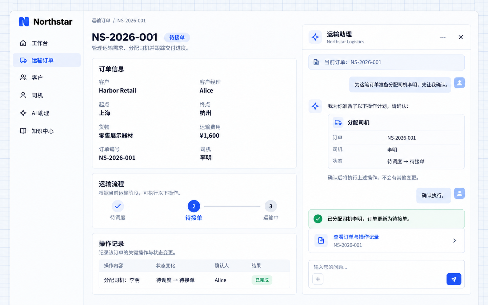

# 执行业务操作

AI 员工可以调用应用接入的业务操作，将自然语言请求转成具体处理，例如分配司机、创建跟进记录或准备通知。应用决定允许哪些动作、需要哪些输入，以及如何确认和展示执行结果。

涉及修改数据时，可以先展示操作计划，用户确认后再执行。业务操作仍需通过服务端权限检查，执行结果应与实际记录一致。

## 示例：确认后分配司机

Northstar 的调度人员希望在订单对话中为 **NS-2026-001** 分配司机李明。运输助理先整理订单、司机和状态变更，确认前保留原记录；用户确认后更新司机，并将订单从待调度改为待接单。

向开发 Agent 描述需求：

```text
为 Northstar 的运输助理接入分配司机操作。
使用当前订单的上下文，检查用户权限、订单状态和司机可用性。
修改前展示订单号、司机及状态变更，必须经用户确认。
确认后执行，并展示实际订单与操作记录；失败时说明原因，不显示成功。
```

## 查看效果

在 NS-2026-001 的对话中输入：

```text
为这笔订单准备分配司机李明，先让我确认。
```

核对计划后，回复「确认执行」。示例结果显示司机为李明，状态为待接单，并记录确认人 Alice 与处理结果。



**对话中的确认落实为业务记录变更，用户可以打开订单和操作记录核对结果。**

:::tip 重要提示

分配司机需要应用提供相应业务操作。职责说明或一句提示词不会自动获得写入权限；用户确认也不能绕过权限、司机可用性或订单状态检查。分配完成不代表司机已经接单，也不会自动发送通知。

:::
