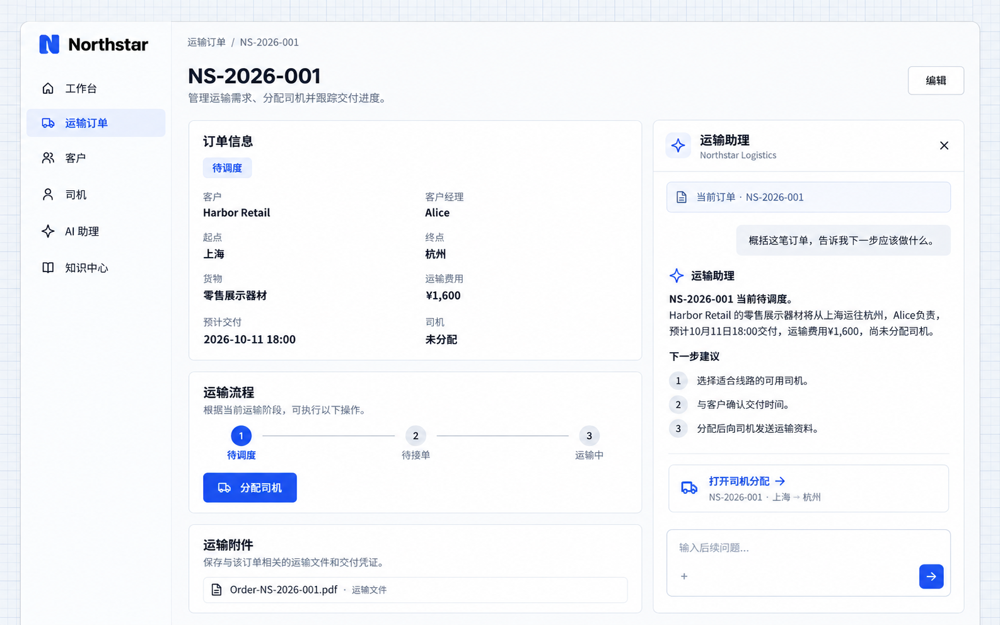

# 理解页面上下文

处理业务时，用户常常需要围绕当前记录提问。应用可以把记录标识及必要信息作为上下文交给 AI 员工，让用户直接问「这笔订单下一步做什么」，无需重新复制客户、线路和状态。

## 示例：在订单详情使用运输助理

```text
在 Northstar 的订单详情右侧加入运输助理对话面板。
打开对话时关联当前订单，使用有权限的业务读取操作获取客户、线路、货物、状态、负责人和司机。
员工询问当前订单时，先概括订单，再说明该阶段的下一步操作。
回答中提供对应的业务入口；切换订单时更新上下文，不混用上一笔订单的信息。
保持应用现有的蓝色主题，订单详情与对话面板同时可见。
```

## 查看效果

在 **NS-2026-001** 的详情中打开运输助理，询问：

```text
概括这笔订单，告诉我下一步应该做什么。
```

左侧保留客户、运输线路、费用和司机信息，右侧对话显示当前关联的订单。回答围绕待调度阶段整理信息，并提供分配司机的入口。



**对话围绕当前订单展开，用户可以从回答继续进入相关业务操作。**

:::tip 重要提示

页面上下文帮助理解问题，访问权限由服务端检查。给助手一个订单编号，不代表它可以读取该用户无权访问的订单；涉及修改、发送或审批时，还应明确允许的操作与确认方式。

:::
