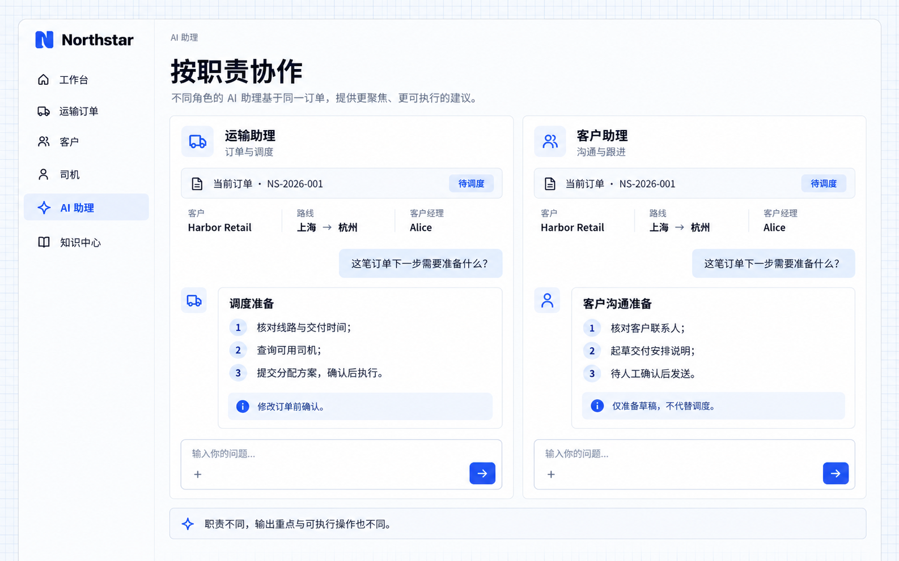

# 职责与工作规则

AI 员工的职责说明可以明确服务对象、处理任务、回答重点和需要遵循的工作规则。工作方法可写入职责说明；支持技能接入的运行方式还可复用技能，让不同助手围绕各自职责处理同一个业务问题。

职责与技能指导工作方式，可执行范围由应用接入的操作和权限决定。助手的补充说明不能覆盖应用规则或当前任务要求。

## 示例：运输助理与客户助理

Northstar 希望运输助理关注订单与调度，客户助理关注沟通与跟进。同样询问 **NS-2026-001** 下一步需要准备什么，前者整理调度事项，后者准备客户沟通内容；修改订单或发送消息均需按应用规则确认。

向开发 Agent 描述需求：

```text
为 Northstar 准备运输助理和客户助理，复用现有可用模型服务。
运输助理负责订单与调度，先核对线路、交付时间和司机；修改订单前必须确认。
客户助理负责沟通与跟进，准备交付说明草稿，不替代调度，也不自动发送。
按职责接入相应读取与业务操作；资料不足时说明缺口，不编造结论。
在对话中显示当前助手与关联订单，让输出重点清晰可辨。
```

## 查看效果

分别向两个助手提问：

```text
这笔订单下一步需要准备什么？
```

运输助理列出核对线路、查询司机和提交分配方案；客户助理列出核对联系人、起草说明和等待发送确认。



**同一个问题可以得到不同职责的工作准备，员工能看清谁负责什么以及哪里需要确认。**

:::tip 重要提示

职责说明不能代替权限控制。只让助手准备草稿时，不应开放发送动作；需要实际操作时，应同时定义输入、权限、确认方式和结果记录。技能中的工作方法也应与这些规则保持一致。

:::
