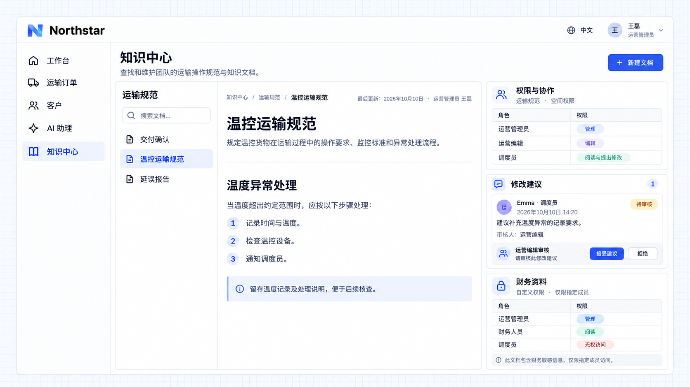

# 访问与协作

知识资料可以按空间、文件夹和文档分配阅读、提出修改、编辑和管理权限。阅读者查阅内容，提出修改者提交建议，编辑者维护正文并审核建议，管理者还可以调整访问范围。文档可以继承所在空间或文件夹的权限，也可以只允许指定成员访问。

## 示例：共同维护运输规范

Northstar 的运营管理员管理运输规范空间，运营编辑维护内容。调度员需要阅读规范并提出修改建议，由运营编辑审核后决定是否采用；财务资料只对获准成员开放。

```text
在 Northstar 知识中心按职责分配访问与协作权限。
运营管理员可以管理运输规范，运营编辑可以编辑并审核修改建议，调度员可以阅读和提出修改。
在文档旁展示权限与修改建议；财务资料只允许指定成员访问，不对调度员开放。
```

## 查看效果

打开 **温控运输规范**，在文档旁查看各角色的访问级别。调度员 Emma 提出补充温度异常记录要求的建议，运营编辑可以接受或拒绝；待审核的建议不会直接改写正文。财务资料采用指定成员权限，调度员不能访问其内容。



**员工可以在职责允许的范围内查阅和协作，资料修改经过审核，受限内容保持在获准成员范围内。**

:::tip 重要提示

文档设为仅限指定成员后，空间管理者仍保留管理权限。AI 使用知识资料时也应遵守访问范围；允许提出修改不等于允许直接编辑或审核建议。

:::
