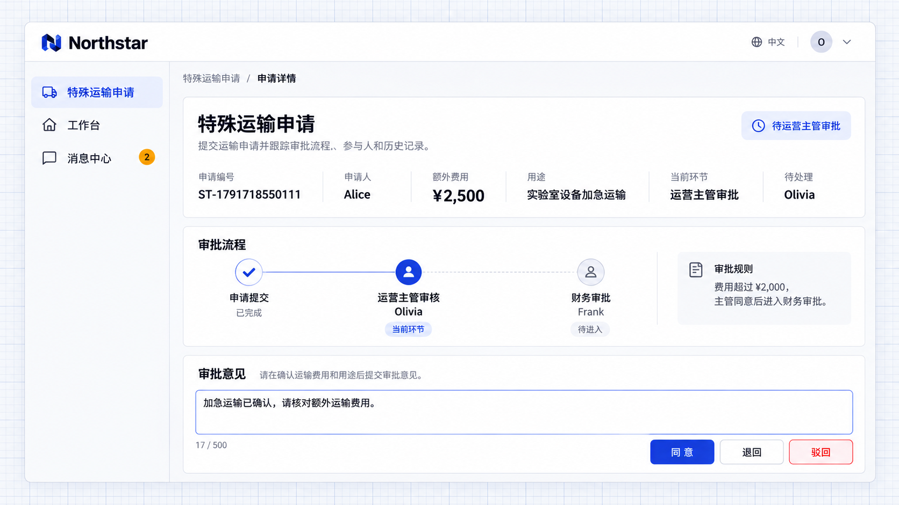

# 多级与条件审批

审批可以按顺序经过多个环节，由不同职责的人员分别审核。也可以根据金额、申请类型等条件决定是否增加某个环节，让不同申请走不同路线。

审批人可以来自指定人员、岗位、部门或主管关系。提交前展示预计路线，实际进入环节时按规则确定审批人。

## 示例：按运输费用确定审批路线

Northstar 的特殊运输费用不超过 2,000 元时，由运营主管审批；超过时，主管同意后继续由财务审批。

```text
为 Northstar 特殊运输申请接入审批，填写货物说明、申请理由、额外费用和附件。
费用不超过2,000元时由运营主管审批；超过时，主管同意后进入财务审批。
提交前预览路线和审批人，详情显示当前环节、可用操作和审批意见。
批准后保留审批结论，不自动支付费用。
```

## 查看效果

Alice 提交 2,500 元的加急运输申请，先进入运营主管 Olivia 的待办。审批人可以核对用途、费用和资料，并填写意见。



**申请先进入主管审批环节。**

主管同意后，金额条件使申请进入财务负责人 Frank 的待办；主管意见仍保留。


**超过 2,000 元的申请继续进入财务审批。**

:::tip 重要提示

需要明确每个环节的进入条件和审批人来源。未找到审批人时，应提示补派或阻止提交；“没有审批人”和“规则允许跳过该环节”是两种不同情况。

:::
