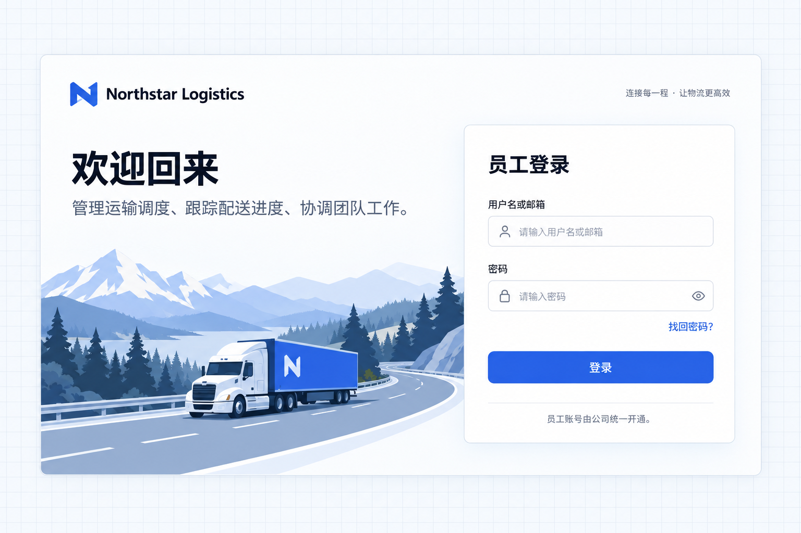

# 定制登录页面

完成账号管理和所需认证方式的接入后，可以进一步定制登录页面。登录页面属于应用源码，可以按照企业品牌调整名称、Logo、说明文字、图片、布局和配色。定制界面时应保留已有的账号认证、错误提示和密码恢复流程。

## 示例：Northstar 员工登录

Northstar 希望员工进入系统时就能识别公司品牌，了解这个系统用于客户管理、运输调度和交付协作。员工由公司开户，登录页不提供自助注册。

将下面的需求交给 Agent：

```text
为现有运输应用定制 Northstar Logistics 登录页。

使用浅蓝色卡车与山路插画，配合白色页面面板和浅灰蓝网格外背景，保证文字清晰。
顶部显示公司名称和图标。左侧显示「欢迎回来」，并说明系统可以管理运输调度、跟踪配送进度、协调团队工作。
右侧放置白色登录表单，使用深色文字、白色输入框和蓝色登录按钮。
保留用户名或邮箱加密码登录、密码显示切换、登录错误提示和找回密码入口。
员工账号由公司管理，关闭自助注册，同时在服务端禁止密码注册；保留原注册页面和组件，便于以后恢复。
登录页与密码恢复页面使用一致的品牌名称和视觉。中文与英文界面都提供对应文案。
```

## 查看效果

打开登录页，可以看到浅蓝色卡车与山路插画、公司品牌和运输业务说明。左侧是欢迎文案，右侧是白色登录表单，深色文字与蓝色按钮形成清晰的视觉层次。页面的背景、配色和布局都可以按企业需求调整。



**登录页呈现企业背景、品牌与布局，保留账号登录能力。**

定制页面复用已有登录表单和认证动作，调整应用拥有的品牌内容与文案。页面不提供注册入口只是界面的一部分，服务端也需要关闭对应注册操作。

## 进一步调整

可以继续说明背景图片、表单位置、品牌色值和字体，或者让不同岗位登录后进入各自的业务首页。修改布局时同时考虑窄屏和深色显示；业务访问权限仍由服务端规则决定。

找回密码入口需要应用接入实际可用的重置邮件服务。显示了入口不代表邮件服务已经配置完成。
