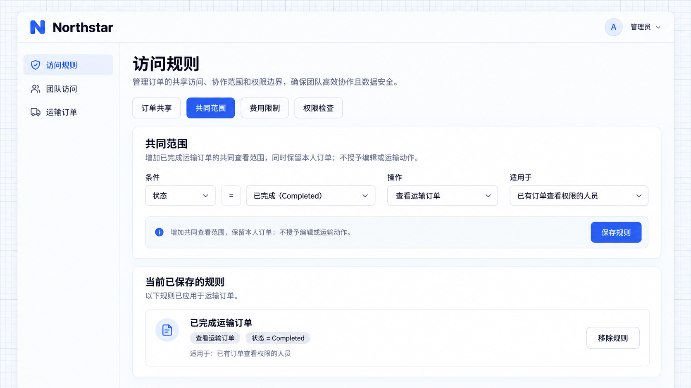

# 默认数据范围

默认数据范围为已经具有某项操作权限的人员增加共同可访问的记录。Northstar 的客户经理除了跟进本人订单，还需要查阅已完成的订单作为运营参考。

## 示例：共同查阅完成订单

已有查看权限的用户，有时还需要查阅一类共同资料。默认数据范围可以在原有个人范围之外增加共同记录，适合开放完成记录或公共参考资料。

```text
客户经理保留查看本人负责订单的范围。
对所有已有「查看订单」权限的人员，增加已完成订单的共同查看范围。
使用默认数据范围配置，管理员可以在「访问规则」中保存或移除已完成订单的共同查看规则。
本次仅增加查看范围，不允许因此编辑他人订单或办理运输动作。
```

按上述需求接入后，Alice 的查看范围包含本人订单，也包含符合共同条件的其他订单。共同范围与原有范围取并集，不会将本人订单范围替换掉。

## 不额外授予操作

没有查看订单权限的人，不会仅凭这条默认范围取得查看能力。查看与编辑也要分别配置：允许查阅完成订单，不等于允许修改它们。

管理员可以在同一资源的默认规则中分别配置各操作的条件。需要只让某位同事协作时，使用[共享规则](./sharing-rules.md)；需要所有来源遵守同一边界时，使用[限制规则](./restriction-rules.md)。

## 配置共同范围

管理员进入 **访问规则 → Common access（共同范围）**，保存已完成运输订单的查看规则。这里仅按订单的 **Completed** 阶段判断；若还要排除敏感订单，需要另外提供相应业务字段和条件。



**共同查看规则已保存，范围为已完成运输订单。**

保存后，Alice 的列表从原来的 6 笔增加到 7 笔。新增的 **NS-2026-003** 由 Bob 负责，因已完成而进入共同范围；Alice 原有订单仍然可见。


**Alice 可见 7 笔订单，新增 Bob 的已完成订单。**
