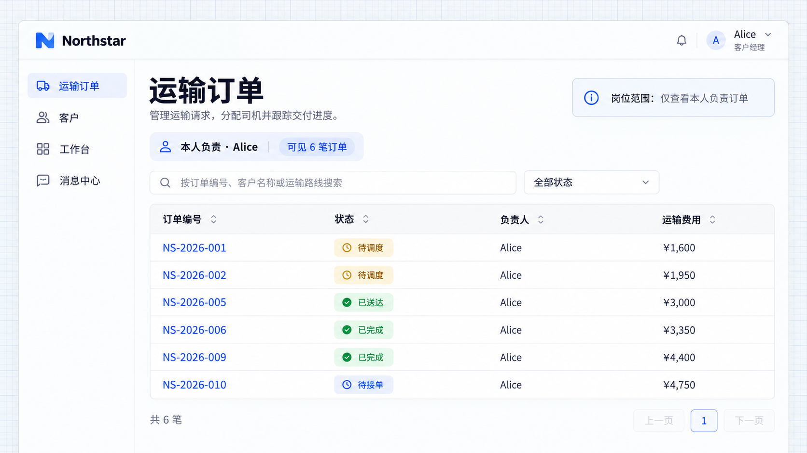

# 权限集与分配

权限集将一组页面、业务操作和数据范围组合为可重复分配的岗位职责。多位客户经理可以使用同一个权限集；一位员工兼任多个岗位时，也可以获得多个权限集。

## 示例：为运输岗位分配职责

多人承担相同职责时，可以把页面、操作和数据范围组合为权限集，再按岗位分配。人员入职或调岗时复用同一套规则，减少逐人重复配置。

```text
为 Northstar 接入客户经理、调度员和司机三个权限集。
客户经理可以进入客户和订单页面，创建订单，查看和编辑自己负责的记录。
调度员可以进入调度工作台，查看运输订单并分配司机，不能维护岗位权限。
司机可以查看分配给自己的任务，执行接单、出发和签收操作，不能修改订单价格或重新分配司机。
只有获得管理授权的人员可以维护权限集和分配。
在「团队访问」中提供岗位编辑与人员分配，初始将 Alice、Bob 分配为客户经理，Emma 为调度员，Daniel 为司机。
```

岗位编辑可以按「页面」「业务操作」「数据范围」呈现。查看订单和编辑订单是不同操作，不能因为允许进入一个页面，就自动给予页面中的全部动作。

## 分配与复用

管理员打开岗位，核对页面、操作及范围，再分配员工。Alice 和 Bob 共用客户经理职责，但根据本人范围看到各自负责的记录；Emma 负责调度，Daniel 只办理分配给自己的任务。

员工可以同时承担多个职责。撤销其中一项分配时，需要留意其是否仍从其他权限集或组织关系获得权限。

默认成员权限集面向所有登录用户，适合共同需要的基础能力。超级管理员拥有不受限访问，不适合代替业务员工展示岗位效果。

团队或部门的批量分配需要应用先接入真实组织及成员关系；仅增加一个部门名称字段，不等于建立了权限继承。

## 当前示例的岗位查看结果

团队访问显示保存的岗位及人员分配。下图先展示客户经理的查看权限；同一岗位分配给 Alice 和 Bob，服务器按真实负责人用户 ID 分别限定各自记录。


**管理员可以查看实际岗位权限与人员分配。**

Alice 的订单列表只有本人负责的 6 单；调度员 Emma 可以查看全部 10 单。两张图使用普通业务账号，未使用超级管理员代替岗位效果。创建、编辑和调度办理属于前面的完整需求，需继续接入各自业务操作的权限。



**只应用岗位范围时，Alice 可见本人负责的 6 笔订单。**


**调度岗位的 Emma 可见全部 10 笔订单。**
