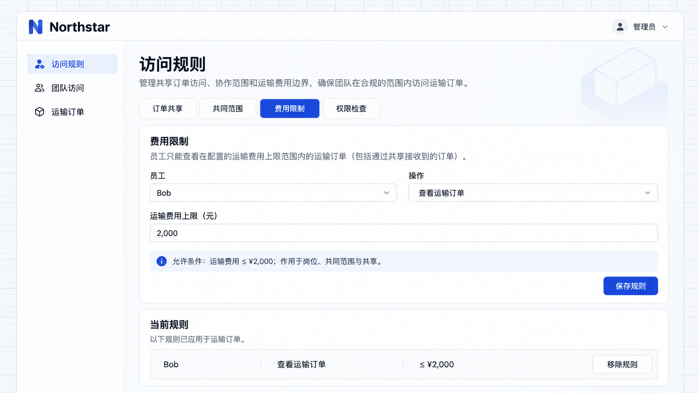

# 限制规则

限制规则在已有授权上收窄记录范围，让岗位、共同范围和共享遵守同一业务边界。它不授予原本没有的操作或数据访问权。

## 示例：运输费用协作范围

某些岗位或人员只能访问符合金额、区域等条件的记录时，可以用限制规则收窄已有范围。无论访问来自岗位、共同范围还是共享，都需要符合限制条件。

```text
Bob 临时协助核对运输费用，只允许查看运输费用不超过 2,000 元的订单。
为他的「查看运输订单」操作增加金额上限，保留已有岗位与订单负责人。
限制同时作用于本人订单、已完成订单共同范围和临时共享的订单。
管理员可以在「访问规则」中调整金额或移除规则；移除前说明可见范围可能扩大。
```

本例限制的是运输订单的费用字段，不是特殊运输申请的额外费用审批。金额恰好为 2,000 元属于允许范围。

## 配置金额上限

进入 **访问规则 → Fee limits（费用限制）**，选择 Bob，将运输费用上限填写为 **2,000**，保存规则。



**Bob 的订单查看范围增加了 2,000 元费用上限。**

## 查看收窄后的订单

Bob 本人负责的订单和共同范围中的完成订单均超过 2,000 元，因此不再出现在列表中。共享的 **NS-2026-001** 费用为 **1,600 元**，仍然可见；其负责人仍为 Alice。


**限制后，仅符合金额条件的共享订单仍可见。**

删除费用限制后，其余授权来源仍然生效；删除共享则只移除这条协作来源。使用[权限检查](./inspector.md)可以查看这些来源。

## 每项操作分别说明

本例只限制查看操作。若编辑或审批也需要金额上限，应分别接入相应规则。多项限制需要同时满足，管理员填写的是允许访问的条件。
