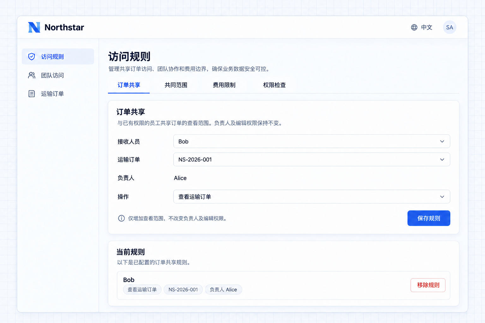
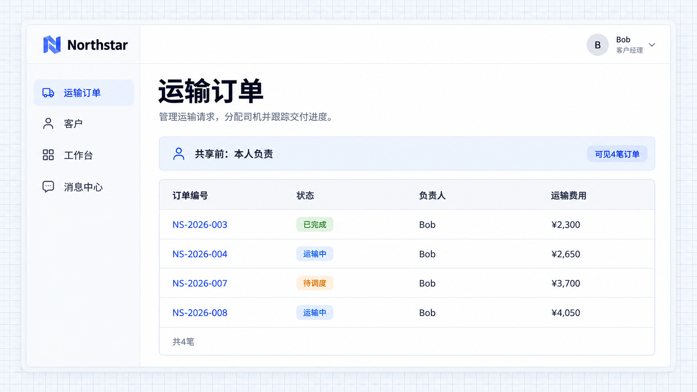
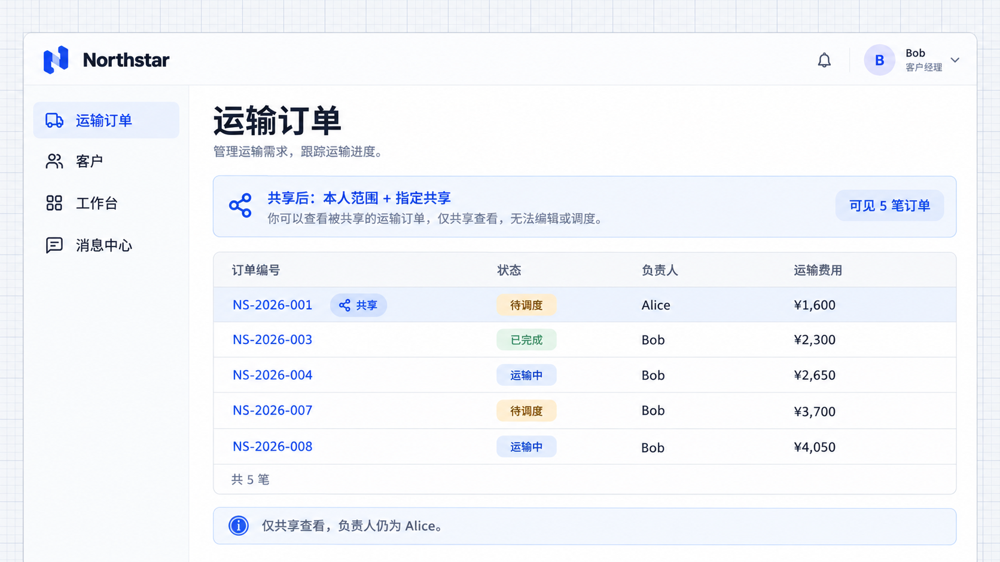

# 共享规则

共享规则为指定人员或已接入的组织对象增加记录范围，适用于临时协作和业务交接。接收人仍需要相应页面和业务操作权限。

## 示例：同事协助跟进订单

临时协作需要让其他人访问指定记录，但不希望扩大其全部岗位范围。共享规则可以开放所选记录，并保留原负责人和日常权限。

```text
Alice 需要 Bob 协助跟进运输订单 NS-2026-001。
Bob 已有订单查看权限，本次将这笔订单的查看范围共享给他。
保留原负责人 Alice，不修改 Bob 的日常岗位和本人范围。
这项共享不允许编辑订单、分配司机或处理审批。
管理员可以在「访问规则」中选择共享人员与订单，保存查看规则，协作结束后移除规则。
```

按上述需求接入后，Bob 可以在已有订单页面查阅该协作订单，同时保留自己原有的订单范围。共享增加的是指定操作的记录范围，不会自动把订单负责人改成 Bob。

## 明确共享哪些操作

只需查阅时共享查看范围；需要协助修改时，另行明确编辑权限及其范围。共享查看不等于共享所有动作，已有的限制规则也不能被共享绕过。

协作结束后移除共享规则。Bob 若还从岗位、共同范围或另一项共享获得访问权，删除本条规则并不意味着所有访问来源同时消失，可通过[权限检查](./inspector.md)核对。

向团队或部门共享，需要应用提供相应对象及真实成员关系。

## 选择协作人员与订单

管理员进入 **访问规则 → Order sharing（订单共享）**，选择 Bob 和 Alice 负责的 **NS-2026-001**，点击 **Save rule**。当前规则列出接收人、订单和「查看运输订单」操作；协作结束后可删除，并在确认窗口核对影响。



**共享规则将指定订单的查看范围开放给 Bob。**

## 接收人查看结果

只应用岗位范围时，Bob 能查看自己负责的 4 笔订单。加入这条共享后，列表增加到 5 笔，其中 NS-2026-001 的负责人仍为 Alice。



**共享前，Bob 可见本人负责的 4 笔订单。**



**共享后，Bob 可见 Alice 的指定订单，负责人不变。**

这两张结果图展示先加入共享、尚未加入共同范围和费用限制时的变化。共享不会给 Bob 增加编辑或调度权限。
