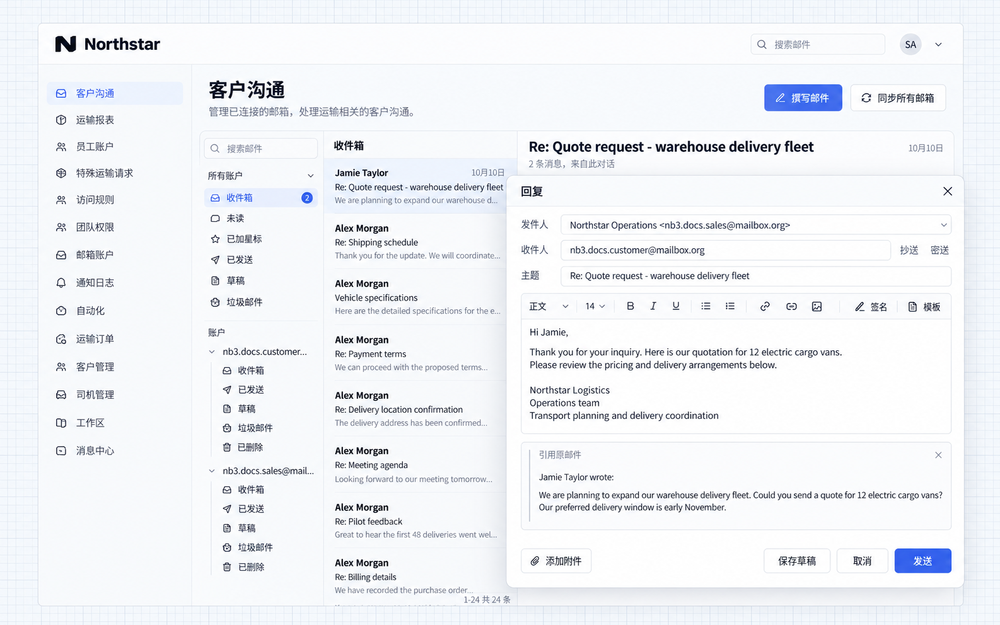

# 同步和发送邮件

本例为 Northstar 添加客户沟通入口，让业务人员在应用内阅读车队合作的报价咨询并回复。关联邮箱后，邮件列表、正文和回复操作都在同一工作台中完成。

## 开始前准备

- 管理员配置可用的邮箱服务商，见[邮箱接入配置](./configuration.md)。
- 用户准备自己的邮箱账号和密码或授权码；使用 Gmail 或 Microsoft 365 时，通过服务商登录授权。

## 示例：在应用中回复客户邮件

业务人员需要在应用内阅读和回复客户邮件时，可以接入自己的邮箱，保留邮件主题、正文和往来上下文，减少切换系统。

将下面的提示词交给 Agent：

```text
为应用添加邮件中心和邮箱账号管理入口。用户可以关联自己的邮箱，按邮箱查看收件箱、同步来信、阅读正文和附件，并回复邮件。

销售人员收到客户的报价咨询后，可以在邮件中心回复。回复时保留原邮件主题和上下文，收件人使用原发件人。每位用户只处理自己关联的邮箱。
```

### 1. 关联邮箱

打开邮箱账号页，点击 **Connect account**，选择服务商，填写邮箱信息并选择首次同步的起始日期。本例使用专用销售邮箱，关联后可以在账号列表中查看地址和连接状态。


**个人邮箱已关联，可以查看连接状态。**

### 2. 同步并阅读来信

进入「客户沟通」，选择销售邮箱并同步来信。列表中显示客户的报价咨询、交付安排和资料确认等邮件，点击一封邮件即可阅读正文。


**用户可以在应用内查看同步来信和邮件正文。**

### 3. 回复客户

阅读报价咨询后，点击 **Reply**，填写报价和交付说明。回复会带入原收件人、主题和上下文，填写完成后点击 **Send**。



**回复编辑器保留邮件上下文，用户可以填写回复内容。**

### 4. 查看回复结果

客户邮箱收到回复后，可以看到销售人员提供的报价和交付安排，继续在同一邮件会话中沟通。

签名、常用模板和业务页面接入，见[更多邮件功能](./usage.md)。


**客户邮箱可以查看已有演示会话中的报价回复。**

本例将此前专用邮箱中的车队合作演示会话同步到新版应用，展示来信、回复编辑入口和已有收件结果。运输进度邮件可以直接从订单带入，见[更多邮件功能](./usage.md)。
