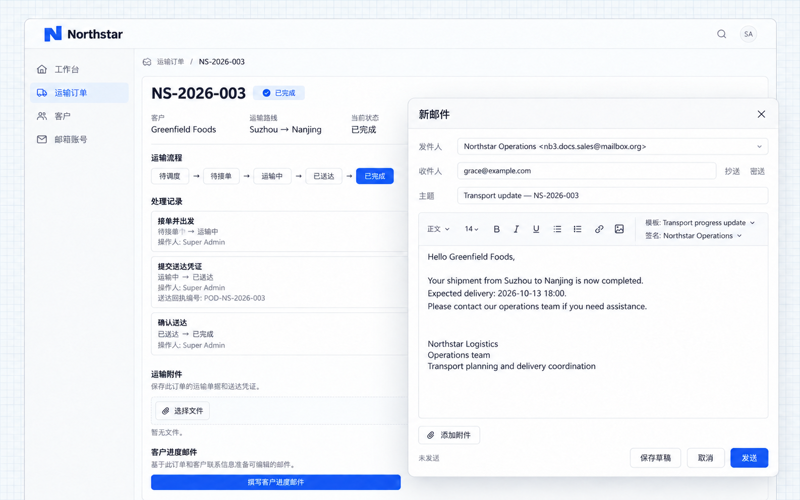
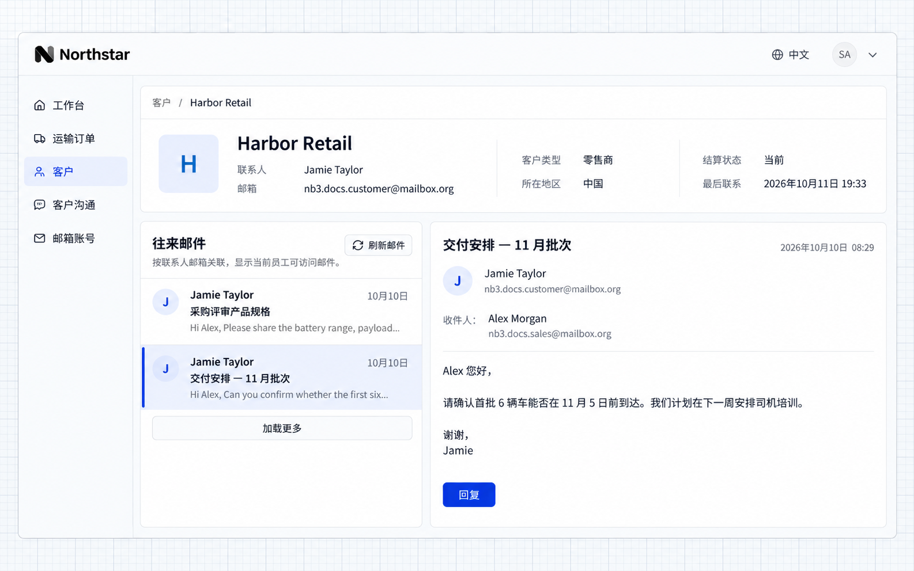
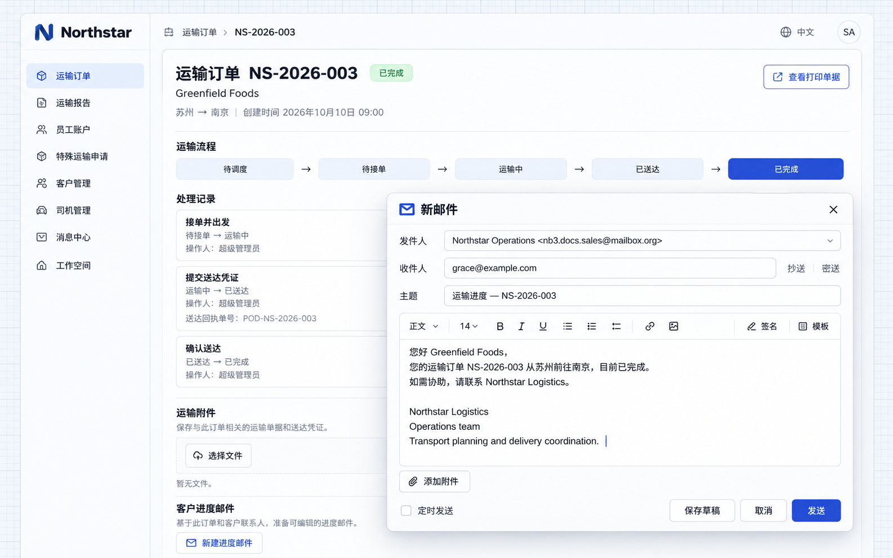

# 更多邮件功能

邮件能力提供签名、模板、邮件阅读和编辑器。应用可以把它们放到邮箱账号页、客户详情或订单详情中，用户从业务页面即可使用。

本例在 Northstar 的导航中设置「邮箱账号」和「客户沟通」入口，并在客户、运输订单详情中接入邮件操作。可以向 Agent 提出需求：

```text
在应用导航增加「邮箱账号」和「客户沟通」。
邮箱账号页接入 NocoBase 的邮箱管理页面，提供邮箱连接、签名和模板管理。
客户沟通页接入邮件中心，员工使用自己已关联的邮箱阅读和发送邮件。
```

邮箱连接步骤见[配置邮箱](./configuration.md)，页面接入方式见[开发参考](./development.md)。

## 使用邮件签名

需要在每封邮件中附上固定的团队名称、职位或联系方式时，可以保存签名，写信时直接选择，减少重复填写。签名属于邮箱账号，可以设置默认签名。

```text
为 Northstar 的业务邮箱准备「Northstar Operations」签名，
包含 Northstar Logistics、Operations team 和运输协调说明。
员工可以在邮箱账号页维护签名，写信时选择使用。
```

打开「邮箱账号」，点击 **Signatures**。选择业务邮箱，填写签名名称和内容并保存；可以将常用签名设为默认。


**业务邮箱已保存签名，并设为默认。写信时可以选择已有签名。**

## 使用邮件模板

反复发送相似内容时，可以将常用主题和正文保存为模板。模板属于当前用户，应用还可以把当前业务记录传给编辑器，让客户名称、订单编号等变量填入模板。

```text
准备「Transport progress update」邮件模板，主题包含运输订单编号，
正文包含客户名称、起点、终点、运输状态和预计交付日期。
从订单详情打开编辑器时，传入当前订单和客户信息。
员工选择模板后仍可编辑内容，并选择已有签名。
```

在「邮箱账号」页点击 **Templates**，维护主题和正文。本例使用 `{{record.customer.name}}`、`{{record.order.number}}` 等变量。


从运输订单详情打开邮件编辑器，点击 **Template**，选择 **Transport progress update**；点击 **Signature**，选择签名。



**模板带入主题与正文，订单和客户信息已填入，邮件末尾附上签名。发送前仍可修改。**

:::info 重要提示

模板变量需要由接入编辑器的业务页面提供。仅保存模板不会自动读取客户或订单；没有对应数据的变量会保留原文。发送前应核对收件人和正文。

:::

## 在业务页面查看往来邮件

需要在查看客户资料时了解沟通记录，可以将邮件列表和阅读功能放到客户详情中，按联系人邮箱关联邮件。

```text
在客户详情增加「往来邮件」。
按当前客户联系人邮箱匹配发件人、收件人或抄送人，
仅展示当前员工自己的已关联邮箱中可访问的邮件。
点击邮件可以阅读正文，点击「回复」打开邮件编辑器，
保留回复关联，员工确认内容后再发送。
提供刷新和加载更多操作。
```

打开客户详情，在「往来邮件」中选择邮件。本例直接读取已同步的邮件，正文由邮件阅读组件显示。



**客户资料和联系人相关邮件显示在同一页面，无需另行查找客户邮箱。**

点击 **Reply** 打开编辑器。


**回复编辑器带入收件人和原邮件主题，员工可以继续编辑并选择签名或模板。**

:::info 重要提示

关联依据是客户联系人邮箱，需要准确填写。业务记录的访问权限与邮箱访问权限分别生效；能够查看客户，不代表能够读取其他员工的邮箱。

:::

## 从业务页面编写邮件

发送订单进度等业务邮件时，可以自动带入联系人和记录信息，减少复制与填写错误。

```text
在运输订单详情增加「编写进度邮件」。
收件人读取当前客户联系人邮箱，主题包含订单编号，
正文带入客户、起点、终点和运输状态。
员工核对并编辑内容后，使用自己已关联的邮箱发送。
允许选择已有邮件模板和签名，不自动发送。
```

打开运输订单详情，点击 **Compose progress email**。



**订单信息已带入邮件主题与正文，发送前可编辑。**

## 使用提示

- 同步用于获取新邮件；刷新列表显示的是已同步到应用的内容。
- 首次同步可选择需要的历史范围。
- 可以用搜索、加星和标签整理邮件；是否同步到服务商，取决于接入方式。
