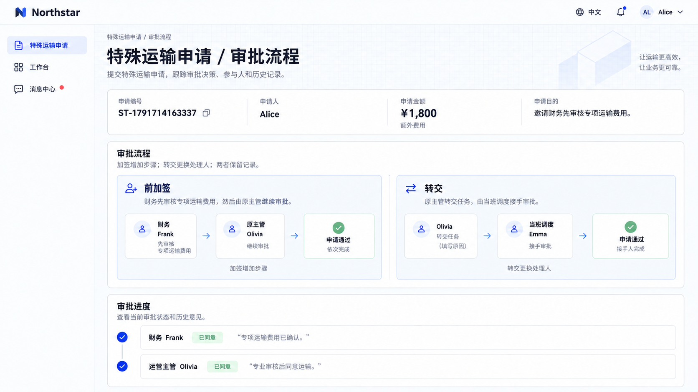
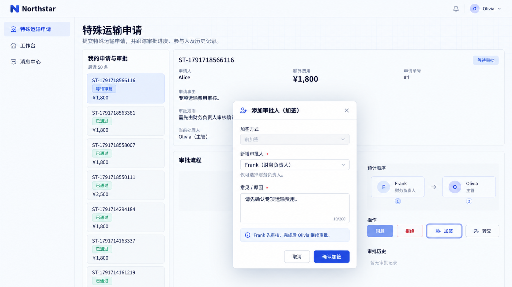
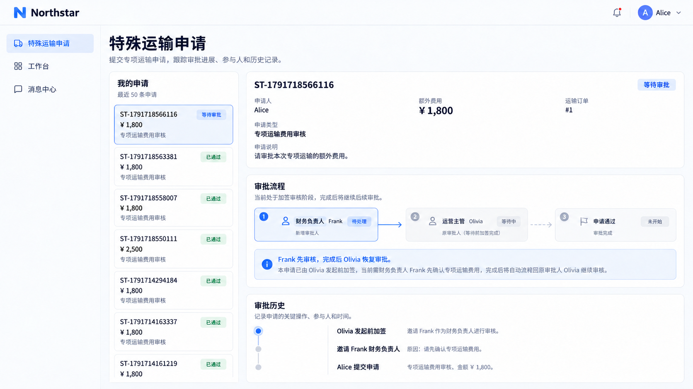
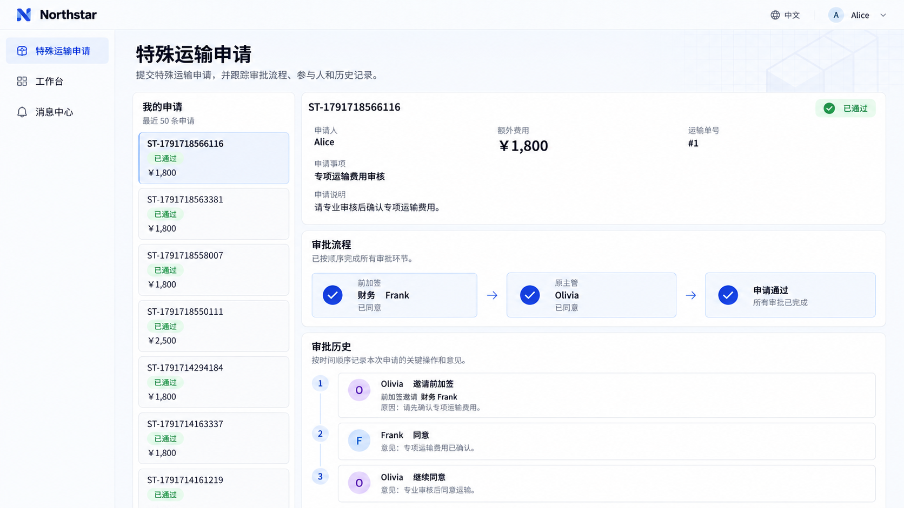
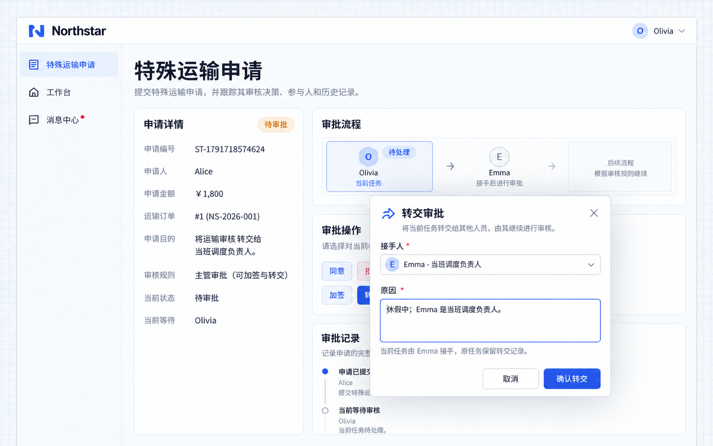

# 加签与转交

审批过程中，可以临时增加需要参与的人，也可以将当前任务交给其他符合条件的人。两种操作都保留原审批人、接手人、操作原因和后续意见。

| 操作     | 如何参与                                             |
| -------- | ---------------------------------------------------- |
| 前加签   | 新增人员先审批，原审批人等待其完成后继续。           |
| 后加签   | 原审批人同意后，新增人员继续审批，再按规则完成。     |
| 并行加签 | 新增人员与当前人员共同参与，按该环节的决策规则汇总。 |
| 转交     | 当前任务由新审批人接手，原任务保留转交记录。         |

## 示例：邀请专业人员审核或转交值班人员

主管遇到特殊货物时，需要财务负责人先给出意见；主管无法处理时，可以转交当班调度负责人。

```text
在 Northstar 特殊运输的主管审批环节开放前加签和转交。
加签只允许选择财务负责人，其完成后原主管继续审批。
转交只允许选择当班调度负责人，要求填写原因。
详情保留原任务、新增或接手人员、原因和处理意见。
在申请详情用流程图展示前加签与转交的审批顺序和处理人。
```

## 在应用中查看审批流程

申请详情的「审批流程」显示两条处理路径：前加签由 Frank 先审核、Olivia 再继续；转交由 Emma 接手当前任务。下方保留实际审批进度和处理记录。



**加签增加参与者，转交更换当前任务的处理人；责任变化均有记录。**

## 查看搭建结果

### 1. 前加签：新增人员先审核，原主管再继续

在特殊运输申请中选择可加签、转交的主管审批规则并提交。Olivia 选择 **Add a signer（加签）**，邀请财务负责人 Frank 先审核专项运输费用。页面中 Frank 为待处理，Olivia 为 **Blocked（等待前加签完成）**；处理记录保留邀请人、加签方式及意见。





**前加签增加审核步骤，原主管须等待新增人员完成。**

Frank 同意后，Olivia 恢复审批；她继续同意，申请变为 **Approved**。详情保留两人的意见和完整处理顺序。



**新增人员同意后，仍由原主管继续审批，再形成最终结果。**

### 2. 转交：接手人完成当前审批

Olivia 无法处理另一笔申请时，选择 **Hand over（转交）**，将任务交给当班调度 Emma 并填写原因。原任务显示 **Transferred**，Emma 获得新的待办和审批操作；处理记录保留转交人、接手人和原因。




**转交将当前任务交给接手人，原审批人不再处理该任务。**

Emma 同意后，申请变为 **Approved**，历史中仍能查看 Olivia 的转交原因及 Emma 的最终意见。


**接手人完成审批后申请通过，责任变化和处理意见仍可追溯。**

:::tip 重要提示

按业务需要开放加签方式和转交对象。应明确新增人员如何影响原来的通过规则，不能把任意用户都作为可选审批人。

:::

## 管理员处理责任变化

需要处理人员离职、无人可办或执行失败时，把管理中心作为业务页面交给 Agent 开发。页面、可查询范围、补派、改派、重新派发和重置入口均按业务需求实现；操作须受权限控制并保留原因、原任务与历史。

“重派”和“重置”应先说明是替换当前办理人，还是结束当前轮次并重新送审；明确允许的状态、重新开始的环节、旧意见、期限、预算及已执行工作的处理方式。

```text
为 Northstar 做一个审批管理页面，有权管理员只能查看自己负责业务的申请、任务、历史和执行结果，并处理人员离职、找不到审批人和执行失败。
允许补派和改派，必须填写原因。我还需要重新派发或重置，请先和我确认适用情况、从哪里重开、旧意见和期限是否保留，以及已占预算和已执行工作怎样处理。原记录不能删除。先给我页面和权限方案，确认后再做。
```

验收时确认加签顺序、候选人限制及管理员权限；旧任务失效后不能继续办理，责任变化始终可以追溯。
