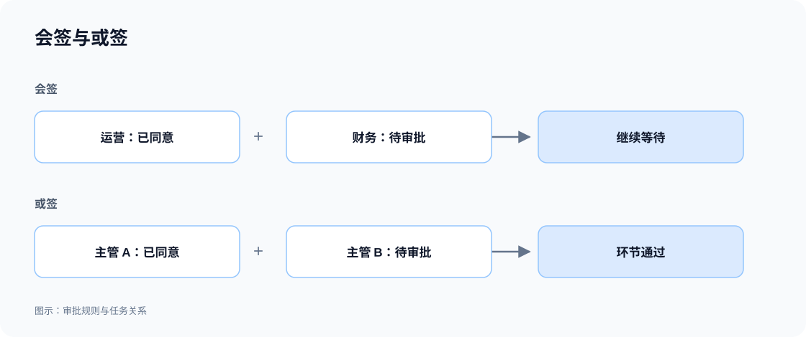

# 会签、或签与通过规则

同一个审批环节可以由多人共同决定。审批按设定的规则汇总意见，决定何时通过、何时驳回，以及是否还需等待其他人。

| 决策方式     | 如何形成结果                                                   |
| ------------ | -------------------------------------------------------------- |
| 会签         | 所有人同意后通过；可以约定一人拒绝即驳回，或收齐意见后再结束。 |
| 或签         | 任一人同意即可通过；所有人都未同意时才驳回。                   |
| 首个意见决定 | 第一份有效意见决定结果，后续人员不再继续决策。                 |
| 指定票数通过 | 达到约定同意票数后通过，可按业务要求换算比例。                 |
| 顺序审批     | 同一环节内的人员按顺序处理，前一人完成后轮到下一人。           |

会签和多级审批不同：多级审批是依次经过不同环节；会签是在同一环节汇总多人的意见。

## 示例：特殊货物由两位负责人会签

运输特殊货物时，需要运营和财务负责人共同确认；普通调度事项则可以由运营或财务负责人中任一人同意。

```text
为 Northstar 特殊货物运输申请增加会签环节，运营负责人和财务负责人都同意后才通过。
一人拒绝即驳回，必须填写原因；只有一人同意时继续等待另一人。
普通调度申请使用或签，由运营或财务负责人中任一人同意即可通过。
详情显示每个人的意见，以及当前还在等待谁。
```

## 查看规则示意



**同样是多人参与，会签等待全部同意，或签在任一人同意后通过。**

## 查看搭建结果

### 1. 会签：一人同意后仍需等待

在 **Special transport requests（特殊运输申请）** 新建申请，将审批规则设为 **Countersignature — all approve（会签：全部同意）** 并提交。运营负责人 Olivia 同意后，申请仍为 **Awaiting review**；页面显示已有 **1 / 2** 人同意，并标明正在等待 Frank。


**第一人同意只完成自己的审核，申请仍等待另一位审批人。**

财务负责人 Frank 同意后，申请变为 **Approved**，两人的意见及处理记录保留在详情中。


**两位负责人全部同意后，会签通过。**

### 2. 或签：任一人同意即可通过

新建一般运输调整申请，选择 **Any reviewer may approve（或签：任一人同意）**。Olivia 同意后，申请直接变为 **Approved**；Frank 的待办随该环节结束而关闭，不需要再给出意见。


**或签已有一份同意意见即可通过；另一人任务关闭不代表其已同意。**

:::tip 重要提示

需同时说明同意和拒绝的汇总规则。按比例通过时，还要明确参与人数、取整方式和实际需要的票数；部分人员已同意不一定代表整个环节通过。

:::
