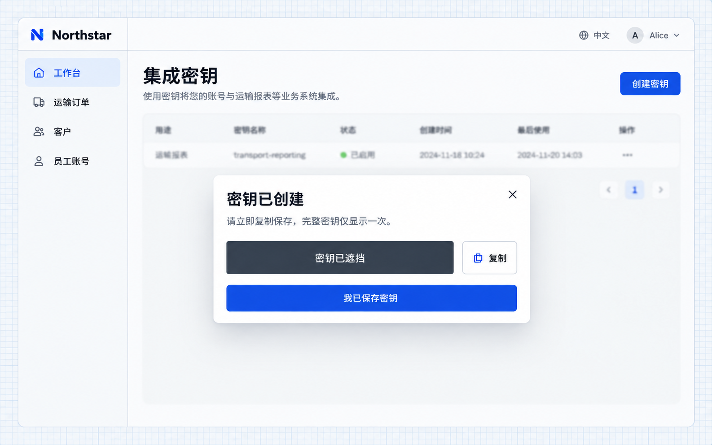

# API keys

[← 认证概览](./index.mdx) · [查看脚本调用场景](./index.mdx#api)

API key 让脚本、定时任务或外部系统调用应用接口，无需通过浏览器登录。默认情况下，Key 代表创建它的用户，沿用该用户已有的权限，不会扩大订单的可访问范围。

Northstar 的客户经理需要把自己可查看的运输订单同步到报表系统，可以创建一个用于订单读取的 Key。报表程序使用 Key 调用应用接口，员工仍通过登录页使用业务页面。

> API keys 提供程序访问凭据；「集成密钥」页面和运输订单接口是 Northstar 示例中的业务实现。使用自己的应用时，需要确认实际接口、返回字段和调用用户的权限。

[搭建密钥管理入口](#提供集成密钥入口) · [创建和撤销密钥](#创建保存和撤销) · [运行订单读取脚本](#用脚本读取运输订单)

## 提供集成密钥入口

脚本和外部系统需要访问应用接口时，可以使用独立密钥作为凭据，避免保存用户密码。用户可以设置密钥有效期，并在集成结束时撤销。

应用可以根据业务需要提供管理页面，不必依赖统一的 Settings 入口。向 Agent 提出：

```text
在 Northstar 的用户菜单中增加「集成密钥」入口，接入应用已有的 API keys 能力。
员工只能管理自己创建的 Key。
创建时填写用途名称，例如 Transport reporting，并填写有效天数。
创建成功后只显示一次完整 Key，提示立即复制保存。
列表显示名称、可辨认的片段、状态、有效期和最近使用时间，支持撤销并二次确认。
不要在列表、日志或后续详情中显示完整 Key。
```

这里的名称、有效期和撤销都复用 API keys 能力；页面位置、布局和业务说明由应用决定。具备该入口的访问权限后，员工才能进入管理页面。

## 创建、保存和撤销

打开「集成密钥」，填写用途名称并选择有效期。创建后复制完整值，保存到调用程序的运行环境中。完整 Key 只显示一次；列表中的片段用于辨认，不能恢复完整值。

不再使用时，在列表中撤销对应 Key。撤销或过期后，该 Key 不再用于调用接口；需要重新接入时创建新的 Key。账号停用后，其 Key 也不能继续代表该账号访问应用。

列表只显示用于辨认的密钥片段，不显示完整值。本例输入 30 天有效期，并保留最近使用时间。


创建成功后，完整密钥只在当前视图出现一次。下图已遮挡实际密钥。



## 用脚本读取运输订单

需要把应用数据交给脚本进行汇总或处理时，可以通过 API 读取，减少手工导出和复制。接口访问沿用密钥所属用户的权限范围。

将 Key 保存到脚本运行环境的 `NOCOBASE_API_KEY` 中，再提出：

```text
请为 Northstar 写一个读取运输订单的脚本。
API key 已保存在环境变量 NOCOBASE_API_KEY 中，不要把它写进源码或日志。
根据应用的实际接口文档选择订单列表接口，在 x-api-key 请求头中传入 Key。
本例应用地址是 http://localhost:13200/main，GET /api/northstar 返回工作台数据，其中 data.orders 是有权访问的订单。
读取订单并根据 data.customers 补充客户名称，输出订单编号、客户、起终点和当前状态。
处理接口错误，不把失败的请求当作空订单列表。
请说明如何设置应用地址并运行脚本。
```

本例使用客户经理 Alice 创建的 Key。脚本通过 `x-api-key` 请求头调用 `GET /main/api/northstar`，从返回的工作台数据中提取订单，并将客户编号转换为客户名称。这个接口一次返回当前账号有权读取的数据，不需要分页。

### 运行脚本

下面的脚本仅适用于本例的 Northstar 接口，并不是所有 NocoBase 应用通用的订单查询代码。接入自己的业务前，让 Agent 核对接口路径、响应结构和分页方式。

将下面的代码保存为 `fetch_orders.py`。脚本仅使用 Python 标准库，不需要额外安装依赖。

```python
import json
import os
import sys
from urllib.error import HTTPError, URLError
from urllib.request import Request, urlopen

base_url = os.environ["NOCOBASE_APP_URL"].rstrip("/")
request = Request(
    base_url + "/api/northstar",
    headers={"x-api-key": os.environ["NOCOBASE_API_KEY"]},
)
try:
    with urlopen(request, timeout=20) as response:
        result = json.load(response)
    data = result["data"]
    customers = {str(item["id"]): item["name"] for item in data["customers"]}
    orders = [
        {
            "number": order["number"],
            "customer": customers.get(str(order["customerId"]), ""),
            "origin": order["origin"],
            "destination": order["destination"],
            "status": order["status"],
        }
        for order in data["orders"]
    ]
except HTTPError as error:
    sys.exit(f"API request failed: HTTP {error.code}")
except URLError:
    sys.exit("Cannot reach the application API.")
except (KeyError, TypeError, ValueError):
    sys.exit("Unexpected API response format.")

print(json.dumps({"count": len(orders), "orders": orders}, ensure_ascii=False, indent=2))
```

在终端中设置应用地址，输入刚复制的 Key，然后运行：

```bash
export NOCOBASE_APP_URL='http://localhost:13200/main'
read -rs -p 'API key: ' NOCOBASE_API_KEY
export NOCOBASE_API_KEY
python3 fetch_orders.py
```

`read -rs` 会隐藏输入的密钥。使用自己的应用时，将应用地址和脚本中的接口路径改成实际值。

### 查看返回的订单

本例运行后，脚本返回 Alice 可以查看的 6 条订单。下面保留前两条，展示实际返回的字段：

```json
{
  "count": 6,
  "orders": [
    {
      "number": "NS-2026-001",
      "customer": "Harbor Retail",
      "origin": "Shanghai",
      "destination": "Hangzhou",
      "status": "awaitingDispatch"
    },
    {
      "number": "NS-2026-002",
      "customer": "Summit Electronics",
      "origin": "Hangzhou",
      "destination": "Suzhou",
      "status": "awaitingDispatch"
    }
  ]
}
```

订单编号为 `NS-2026-001` 和 `NS-2026-002`，客户分别为 Harbor Retail 与 Summit Electronics；`awaitingDispatch` 表示待调度。程序可以继续使用这些数据生成报表或同步到其他系统，无需浏览器登录。

同一个接口不会因使用 Key 而扩大数据范围。要读取跨团队订单，应先为集成账号分配适当权限。Key 被撤销、过期或所属账号被停用后，脚本不能继续以它调用接口；请求失败会显示 HTTP 状态码，而不是伪装成空订单列表。

业务权限与数据范围见[权限](../authorization/index.md)。

## 完成后如何检查

- 完整 Key 仅在创建时显示，并保存在调用程序的运行环境中。
- 分别用不同权限的账号验证返回范围，Key 不应扩大所属用户的访问权限。
- 撤销、过期或账号停用后，请求应失败；脚本不能把失败当作空数据。

需要调整需求时，返回[认证概览中的脚本调用场景](./index.mdx#api)，修改提示词后继续与 Agent 对话。
