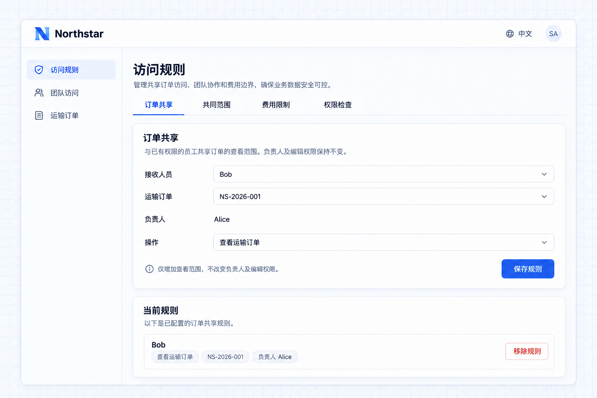

# 权限

权限决定员工能进入哪些页面、执行哪些操作，以及查看或处理哪些记录。Northstar 的客户经理维护运输需求，调度员安排司机，司机处理分配给自己的任务；三者可以使用同一套应用，但业务职责和数据范围不同。

[认证](../auth/index.mdx)确认访问者身份。订单页面要求登录属于认证；司机只能办理自己的任务属于权限。

## 从业务职责开始

| 岗位       | 页面与操作                         | 数据范围             |
| ---------- | ---------------------------------- | -------------------- |
| 客户经理   | 维护客户、创建和编辑运输订单       | 本人负责的客户与订单 |
| 调度员     | 查看调度工作台、分配司机           | 需要统筹的运输订单   |
| 司机       | 查看任务、接单、出发、提交签收资料 | 分配给自己的任务     |
| 运营主管   | 查看运输进度、处理特殊运输         | 职责覆盖的订单与申请 |
| 财务负责人 | 查看结算资料、审核额外费用         | 获得授权的财务资料   |
| 应用管理员 | 维护人员分配与访问规则             | 按管理职责配置       |

应用声明页面、业务操作及其数据范围，权限能力计算用户的访问结果。业务状态还会决定一条记录当前是否能执行操作：有分配司机的权限，不代表已完成的订单也能重新分配。

## 本节内容

| 能力                                 | 作用                                           |
| ------------------------------------ | ---------------------------------------------- |
| [权限集与分配](./permission-sets.md) | 将岗位所需页面、操作与范围组合起来，分配给人员 |
| [数据范围与规则](./data-scopes.md)   | 定义本人、全部及业务条件等记录范围             |
| [默认数据范围](./default-access.md)  | 为已有操作权限的人提供共同范围                 |
| [共享规则](./sharing-rules.md)       | 为指定协作人员增加记录范围                     |
| [限制规则](./restriction-rules.md)   | 对已有授权进一步收窄范围                       |
| [检查权限结果](./inspector.md)       | 查看权限、数据条件与授权来源                   |

## 用业务语言管理权限

人员入职、调岗或临时协作时，管理员需要调整已接入的岗位和访问规则。应用可以提供业务化管理入口，让这些配置由管理员日常维护。

Northstar 可以在应用中提供「团队访问」入口，集中管理岗位、人员分配和规则。它复用权限能力，但页面位置与呈现由业务决定，不要求保留统一的 Settings 页面。

```text
为 Northstar 提供「团队访问」管理入口，仅允许获得授权的管理员使用。
按客户经理、调度员、司机、运营主管和财务负责人定义岗位权限。
分别说明各岗位的页面、操作和记录范围，在服务端执行规则。
支持人员分配、默认范围、临时共享、限制及权限来源检查。
管理页面使用业务名称，不能只展示角色标签而不执行真实授权。
```

## 查看实际效果

本例先为 Alice、Bob 配置客户经理的本人订单查看范围，为 Emma 配置调度员的全部订单查看范围。管理员在「访问规则」中增加共同范围、共享和费用限制；员工在原有订单页面查看结果。页面入口也受权限控制，普通客户经理不会看到管理入口。



**共享规则将指定订单的查看范围开放给 Bob。**

接下来按[岗位分配](./permission-sets.md)、[数据范围](./data-scopes.md)、[共同范围](./default-access.md)、[临时共享](./sharing-rules.md)和[限制](./restriction-rules.md)逐步查看配置与结果。
