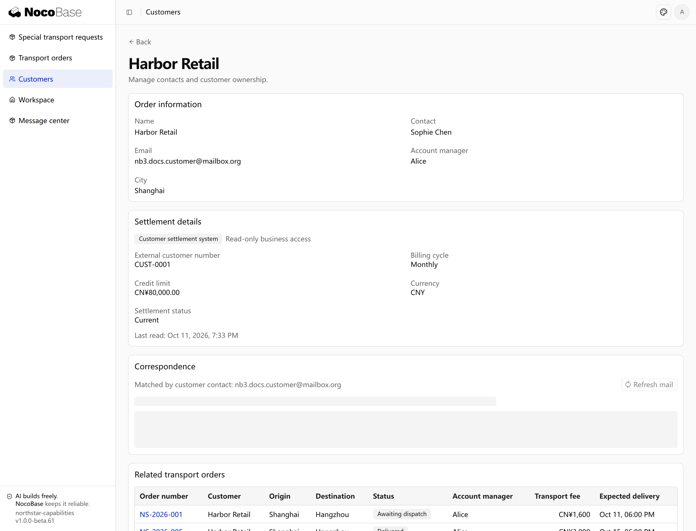

# 数据源

应用可以选择自己的主数据库，也可以接入已有数据库作为外部数据源，在页面中直接使用其中的数据。

## 应用数据库支持哪些类型

应用通过相应数据库驱动连接数据库。默认模板使用 SQLite；使用其他类型时，需要安装对应驱动，并提供连接配置。

| 数据库               | 配置中的类型 |
| -------------------- | ------------ |
| SQLite               | `sqlite`     |
| PostgreSQL           | `postgres`   |
| MySQL、MariaDB       | `mysql`      |
| Microsoft SQL Server | `mssql`      |
| Oracle Database      | `oracle`     |
| 达梦                 | `dameng`     |
| 人大金仓 KingbaseES  | `kingbase`   |
| OceanBase            | `oceanbase`  |

选择数据库时，同时确认所用驱动支持的版本、部署平台和服务端连接条件。这张表说明可配置的数据库类型，不表示所有驱动都已安装，也不表示切换连接会自动迁移原有业务数据。

## 外部数据源

已有数据保存在其他数据库时，可以将该数据库作为外部数据源接入应用，直接读取并展示其中的数据，减少重复录入。主数据库继续保存应用自己的业务数据，外部数据仍由原系统维护。

### 示例：通过外部数据源展示客户结算资料

本例接入一个独立的结算数据库，在客户详情中展示其中的结算周期、信用额度和结算状态。

将数据库连接信息和表结构准备好后，向 Agent 提出需求：

```text
将 Northstar 已有的结算数据库作为外部数据源接入，只读取数据，不修改外部表。
通过客户编号匹配，在客户详情增加「结算资料」，展示结算周期、信用额度和结算状态，并标明数据来源。
客户联系信息仍从主数据库读取，结算资料直接从外部数据库读取，不导入主库。
连接凭据从服务端运行配置读取。
```

### 查看效果

打开 Harbor Retail 的客户详情，上方是主数据库中的联系信息，下方的「结算资料」来自独立结算数据库，展示月结账期和 80,000 元信用额度。



**同一页面同时展示主库客户资料和外部数据源的结算资料，无需重复录入。**

:::tip 重要提示

- **明确数据对应关系**：本例通过客户编号匹配两边的数据。接入时需说明应用字段与外部字段如何对应，避免按名称匹配到错误记录。
- **明确读取与修改范围**：本例只读，不修改外部数据。需要写回时，应说明允许修改的表和字段。
- **明确谁能访问**：连接数据库不等于所有用户都能查看其中的数据，需要按业务要求设置服务端访问权限。
- **连接不等于同步**：本例在访问页面时读取外部数据，不会自动复制到主库。需要同步时，应另行说明同步频率和失败处理方式。

:::

KingbaseES, Dameng and OceanBase drivers are NocoBase Pro commercial packages requiring the appropriate commercial license and authenticated access to the private package registry. Install the selected package in the application’s production dependencies, then configure its dialect and connection settings. Automatic loading and `config init --dialect` remain supported; explicit registration in `database.drivers` is optional and takes precedence.
