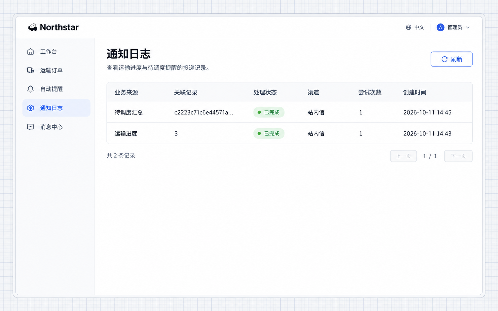

# 通知

通知支持 **站内信、邮件、飞书群机器人、钉钉群机器人 4 类渠道**。其中，邮件支持 **SMTP 和 Resend** 两种接入方式。同一业务可以同时使用多个渠道，各渠道分别保存投递结果。

| 通知渠道     | 支持方式         | 用途                                         |
| ------------ | ---------------- | -------------------------------------------- |
| 站内信       | 应用内消息中心   | 向应用用户发送业务提醒，并提供相关记录入口。 |
| 邮件         | SMTP、Resend     | 将通知发送到收件人的邮箱。                   |
| 飞书群机器人 | 群机器人 Webhook | 将业务消息发送到飞书群。                     |
| 钉钉群机器人 | 群机器人 Webhook | 将业务消息发送到钉钉群。                     |

应用决定何时通知、收件人、内容和点击后的业务页面；通知能力负责消息投递、投递记录和重试历史。还可以按需要扩展其他通知服务。

## 示例：发送站内信通知

需要在应用内向用户发送业务提醒时，可以使用站内信。本例向操作人发送运输订单进度通知，并在消息中提供订单详情入口。

向 Agent 提出：

```text
为 Northstar 运输订单增加「发送进度提醒」，通过站内信将当前订单的进度发到当前操作人的消息中心。
消息标题包含订单编号，正文包含起点、终点和当前状态。
点击消息打开对应运输订单详情，不依赖固定的部署前缀。
同一订单的同一版本向同一收件人仅发送一次，重复点击不产生重复消息。
保留现有业务状态，发送通知不改动运输进度。
侧栏提供「消息中心」和仅业务管理员可进入的「通知日志」。
消息中心只显示当前账号收到的消息；日志显示业务来源、渠道、状态和尝试次数。
```

### 查看结果

在订单 `NS-2026-003` 中点击 **Send progress update**，再打开 **Message center**。消息标题带有订单编号，正文显示 Suzhou → Nanjing 以及完成状态。本例消息发送给操作该按钮的演示账号。


**消息中心显示订单进度提醒，并提供订单入口。**

点击右侧消息标题可以进入对应运输订单。消息保存后，刷新页面仍可查看；可标记已读、未读或移除自己的消息。业务页面的可访问范围仍由订单权限决定，收到消息不会额外授予订单访问权。

## 将通知接入业务流程

审批等业务产生结果后，可以自动通知实际申请人，并提供详情入口，减少用户反复查询进度。

手动提醒说明发送和跳转；真实业务通常由流程触发。已有申请人和审批结果后，可以继续提出：

```text
在特殊运输申请审批通过或驳回后，只给申请人发送结果通知。
消息包含运输订单编号、申请原因和审批结果，点击打开对应申请详情。
待审批时不发送，同一次结果只通知一次。
保留申请人自己的消息中心，管理员在通知日志中查看投递记录。
通知失败不撤销已经保存的审批结果。
```

申请人和审批人必须是实际业务账号。消息中的用户身份、触发条件和权限由 Agent 接入业务，不能仅靠通知标题模拟审批已完成。审批方式见[审批](.././approval/index.md)。

## 查看通知日志

通知能力提供投递日志和查询接口，应用可根据管理需要搭建日志页面。**本例的 Notification log（通知日志）由 Agent 为运输应用搭建，读取实际投递记录。**

业务管理员打开 **Notification log**，可以看到运输进度和待调度汇总的记录，包含业务来源、关联记录、渠道、状态、尝试次数和时间。



**管理员可以查看通知渠道、处理状态和尝试次数。**

`completed` 表示通知各项投递均已完成处理；渠道接受提交与收件人实际阅读是不同的状态。多个渠道独立投递，一个失败不能当作所有渠道均失败。先检查业务是否产生记录，再检查失败渠道、收件人和服务配置。

需要检查渠道是否可用时，也可以让 Agent 增加「发送测试通知」入口，选择已配置的渠道和收件人，发送后查看投递记录。

## 进一步使用：邮件和群通知

用户不一定持续使用应用，重要消息可以通过邮件或群通知等渠道送达。多个渠道分别记录发送结果，方便追踪和处理失败。

外部渠道由开发或部署人员准备，凭据只保存在服务端运行环境中。

| 通知方式         | 需要准备                                       | 配置位置                                |
| ---------------- | ---------------------------------------------- | --------------------------------------- |
| SMTP 邮件        | 服务器、端口、发件账号、密码或授权码、发件地址 | `config.yml` 的 `notification.channels` |
| Resend 邮件      | API Key、可用发件地址                          | 同上                                    |
| 飞书、钉钉群消息 | 群机器人 Webhook，必要时签名密钥               | 同上                                    |
| 站内消息         | 实际应用用户 ID                                | 应用已有站内渠道                        |

配置后提出：

```text
在运输申请审批结果站内信之外增加邮件，使用已配置的邮件渠道。
从申请人的实际业务账号读取邮箱，主题包含订单编号，正文说明申请及审批结果。
没有邮箱时只发送站内信。邮件失败不影响已保存结果和站内信。
管理员可以查看每个渠道的投递记录，不在页面或日志中显示服务凭据。
```

同一逻辑通知使用稳定标识避免重复。失败可以按记录重试；投递结果未知时先确认外部服务是否已接收，不直接再发一条。具体重试与业务补偿由 Agent 根据场景接入。

## 相关能力

- [定时任务](.././scheduler.md)：按时间产生待调度汇总。
- [工作流](.././workflow/index.md)：按业务进度触发提醒。
- [邮件](.././mail/index.md)：连接个人邮箱处理往来邮件。
