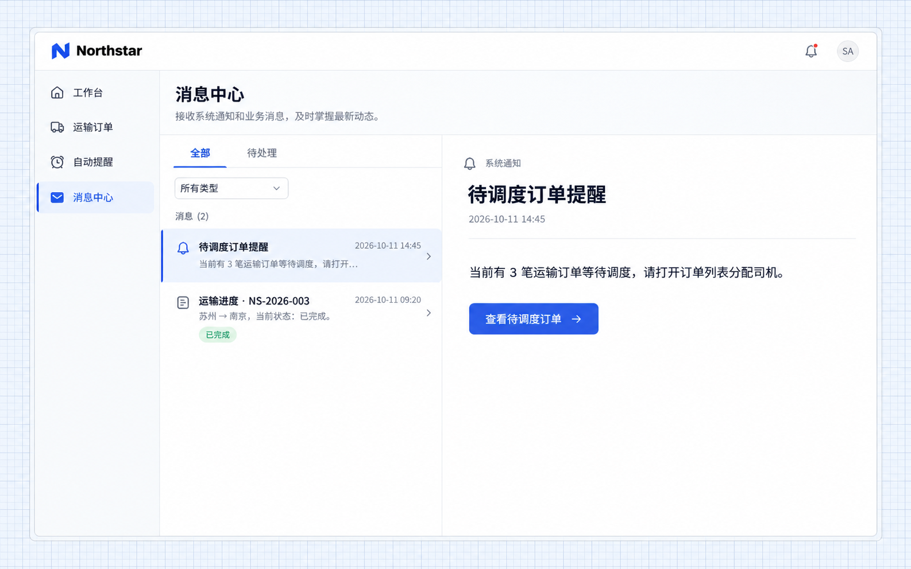

# 定时任务

NocoBase 3 提供定时任务能力，可以按指定时间或周期自动执行业务操作。例如，每天提醒相关人员处理待办事项、每周生成经营报表，或每隔一段时间同步业务数据。

你可以向 Agent 说明什么时候运行、处理哪些数据，以及希望产生什么结果。Agent 接入业务逻辑后，管理员可以在「自动提醒」中查看任务的运行时间和执行记录，并暂停或恢复任务。

## 接入前准备

本例在已有的Northstar 运输订单应用中添加待调度订单提醒。准备待调度的订单和调度负责人账号，明确每条订单由谁处理。

需要告诉 Agent 的是：运行时间和时区、需要处理的订单范围、通知发给谁，以及点击通知后打开哪个页面。

## 示例：每天提醒调度负责人处理待调度订单

调度负责人需要及时处理待调度订单。应用每个工作日定时检查，将待调度订单汇总，并通过站内通知提醒。

```text
为现有订单应用添加“待调度订单提醒”。

每个工作日北京时间上午9点，查找仍待调度的订单，汇总数量，并向调度负责人发送一条站内通知。
通知显示待调度订单数量，点击后打开待调度订单列表；没有待调度订单时不发送。
管理员可以在「自动提醒」中查看任务的运行时间和执行记录，并暂停或恢复提醒。
```

### 查看效果

1. 管理员进入 **Automation**，可以看到 **Awaiting dispatch reminder**。任务列表显示运行时间、时区、下次触发时间和当前状态。

2. 点击任务名称，查看任务详情。**Execution records** 显示每次执行的时间、耗时和状态；图中的 **succeeded** 表示本次提醒任务已执行成功。

3. 调度负责人打开通知中心，可以看到待调度订单数量。点击通知，进入待调度订单列表处理订单。


**任务页保留定时配置及本次成功执行记录。**



**待调度汇总消息已进入演示账号的消息中心。**

本例向演示业务管理员汇总待调度订单；实际团队按岗位绑定收件人后，可以分别通知对应负责人。`succeeded` 是本次汇总逻辑成功，通知的最终投递还可在通知日志中查看。

定时任务负责按时触发；查找订单、汇总数量和发送通知由 Agent 接入的业务逻辑完成。通知能力的使用方式见[通知](.././notification.md)。

## 管理任务

### 暂停和恢复

管理员可以在任务列表或详情中使用启停开关。暂停后不再产生新的定时触发；恢复后继续按设定时间运行。历史执行记录保留，已经开始的业务处理由对应执行逻辑继续完成。

### 修改运行时间或业务规则

已有定时任务需要配合新的工作安排时，可以调整执行时间，同时保留原有处理范围、收件人和业务内容。

可以让 Agent 调整已有任务，例如：

```text
把“待调度订单提醒”改为每个工作日北京时间上午10点运行。
保留原有的订单范围、收件人和通知内容。
```

修改完成后，在任务详情中查看新的运行时间和下次触发时间。增加、修改或移除任务由 Agent 更新应用代码；管理员在「自动提醒」中负责查看和启停。

## 进一步使用

### 定期生成报表

报表需要按固定周期提供时，可以自动生成并通知负责人，减少人工记忆和重复操作。

已有报表生成能力时，可以增加定时生成和结果通知：

```text
每周一北京时间上午8点生成上周的销售汇总报表，并通知销售负责人查看。
报表包含销售额、订单数量和各区域汇总。管理员可以查看任务及执行记录。
```

### 定期同步数据

数据由外部系统维护时，可以定期同步指定字段，让应用及时反映变化，减少两边重复维护。

已有同步接口时，可以指定周期和处理范围：

```text
每10分钟从现有客户系统同步客户状态，更新应用中的对应客户记录。
保留其他客户信息，管理员可以查看任务的运行时间和执行记录。
```

## 常见问题

### 为什么运行时间与预期不同？

先查看任务详情中的时区。向 Agent 描述时间时，说明采用北京时间或其他业务时区；例如本例使用 `Asia/Shanghai`。让 Agent 修改时间后，再查看下次触发时间。

### 任务执行后在哪里看业务结果？

在任务详情中查看执行记录，在对应业务页面查看结果。本例查看调度负责人的收件箱和待调度订单列表；报表任务查看生成的报表，同步任务查看更新后的数据。

### 应用停止时任务还会执行吗？

任务需要应用的运行进程提供执行服务。需要持续运行时，由应用部署人员保持服务运行；多实例部署时，还需要配置共享的调度后端。

## 开发参考

任务定义和业务目标由应用代码维护。下面是主要接入点，具体实现可以交给 Agent：

| 接入点                                    | 用途                                   |
| ----------------------------------------- | -------------------------------------- |
| `schedulerServiceToken`                   | 获取定时任务服务                       |
| `registerTarget()`                        | 注册实际执行业务操作的目标             |
| `defineSchedule()`                        | 定义任务名称、运行时间、时区和执行目标 |
| 应用 Provider 的 `register()` 或 `boot()` | 注册目标与任务定义                     |

任务使用稳定且在应用内唯一的 `key`。运行时间支持五段或六段 Cron，时区使用 IANA 名称；未指定时区时默认 `UTC`。短任务可以直接完成，耗时任务可以交给应用的后台执行服务，并回报最终结果。

应用启动时会自动同步任务定义，并保留管理员的启停选择。开发人员也可以在应用根目录手动同步：

```bash
pnpm nocobase scheduler sync --json
```

部署时移除了旧任务，应用部署人员可以在完整代码与插件清单加载后执行：

```bash
node dist/cli/index.js scheduler sync --finalize --json
```

该操作停用已经从代码中移除的任务并保留历史记录。单进程可以使用内置 memory 调度后端；多实例部署使用 Redis 共享后端，通过 `jobs.default` 选择。需要独立的调度配置时，使用 `scheduler.jobs`；对应配置的 `attempts` 保持为 `1`。

本例先用短周期运行一次以展示结果，再恢复为工作日 09:00 的配置。截图中的执行记录来自这次演示，下一次运行时间按恢复后的配置计算。
