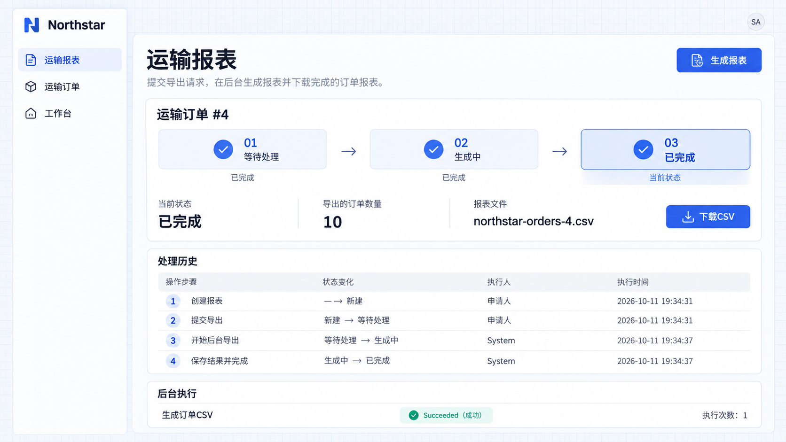

# 等待、超时与可靠执行

工作流可以在某个阶段停下来等待人员操作、外部系统返回结果，或约定时间到达，再继续推进。同一笔业务的等待状态会保存，应用重启后可以继续处理。

调用外部系统失败时，可以记录失败并按规则重试；收到重复结果时避免重复推进，收到迟到结果时按当前阶段处理。后续步骤失败还可以安排补救动作，例如释放已预留的车辆或仓位。

## 能处理哪些等待与失败

| 能力           | 作用                                                               |
| -------------- | ------------------------------------------------------------------ |
| 等待人员操作   | 工单等待客户回复，收到回复后继续；超过时限则关闭或转交。           |
| 等待外部结果   | 开票、签章或导出提交后等待回调，也可以定时查询结果。               |
| 按时限推进     | 约定时间到达后取消、续费或升级处理，而非依赖用户保持页面打开。     |
| 失败重试与补救 | 调用失败后重试，最终失败交给人工；需要时撤销之前的资源预留。       |
| 防止重复处理   | 同一通知或请求重复到达时不重复执行；迟到结果不倒退已经完成的进度。 |

## 示例：在后台导出运输订单

导出数据需要时间时，可以先提交任务，由后台处理，完成后再下载结果。用户无需停留在页面等待，也可以稍后回来查看进度和文件。

```text
在 Northstar 增加运输订单报表页面，导出现有订单为 CSV。
提交后进入等待处理，由后台开始生成，成功后自动完成并提供下载入口。
显示当前阶段、文件名、导出订单数，以及提交和系统处理的记录。
生成失败时按规则重试，最终失败保留结果供负责人处理；重复执行不要生成重复的报表文件。
刷新页面后仍可查看进度与结果，只有获得授权的人员可以导出订单。
```

## 查看执行结果

### 1. 提交后等待后台处理

打开 **Transport reports（运输报表）**，点击 **Generate report（生成报表）**。新报表进入 **Waiting（等待处理）**；处理记录中显示创建和提交动作。此时还不能下载文件。


**任务已提交，系统保存等待状态，后台继续处理。**

### 2. 完成后下载报表

后台生成结束后，状态自动变为 **Completed（已完成）**，页面显示 **10** 笔导出订单及文件名。点击 **Download CSV** 可以下载实际生成的报表。



**系统已自动生成可下载的 CSV，保留等待、开始处理和完成的记录。**

**Processing history** 标明后台动作由 **System** 执行；**Background execution** 显示 **Succeeded** 和实际执行次数。本次生成一次成功；重新打开页面，完成状态和下载入口仍然保留。

## 应用到运输业务

同样的能力可以用于运输订单的开票、月报导出、资源预留和异常工单。提出需求时，应明确“等待什么”“多久算超时”“失败后怎么办”。

| 需求           | 需要说明的规则                                                 |
| -------------- | -------------------------------------------------------------- |
| 开票或月报导出 | 等待回调还是定时查询，等待多久，失败是否重试，结果在哪里查看。 |
| 车辆或仓位预留 | 后续确认失败是否释放，释放失败如何重试或交给人工。             |
| 仓库与费用确认 | 是否两项都完成才能交接，是否允许先后顺序不同。                 |
| 承运商轨迹     | 如何识别重复事件，迟到事件怎样处理，什么结果允许推进。         |
| 异常工单       | 等待客户多久后关闭，关闭后是否允许重开，改派需要什么说明。     |

:::tip 重要提示

通知是流程可以调用的一项能力，工作流负责等待、推进和失败处理。消息发送成功不代表业务已完成；发送失败也不应丢失已保存的业务结果。重试外部操作时，应同时明确如何避免重复扣款、开票或预留。

:::

## 补充时限与失败恢复规则

说明时限从何时开始、转交或重新提交后是否重新计时、先提醒还是直接升级；已办结的单据不应再收到等待提醒。外部事项应明确自动重试次数、最终失败由谁处理，以及重复、迟到或结果未知时怎样核对。需要人工恢复页面时，由 Agent 按业务职责和权限开发。

```text
Northstar 订单待接单超过 30 分钟提醒调度员，超过 60 分钟交给值班负责人；重新分配司机后重新计时，已出发的订单不再收到接单提醒。自动处理保留原因和系统办理记录，应用重启不能漏掉到期处理。
运输报表生成失败自动重试 3 次，仍失败时在报表页显示原因，由有权负责人重试。重复请求不能生成多份相同报表。承运商通知重复或迟到时，按当前进度处理，不恢复已取消订单；结果未知时先核对再重试。先确认这些情况的处理结果。
```

验收应覆盖超时、重启后的处理、重复与迟到结果、最终失败和人工恢复，而不只检查一次成功执行。
