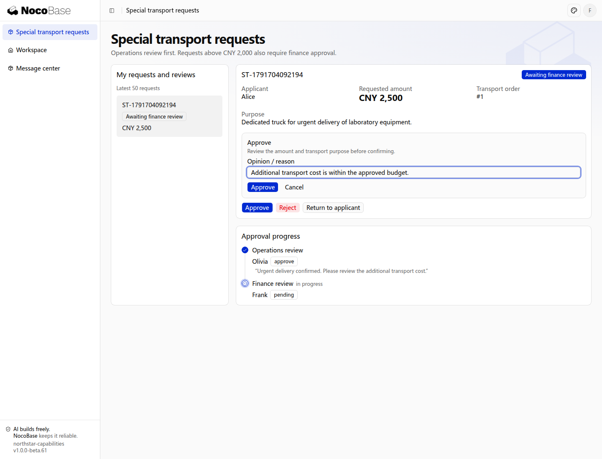

# 审批

多级审批与普通运输办理不同。司机接单是某个角色执行业务动作；特殊运输可能需要主管和财务依次决策，或多个负责人共同处理，适合接入 Pro 审批能力。

## 示例：特殊运输申请

客户经理提交特殊运输申请，填写货物说明、原因、额外费用和资料。费用不超过2,000元时由运营主管审批；超过2,000元时，主管通过后追加财务审批。本例先展示申请与审批结果；批准后不会自动支付费用或改变运输订单状态。需要把批准结果作为后续办理条件时，再接入相应业务动作。

这组金额与路线是示例规则，可以按公司制度调整。

## 接入前准备

审批使用商业包 `@nocobase/app-plugin-approval`，需要相应授权、下载源及兼容版本。让 Agent 按应用的插件接入方式安装、注册并同步所需开发资料，所用凭据保留在本地配置中。

插件提供审批数据结构、服务与前端辅助组件；业务路由、申请页和审批待办由应用接入。安装不会自动生成完整审批中心，也不代表已替业务定义好审批路线。

## 交给 Agent 的需求

```text
为 Northstar 的特殊运输申请接入 Pro 审批。
先给出流程表、阶段表和每一步对业务数据的影响，确认后实现。
申请由客户经理发起，包含货物说明、理由、额外费用和附件。
费用不超过2,000元由运营主管审批；超过2,000元时主管通过后进入财务审批。
提交前预览实际路线和处理人，缺少处理人时不能让申请无提示地卡住。
申请详情显示阶段进度、审批人、可用操作和历史，员工可在自己的待办中办理。
驳回结束本次申请；退回补充需要说明理由，申请人补充后重新提交，保留之前的记录。
批准后回写运输业务条件，执行运输继续沿订单流程进行。
请明确每个阶段允许的操作、撤回规则、时限和人员来源，复用服务端审批能力，不直接修改审批结果字段。
```

## 查看审批结果

Alice 为本人订单申请专车运输，金额为 2,500 元，用途是加急运送实验室设备。提交后，申请进入运营主管 Olivia 的待办。打开申请，可以同时核对金额、用途、审批进度和可用操作；审批时可填写意见。


主管同意后，因金额超过 2,000 元，申请进入财务负责人 Frank 的审批阶段。主管的意见仍保留在进度中。



财务同意后，申请显示 **Approved**。页面保留两个阶段的审批人和意见，申请人可以继续查看结果。


本例的主管和财务是应用中分配了相应岗位的独立账号。审批按钮根据当前登录人的任务显示，申请人与审批人分别操作。

## 使用过程

| 人员       | 使用动作                   | 应呈现的信息                   |
| ---------- | -------------------------- | ------------------------------ |
| 客户经理   | 填写申请，提交前预览       | 根据本次内容计算的路线和处理人 |
| 运营主管   | 从个人待办查看并决策       | 被审批的资料、费用、操作及理由 |
| 财务负责人 | 办理符合金额条件的下一阶段 | 前序结果、当前资料与财务动作   |
| 申请人     | 跟踪申请                   | 当前阶段、结论和完整历史       |

退回补充与驳回不是同一结果：退回允许按指定规则修改再提交，驳回则结束当前申请。部分人员表态还不是阶段完成，要按阶段决策策略汇总。

## 更多审批规则

| 规则           | 需要讲清楚的业务决定                           |
| -------------- | ---------------------------------------------- |
| 多级审批       | 阶段顺序、进入条件、每阶段人员来源             |
| 会签、或签     | 必须全部同意，还是任一人同意；拒绝怎样影响结果 |
| 比例通过       | 参与人及通过比例，如何处理弃权或缺席           |
| 顺序或并行处理 | 人员依次办理还是共同参与，何时算阶段结束       |
| 加签           | 谁可以增加人员、加到何处、怎样影响原决策       |
| 转交           | 可以转给谁，是否需要理由，原任务怎样结束       |
| 退回指定环节   | 可退回的目标、资料修改范围、重新提交后的路径   |
| 抄送与阅知确认 | 接收对象、是否必须确认，是否影响继续推进       |
| 审批时限       | 提醒、升级、转交或最终处理，不能默认为自动同意 |

这些动作需要在业务阶段中明确配置或扩展。没有配置的动作不应自动出现，不必给每个阶段开放全部审批操作。

## 审批与实际执行

审批通过只是决策结果。若批准后还要预留车辆、修改额度或调用外部服务，应分别定义执行、失败与重试路径。撤回、驳回、退回及其他出口都需要处理已有预留，避免资源一直占用。

决策时应核对当前被审批内容，防止根据过期资料批准；页面提交的动作由服务端确认操作者、任务及业务权限。不能直接把结果字段改成已批准，也不能绕过审批服务推进阶段。

路线写在应用源码中，修改需要重新检查并部署，同时说明在途申请如何继续。更多独立的审批场景，可以沿同一运输背景逐项加入。
