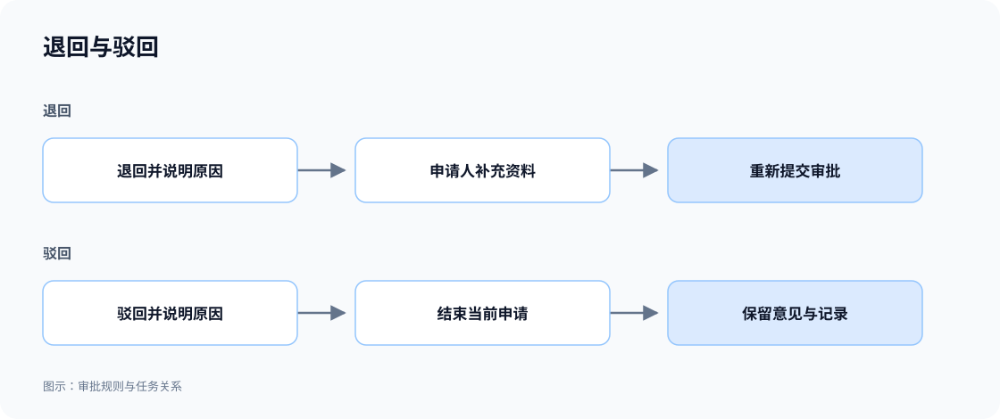

# 申请处理与进度

审批可以覆盖提交、审核、退回补充、重新提交和结束的完整过程。申请人查看进度，审批人处理待办，抄送人查看资料与意见；不同人员拥有对应的操作入口。

## 退回、驳回与撤回

| 操作     | 对申请的影响                                       |
| -------- | -------------------------------------------------- |
| 退回     | 返回指定环节，允许按规则补充或修改，再重新提交。   |
| 驳回     | 结束当前申请，保留拒绝原因和意见。                 |
| 撤回     | 申请人在允许的阶段主动撤回，当前审批任务随之结束。 |
| 补充材料 | 审批人等待补充资料，申请人提交后继续原任务。       |

### 示例：资料不足时退回补充

```text
Northstar 特殊运输申请缺少必要资料时，允许主管填写原因并退回申请人补充。
申请人修改后重新提交，保留之前的意见；重新进入审批时再次确定处理人。
提交后、尚未结束时允许申请人撤回，审批人不能再处理已撤回的任务。
页面明确区分退回、驳回和撤回，并显示下一步由谁处理。
```



**退回可以补充后继续，驳回结束当前申请，两者保留各自的原因和记录。**

## 抄送与阅知

需要让相关人员了解审批结果时，可以设置抄送和已读确认。抄送人查看进度、资料和意见，阅知不计入审批票数。

```text
将 Northstar 特殊运输申请抄送给负责客户经理。
提供「抄送给我」列表和已读确认，抄送人可查看进度及意见，但不参与审批决策。
```

## 时限与任务分配

审批可以按约定时限提醒、升级给负责人，也可以让团队成员认领任务。认领后超时未处理时，可以释放任务供其他人继续；需要时按工作日历计时。

```text
Northstar 主管审批超过一个工作日时提醒，超过两个工作日时升级给主管负责人。
团队待办允许符合岗位的人员认领，认领超时未处理时释放。
显示当前处理人、截止时间和任务分配记录。
```

## 查看审批结果

现有特殊运输申请由主管 Olivia 和财务负责人 Frank 依次审批后，显示 **Approved**；详情保留两个环节的审批人和意见。


**申请人可以查看最终结论、审批人及各环节意见。**

:::tip 重要提示

需明确哪些阶段允许撤回、退回到哪里，以及重新提交后是否沿用之前的意见。抄送阅知与审批决策分开；超时处理也应明确为提醒、升级或转交等动作。

:::
