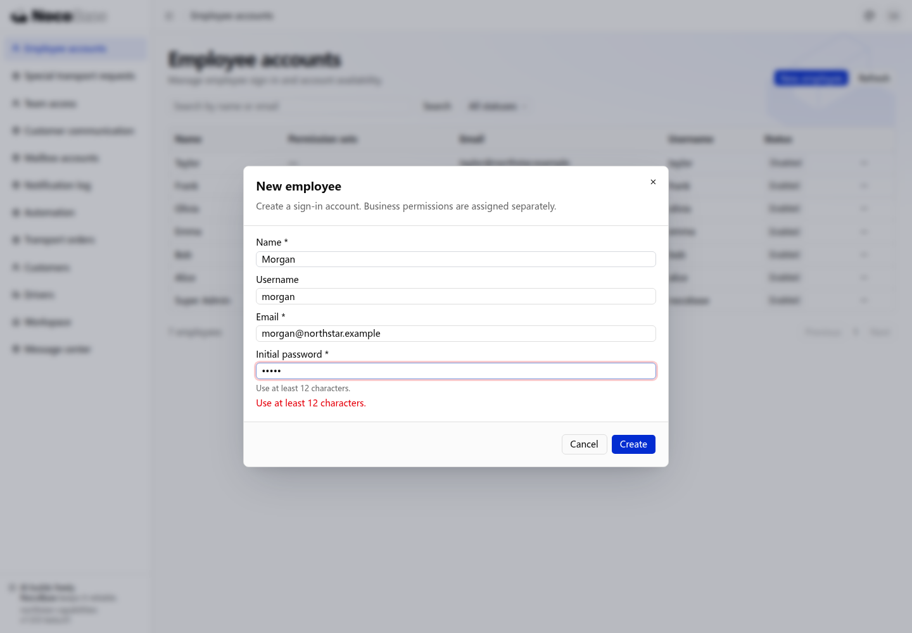
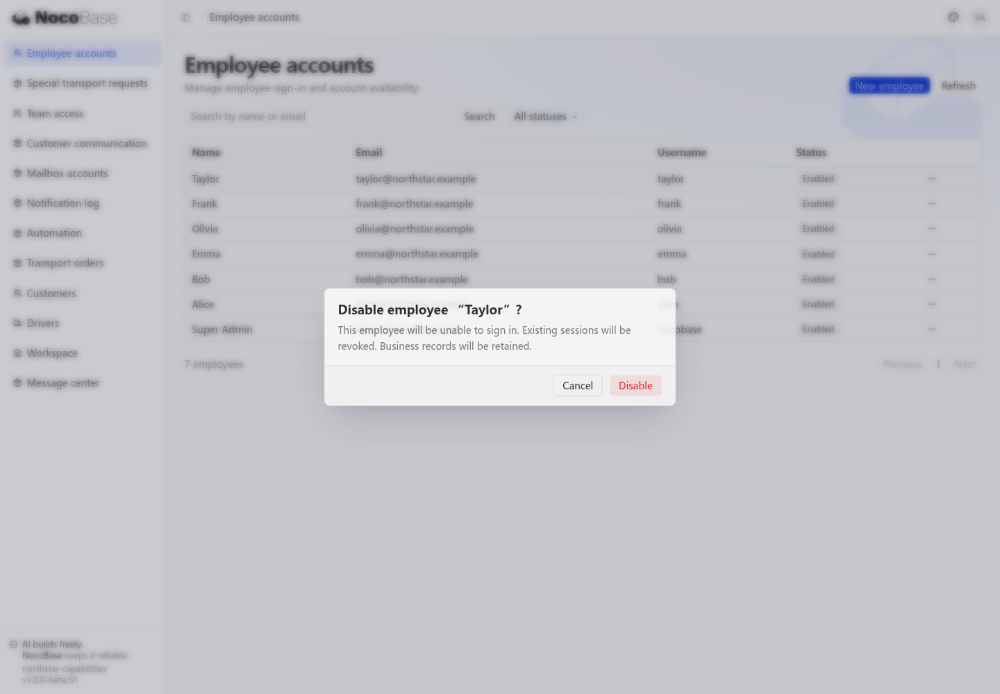

# 密码认证与账号

Northstar 的客户经理、调度员和司机使用公司分配的账号登录运输系统。管理员负责开户和离职停用，员工可以退出登录，并通过邮箱申请找回密码。

## 登录与退出

打开应用登录页，输入用户名或邮箱和密码，点击 **Sign in**。本例使用蓝色风格的 Northstar 登录页，认证动作和会话由 NocoBase 提供。


登录后进入业务工作台。点击右上角头像，打开用户菜单，选择 **Sign out**，即可退出并返回登录页。会话过期后也需要重新登录。


登录页的品牌与布局可以调整，示例见[定制登录页面](./login-pages.md)。

## 员工账号由公司管理

运输系统保存客户资料和内部订单，Northstar 希望只有公司认可的员工能够进入。账号由管理员统一创建和分配岗位，员工不通过公开注册自行加入。

向 Agent 提出需求：

```text
Northstar 的运输系统只供公司员工使用，账号由管理员统一创建。
关闭自助注册，登录页不显示注册入口，服务端也禁止自助注册。
为管理员搭建“员工账号”页面：支持按姓名、邮箱搜索，按启用或停用状态筛选。
可以创建账号、停用和重新启用账号，也可以单独撤销登录会话。
创建账号与分配业务权限分开，不能默认授予管理员权限。
```

打开 **Employee accounts**，可以查看员工的姓名、邮箱、用户名、权限集和账号状态。点击 **New employee**，填写姓名、邮箱和初始密码，创建账号；用户名可以选填。员工没有自行注册的入口。


账号决定员工能否登录，权限集决定员工登录后能访问哪些业务。创建一个账号，不等于允许他查看全部订单。权限配置见[角色与权限](../authorization/index.md)。

## 自定义密码要求

公司希望员工使用更难被猜到的密码，同时让开户和密码重置遵守同一标准。本例要求新密码至少 12 个字符，并在填写时就说明要求，避免提交后才发现不符合规则。

```text
员工设置新密码或重置密码时，密码至少需要 12 个字符。
在创建账号和重置密码表单中显示要求，前端提示与服务端校验保持一致。
已有员工仍可使用原密码登录，不要求本次改造时立即修改密码。
```

创建账号时，密码输入框下方显示长度要求。输入不足 12 个字符的密码并点击 **Create**，表单会显示提示，账号不会提交创建。服务端也校验新密码长度；已有账号的登录密码不会因此被立即替换。



## 找回密码

员工忘记密码后仍需要及时查看订单，公司希望他们通过已登记的邮箱自行恢复访问，减少管理员代办。重置过程应确认邮箱归属，并让员工设置自己的新密码。

向 Agent 提出需求：

```text
为 Northstar 员工接入忘记密码流程，使用邮件渠道发送重置链接。
员工在登录页点击 Forgot password?，填写邮箱后申请重置。
无论邮箱是否存在，都显示相同的提交提示。
员工打开邮件链接，设置至少 12 个字符的新密码，再返回登录页登录。
复用认证能力处理重置链接的有效期和一次性使用。
```

点击登录页的 **Forgot password?**，填写账号邮箱。


应用需要接通邮件发件渠道，才能完成“提交申请 → 收到邮件 → 打开重置链接 → 设置新密码”的完整流程。邮件链接应指向员工实际可以访问的应用地址。

## 登录状态与停用账号

员工离职或暂停业务时，公司需要及时停止其访问客户与订单资料。停用不仅要阻止下一次登录，也要结束已经登录的访问，避免旧浏览器继续使用系统。

```text
为管理员提供员工离职停用操作。
停用前显示员工姓名和操作影响，确认后禁止该员工继续登录，并使已有会话失效。
保留员工关联的客户、订单等业务记录。
允许重新启用账号；重新启用后，员工需要重新登录。
```

在员工列表中打开 Taylor 行的操作菜单，选择 **Disable**。确认窗口会说明：该员工不能再登录，已有会话将被撤销，业务记录仍然保留。



确认后，列表中的 Taylor 显示为 **Disabled**。原有登录会话不能继续访问内部业务，员工回到登录页。需要恢复账号时，选择 **Enable**；已撤销的会话不会自动恢复。


如果仅需要让员工重新登录而不暂停账号，可以使用 **Revoke sessions**。业务页面和接口都需要处理身份要求，公开内容与内部业务的区别见[保护页面和接口](./protecting-access.md)。
