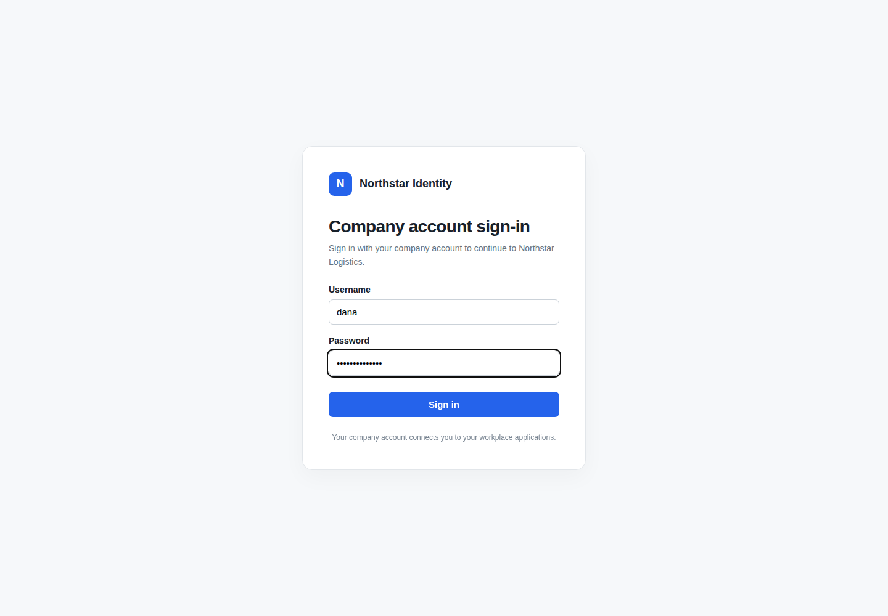
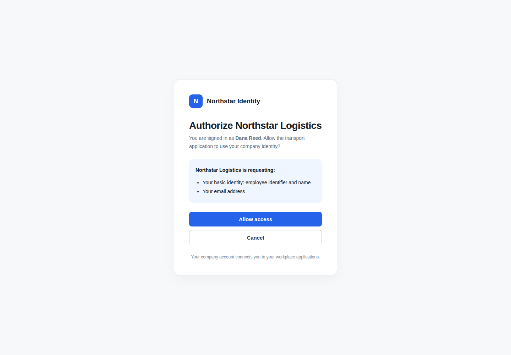
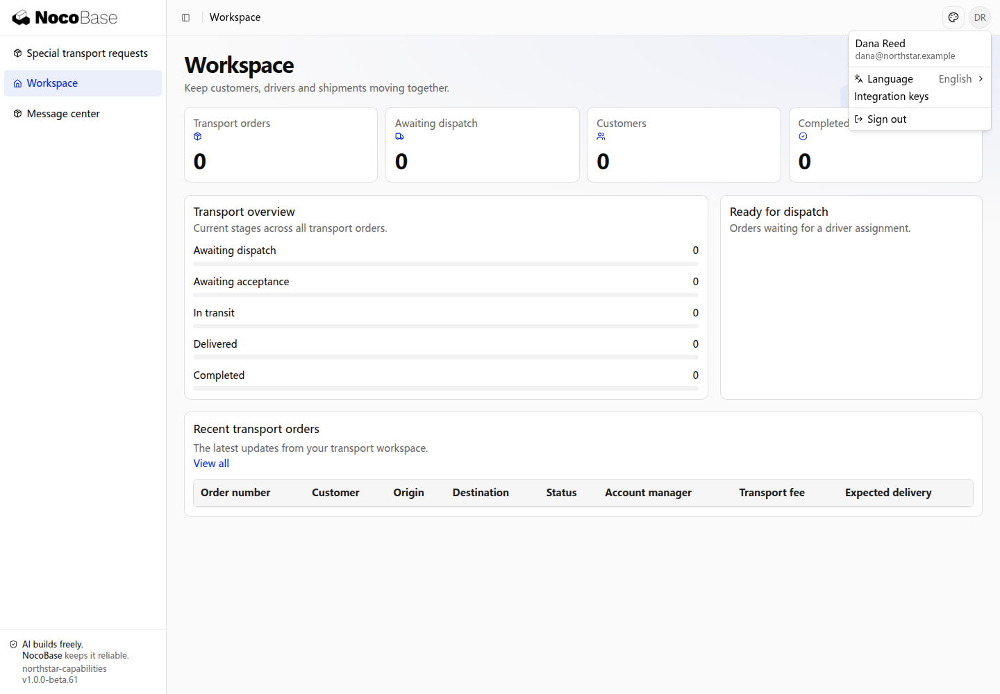

# 增加认证方式

Northstar 已有公司统一身份平台，希望员工用企业账号进入运输系统。身份平台负责验证企业账号，应用在登录成功后建立自己的会话，再按业务权限开放页面、操作和订单数据。

## 可以接入哪些方式

NocoBase 的认证能力基于 Better Auth，可按应用需要接入平台配置或认证扩展。这些方式需要完成相应配置，不表示新应用默认全部开启。

| 登录需求                   | 接入方式                            | 需要准备                             |
| -------------------------- | ----------------------------------- | ------------------------------------ |
| GitHub、Google 等平台账号  | 对应平台的登录配置                  | 平台应用、凭据和回调地址             |
| 企业统一账号               | OAuth 2.0 或 OpenID Connect（OIDC） | 身份平台地址、应用信息、账号关联规则 |
| 飞书、钉钉等平台账号       | 对应平台授权与用户信息接口          | 开放平台应用、登录权限和回调地址     |
| 邮箱验证码或登录链接       | 相应认证扩展                        | 邮件服务、页面和所需存储             |
| Passkey、双因素认证        | 相应认证扩展                        | 所需页面、配置和数据结构             |
| 公司内部 ticket 或签名协议 | 自定义认证扩展                      | 协议文档、验证接口和稳定用户标识     |

## 接入前准备

身份平台管理员为运输应用建立登录接入，提供平台地址、应用标识和所需凭据，并登记回调地址。开发 Agent 完成应用侧接入，明确哪些配置需要由负责人填写；凭据保留在服务端运行配置中。

还需要决定首次登录是否创建应用账号，以及能否关联已有账号。应以身份平台的稳定用户标识识别用户，不能仅凭同名或相同邮箱自动合并账号。企业账号接入与岗位权限分配是两件事。

## 示例：企业账号进入运输系统

```text
Northstar 已有企业身份平台，请采用 OIDC 接入运输系统。
保留账号密码登录，在品牌登录页增加「企业账号登录」按钮。
员工点击后进入企业身份平台，使用公司账号登录。
身份平台显示授权确认，说明运输应用需要员工的基本身份信息和邮箱。
员工确认授权后返回运输工作台；取消授权则不进入应用。
首次登录允许创建应用账号，使用身份平台的稳定用户标识识别用户。
不要按同名或相同邮箱自动合并已有账号，新账号不能自动取得管理员权限。
请列出平台管理员需要提供的信息、应登记的回调地址，以及应用需要的配置。
```

### 1. 从运输应用进入公司登录

打开运输应用登录页，选择 **Continue with Company account**。密码登录入口仍保留，员工可以根据公司配置选择登录方式。


### 2. 在公司身份平台验证账号

页面跳转到独立的 **Northstar Identity** 身份平台。员工填写公司用户名和密码，点击 **Sign in**。运输应用不在自己的页面收集公司账号密码。



### 3. 确认授权运输应用

身份验证成功后，平台显示 **Authorize Northstar Logistics**，说明当前登录员工为 Dana Reed，以及运输应用申请使用的信息：员工标识、姓名和邮箱。

点击 **Allow access** 继续；不希望授权时，可以选择 **Cancel**。



### 4. 返回运输工作台

授权后自动返回运输应用。打开右上角用户菜单，可以看到员工 **Dana Reed** 和公司邮箱，说明应用已识别该员工并建立自己的登录会话。



首次登录创建账号，不等于自动获得订单或管理员权限。本例的新账号还没有分配业务数据权限，因此工作台暂不显示订单；管理员可以继续按岗位为其分配[权限集](../authorization/permission-sets.md)。

公司登录解决“员工是谁”，后续可以查看的页面、订单与操作仍由运输应用的业务权限决定。身份平台是否展示授权确认、是否记住授权，由公司的平台配置决定。

## 其他接入需求

GitHub、Google 等登录可以用相同方式描述：保留已有密码入口，说明首次开户与账号关联规则，让 Agent 给出平台侧应用和回调地址的准备清单。

对于内部 ticket 协议，可以提供协议文档，再提出：

```text
公司门户会带着一次性 ticket 跳转到 Northstar。
请按协议调用门户验证接口，使用返回的稳定用户标识找到应用中的已有账号。
首次登录不自动开户；未找到账号时给出申请开通的指引。
保留密码登录，成功后进入运输工作台。
```

还可以明确退出时是否同时退出企业身份平台、已有员工如何绑定企业账号，以及不同岗位登录后的首页。所需的绑定页面、认证扩展和数据结构由 Agent 随接入一起完成。
