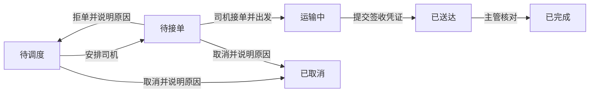

# 工作流

运输订单不会在创建时一次完成。它需要等待调度员安排、司机接单、实际运输和签收核对。工作流把每一步的办理人、输入、下一环节和时限组织起来，让应用知道当前能做什么、还在等什么。

## Northstar 的运输流程

这是本章的业务方案：待接单时，指定司机确认并出发；如果需要将接单与出发分开，可以增加待出发环节。运输开始后不沿用未出发时的取消动作，应另行定义异常处理。

## 流程页面应呈现什么

- 流程图标出当前环节及经过的路径。
- 操作区显示能办理的动作，不能办理时说明原因。
- 办理记录保存操作人、时间、前后环节和输入，自动办理显示为系统。
- 列表按环节筛选，个人待办随办理结果更新。
- 等待超时按规则提醒或升级，必要的对外事项提交后执行并记录结果。

页面由应用按业务构建，工作流不要求独立的统一管理页面。单据当前环节保存在自己的数据中；配合后台任务，应用重启后仍可继续处理等待、时限和未完成事项。

## 适用边界

订单、工单、开票、导出、续费等有中间环节的业务适合流程。如果一次操作即可完成，或数据变化后只需发一条通知，通常不必建立完整流程。

一个人简单确认可使用业务流程的办理条件。多级、多人决策、加签和转交等需要[审批](../approval/index.md)能力。

流程在源码中定义，没有拖拽设计器。规则调整由 Agent 修改、检查并重新部署；上线后还需考虑在途单据。

## 阅读本节

- [快速开始](./quick-start.md)：从环节表到第一条运输流程。
- [使用 Agent 开发](./develop.md)：补充规则、时限、对外事项、页面和上线安排。
- [场景示例](./scenarios.md)：开票、导出、补偿、续费、外部事件和异常工单。
- [扩展参考](./extension.md)：事务边界、扩展点、已有数据及开发接口。
