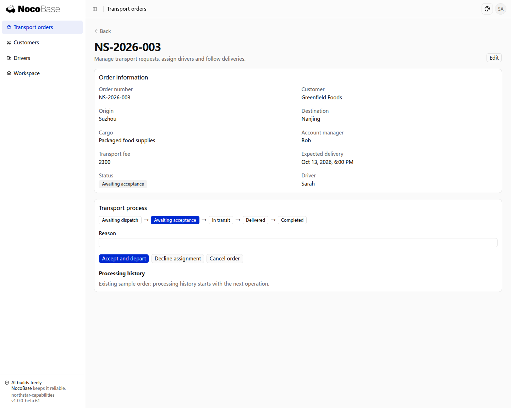

# 快速开始

在[快速启动](../quick-start.md)已经搭建的 Northstar 应用中，为现有运输订单增加办理流程。先把一笔订单从接单走到完成，再增加时限和外部系统协作。

## 1. 描述运输办理需求

业务需要多人按顺序办理时，可以定义环节、动作和必填信息，并记录每次处理。用户能够知道当前进度、下一步要做什么和由谁处理。

```text
为 Northstar 的现有运输订单增加办理流程。
待调度时选择司机，进入待接单；司机接单并出发后进入运输中。
拒单必须填写原因，订单返回待调度并清除原分配。
运输中提交签收凭证后进入已送达，主管核对后进入已完成。
待调度和待接单时可以取消，必须填写原因；出发后需要单独的异常处理。
订单详情显示当前阶段、可办理操作、不能办理的原因和办理历史。
办理历史保存操作人、时间、前后阶段和提交资料，刷新后仍能查看。
普通编辑不能直接修改流程阶段；服务端核对输入、当前阶段与办理条件。
先给出环节表与需要确认的业务规则，确认后实现页面和接口。
```

接单与出发在本例中是同一次操作。若公司要求分别确认，在实现前让 Agent 增加待出发环节。

## 2. 确认办理顺序

| 当前阶段       | 办理动作       | 下一阶段 |
| -------------- | -------------- | -------- |
| 待调度         | 安排司机       | 待接单   |
| 待接单         | 接单并出发     | 运输中   |
| 待接单         | 拒单并说明原因 | 待调度   |
| 运输中         | 提交签收凭证   | 已送达   |
| 已送达         | 核对交付       | 已完成   |
| 待调度或待接单 | 取消并说明原因 | 已取消   |

确认谁能看订单、谁能办理各动作，以及拒单、取消和签收需要哪些输入。岗位与记录范围使用[权限](../authorization/index.md)能力接入。

## 3. 查看待办理订单

打开 **Orders** 中的 **NS-2026-003**。在办理前的截图中，这笔订单已经分配司机，处于 **Awaiting acceptance（待接单）**；详情的 **Transport process** 显示阶段及接单、拒单、取消操作。



**订单当前处于待接单，可查看对应办理动作。**

## 4. 办理并查看结果

点击 **Accept and depart（接单并出发）**，再提交签收凭证，最后核对交付。订单进入 **Completed（已完成）**，**Processing history** 保留三次实际办理的动作、时间、前后阶段和凭证编号。


**订单已完成，办理历史保留动作、阶段变化和提交资料。**

这组截图展示管理员账号完成的业务办理。员工按岗位使用时，需要同时配置相应的页面、操作和记录范围。

页面刷新后，进度和历史仍然保留。应用其他入口也应通过相同办理规则推进订单，避免普通编辑把订单直接改成完成。

## 下一步

基本流程完成后，按需要加入[接单提醒、通知与外部协作](./automation.md)。多人、多级决策参见[审批](../approval/index.md)。
