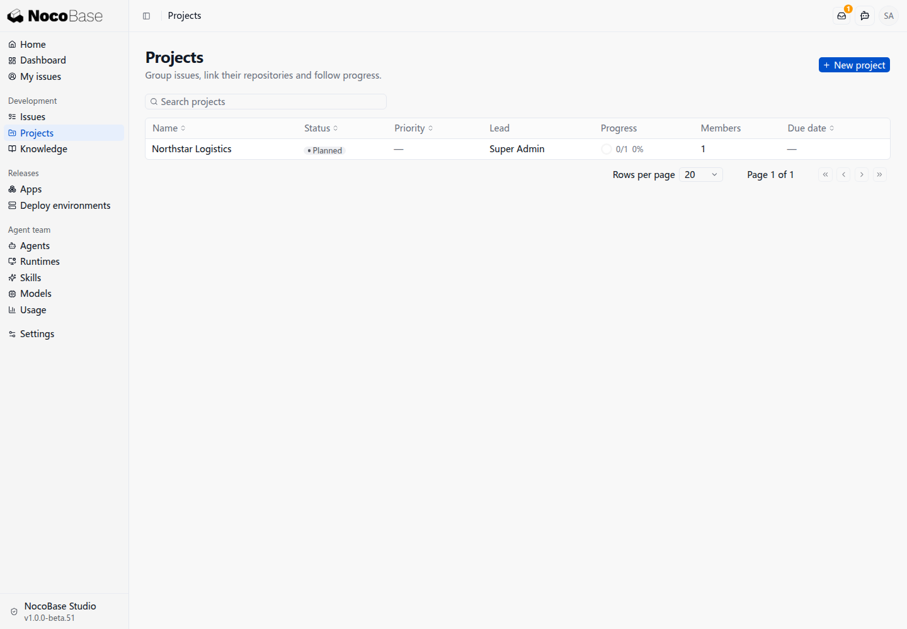
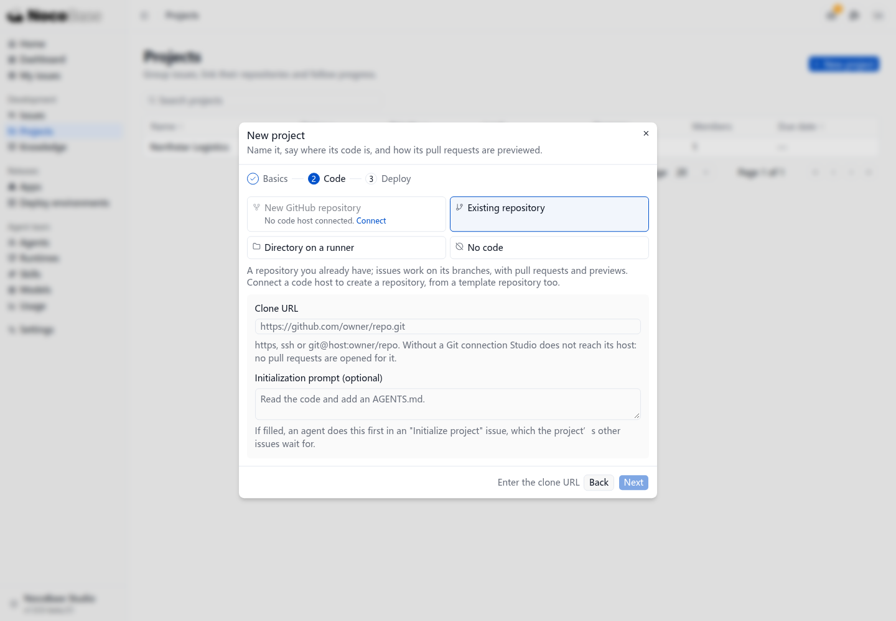
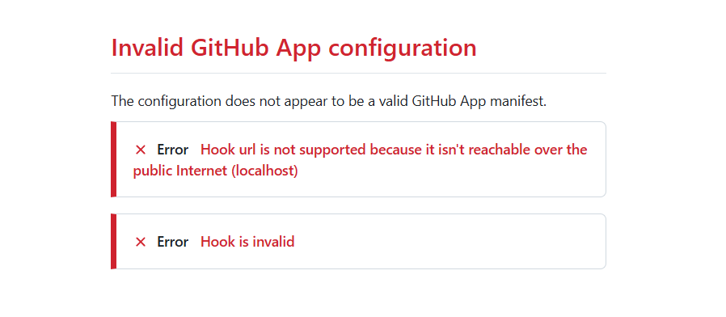
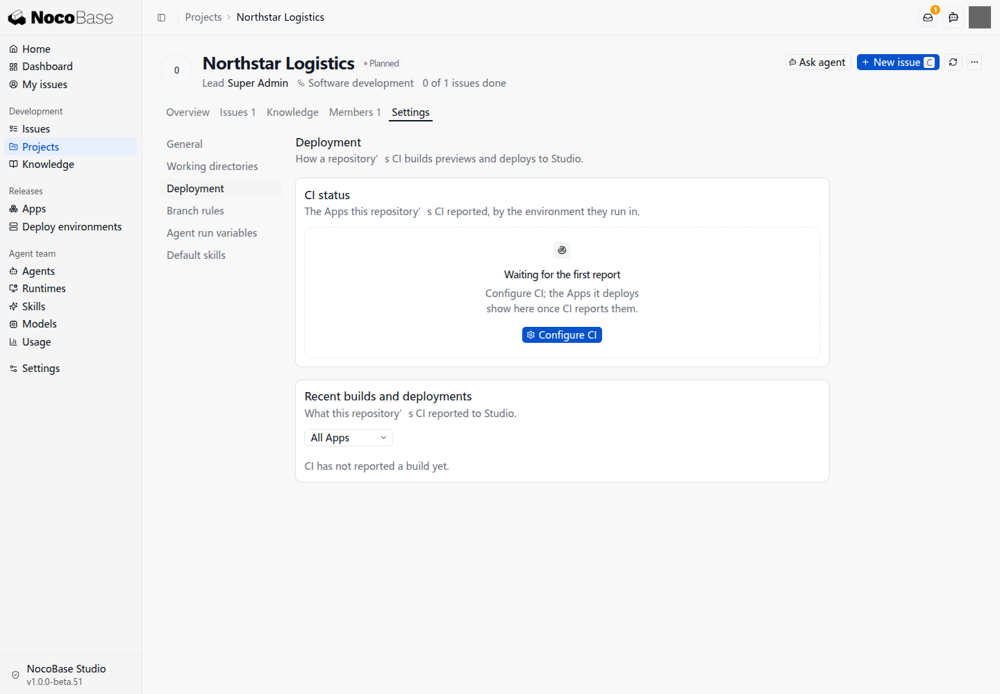
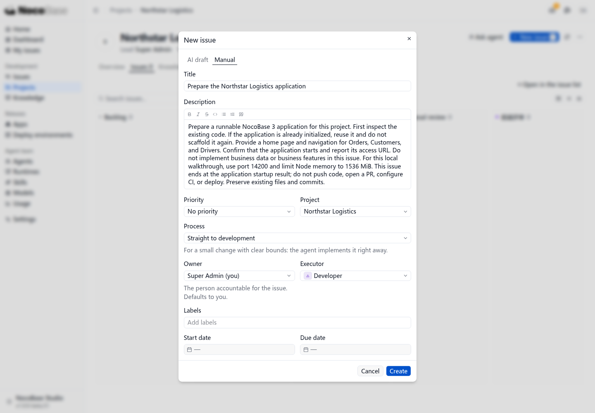
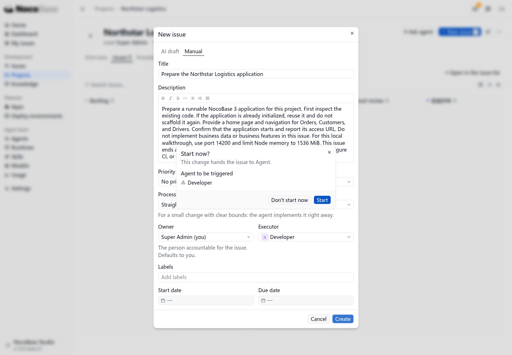
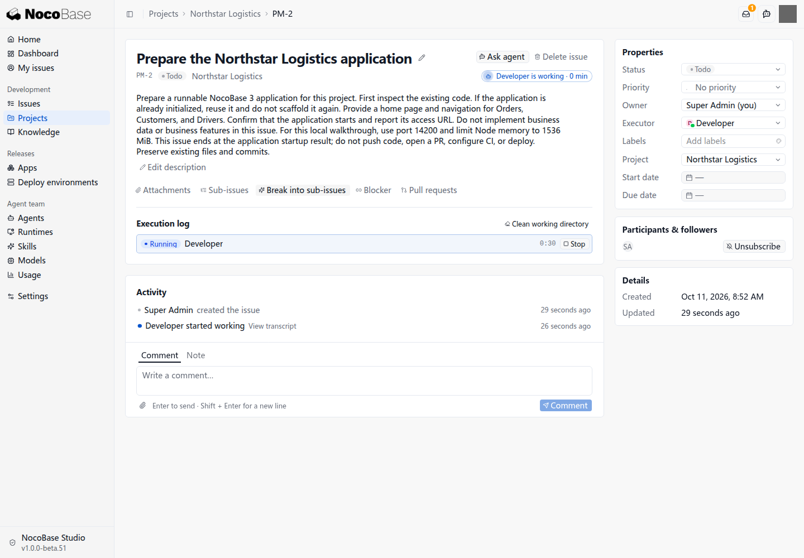
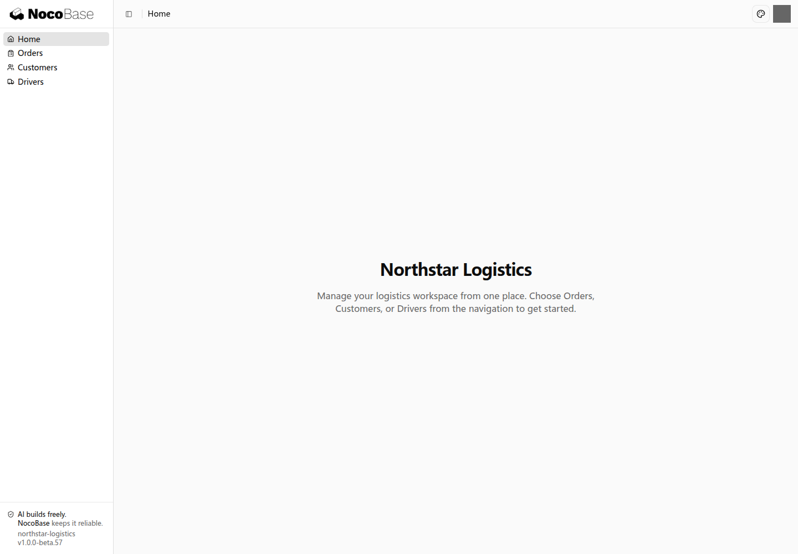

# 创建第一个项目

以一家运输公司的订单管理应用为例，通过新建项目向导填写基本信息、准备代码仓库，再安排应用初始化和开发任务。

::: danger 本轮累计遇到的问题

1. **首次开发前缺少仓库准备提示。** 此前任务下发后才发现没有关联代码位置；本轮改为手动创建项目时先准备仓库。
2. **本地 Studio 缺少云端可访问的地址。** Webhook 通知和云端 CI 回传都需要访问 Studio；本轮公网上传超时，已通过本地补充上传完成 Preview 部署，处理过程见后文问题记录。
3. **Developer 缺少 NocoBase 3 初始化指引。** 此前自行使用旧版命令；本轮补充正确步骤后完成初始化，默认流程修复情况待确认。
4. **Runner 默认拒绝下载执行脚手架。** 此前正确命令也被策略拦截；本轮已通过额外配置完成初始化，开发反馈线上已修改，本地未拉代码重验。
5. **GitHub App 注册被 localhost Hook URL 阻塞。** 此前无法继续授权；本轮通过公网地址完成注册和仓库授权。

以上保留累计编号，已处理的项目标明结果，不表示五项仍全部阻塞。详细记录与建议见[本轮待确认问题](./review-notes)。

:::

## 打开新建项目向导

进入 **Projects（项目）**，点击 **New project（新建项目）**。



## 填写基本信息

在 **Basics（基本信息）** 步骤填写：

- **Project name（项目名称）**：`Northstar Logistics`。
- **Description（描述）**：说明应用服务的用户和业务目标。本例为调度员、司机和管理人员使用的运输订单管理应用，管理客户、货物、司机分配及配送进度。
- **Workflow template（工作流模板）**：本例保留 **Software development (default)**。


点击 **Next（下一步）**，进入 **Code（代码）** 步骤。

## 在代码步骤连接 GitHub

代码步骤用于选择项目的代码位置，提供 **New GitHub repository（新建 GitHub 仓库）**、**Existing repository（已有仓库）**、**Directory on a runner（Runner 上的目录）** 和 **No code（无代码）**。

本演示采用 GitHub 仓库，以便后续通过 Runner 推送代码并在 Studio 中处理 PR。已有仓库为个人账号下的 **northstar-logistics**；先配置 GitHub 连接和仓库授权，再关联该仓库。

未连接代码托管平台时，**New GitHub repository** 显示 **No code host connected**，该选项不可用。点击旁边的 **Connect（连接）**。



:::warning 先连接 GitHub，再继续仓库配置

仅填写仓库的 Clone URL 不会完成 GitHub 连接，界面也提示未连接时不能为该仓库创建 PR。本演示在代码步骤补齐连接和授权后，再继续项目配置及开发任务。

:::

**Connect** 会进入 **Settings → Git**。点击 **Add connection → GitHub**，打开连接窗口。

Studio 支持以下两种 GitHub 连接方式：

- **GitHub App（本演示采用）**：将 App 安装到 GitHub 账号或组织，并授权指定仓库。项目关联该连接下的仓库后，Studio 可以为 Runner 提供限定仓库的短期推送凭据，并处理 PR。Studio 引导完成 App 注册，无需编写 App 代码。
- **Token**：使用 GitHub Token 创建连接。当前此方式不会自动向 Runner 提供推送凭据，还需在 Runner 所在机器配置 Git 凭据，才能完成代码推送。

本例选择 **My account（个人账号）**，通过 **Create on GitHub** 注册 GitHub App，目标是仅授权 **northstar-logistics** 仓库。


本地 Studio 使用 localhost 地址时，GitHub 曾拒绝 App 注册配置中的 Hook URL。下一步通过临时隧道提供公网地址，再继续注册。


## 哪些步骤需要云端可访问的地址

本机能访问 GitHub，不代表 GitHub 或 GitHub Actions 能反向访问本机 Studio。公网地址的用途分为以下三类；它们可以共用一个入口，但彼此独立。

| 环节                      | 谁访问 Studio             | 缺少可访问地址时的影响                                                                                                                                                      |
| ------------------------- | ------------------------- | --------------------------------------------------------------------------------------------------------------------------------------------------------------------------- |
| GitHub App 注册与授权回调 | 完成授权的浏览器          | 本例自动注册配置包含 localhost Hook URL，被 GitHub 拒绝，不能继续注册。浏览器回调本身需要浏览器能访问对应地址；手动接入 App 或 Token 是其他连接方式，不代表解决了部署网络。 |
| Webhook 事件通知          | GitHub                    | GitHub 无法主动通知 Studio 更新 PR、检查等状态。当前 Studio 可轮询 GitHub 兜底，状态同步可能延迟；Webhook 不传输应用部署包。                                                |
| CI 状态回传与部署包上传   | GitHub Actions 的执行机器 | 本例标准工作流无法登录 Studio、回传构建状态或上传部署包，不能完成自动部署与 Preview。Token 只改变 GitHub 身份验证，不会让云端 Actions 获得访问本机的网络通路。              |

本地使用 Studio、Runner 初始化应用和推送代码本身不要求 Studio 有公网地址。本例采用云端 Actions 向本地 Studio 回传的工作流，因此还要准备云端能访问的入口。公网入口不等于必须把 Studio 搬到云服务器，也不等于必须购买域名；本轮公网转发的上传超时及补充处理见[本轮待确认问题](./review-notes)。

本轮 Webhook 已能通过临时 HTTPS 隧道同步事件，但部署包上传约 125 秒后返回 HTTP 524。该结果说明通知和上传是两类请求：通知成功不保证大包上传成功。当前只替换 CI 回传入口，原 Webhook 入口保留；部署结果确认后再补充截图。

## 使用临时隧道继续注册

本演示选择 GitHub App 自动注册＋临时隧道。先将本地 Studio 的 HTTP 服务通过隧道映射到公网 HTTPS 地址，再将 Studio 的 `APP_PUBLIC_ORIGIN` 设置为该地址并重启 Studio。仅打开隧道、不更新 Studio 公网地址，不能保证生成的注册配置使用新地址。

本轮使用 Cloudflare Quick Tunnel，将服务映射到公网地址后，已确认入口可访问。配置完成后重新打开 **Connect GitHub**，界面不再提示 localhost 的 Webhook 不可达。


生成的 App 注册配置中，Hook URL 和授权回调地址均已使用公网 HTTPS 地址。继续点击 **Create on GitHub**，在已登录 GitHub 的浏览器中完成注册和安装授权；本演示的目标是只授权 **northstar-logistics**。

## 查看 GitHub 连接结果

在 GitHub 完成 App 注册及安装授权后，返回 Studio 的 **Settings → Git**。本例的 App 名称为 **Demo Northstar Studio**，连接显示 **Connected**，授权仓库数量为 **1**。


GitHub 连接供 Studio 中的项目使用。连接成功不代表仓库已关联到项目，还需在项目的代码步骤选择仓库。临时隧道地址重启后可能变化，届时需要更新 Studio 公网地址和 App 的 Webhook、回调地址。

## 给已有演示项目关联仓库

:::warning 本轮演示的接续方式

Northstar Logistics 项目已在此前演示中创建。本轮保留该项目，通过项目设置补充仓库关联；下面的截图来自已有项目设置，不代表已完成新建项目向导。

:::

进入项目的 **Settings → Working directories**，点击 **Add**，选择 **Existing repository**。仓库列表来自已配置的 GitHub 连接，仅列出授权给 Studio 的仓库。本例选择 **northstar-logistics**，默认分支保留 **main**。


此前应用已在本地生成，本轮将 **Initialization prompt (optional)** 留空，点击 **Add**，关联仓库。返回 **Working directories**，可以看到已添加的 Git 仓库；原本地目录及其中尚未推送的应用代码保留。


添加后界面自动进入 **Deployment**，提示 **Waiting for the first report** 并提供 **Configure CI**。仓库关联已完成，但尚未配置 CI，也未验证 Runner 的代码推送和 PR 创建。

## 下发第一个任务前配置 CI 和 Preview

仓库关联后，先完成预览配置，再下发应用初始化或业务开发任务。进入项目 **Settings → Deployment**，点击 **Configure CI**。



本例采用 Studio 内置的标准工作流，填写：

- **Trigger（触发方式）**：**Pull request**，每个应用 PR 使用独立预览应用。
- **Environment（环境）**：**Preview**。
- **Directory（应用目录）**：`.`，应用位于仓库根目录。
- **App ID（应用标识）**：`northstar-logistics`。
- **Method（配置方式）**：**Write the standard workflow**，由 Studio 生成配置。


点击 **Write workflow**。Studio 为仓库配置 CI 所需的托管 API key，并将其存为 GitHub Actions secret **NB_STUDIO_API_KEY**，无需把密钥写入任务描述。对于本例的已有仓库，Studio 创建 **Add Studio CI workflows** PR，提交预览工作流。


生成配置后，页面显示 **Waiting for pull request #1 to be merged**。本例随后合入配置 PR，让应用代码 PR 使用该工作流；合入配置不等于预览已部署。

::: warning 首次 CI 失败是此阶段的预期结果

本例先配置 CI，远程仓库中还没有应用代码。配置 PR 触发的首次运行因此在准备 pnpm 时失败，提示 **No pnpm version is specified**，这是当前步骤的预期结果。接下来初始化项目并推送代码；本例已有初始化代码，可直接新建推送任务，随后由 CI 构建并生成 Preview。

:::

## 新建应用初始化任务

项目及代码位置准备好后，打开项目的 **Issues（任务）**，点击 **New issue（新建任务）**。本例只创建一个目标明确的初始化任务，选择 **Manual（手动）**。

填写任务标题 **Prepare the Northstar Logistics application**，在描述中说明要得到的基础应用：

```text
请为当前 Northstar Logistics 项目准备一个可运行的 NocoBase 3 基础应用。

先检查已有代码：如果应用已经初始化，沿用现有代码，不要重复创建。提供应用首页，以及 Orders、Customers、Drivers 导航，确认应用能够启动，并给出访问地址。

本任务暂不实现业务数据和业务功能。
```

**Project** 选择 **Northstar Logistics**，**Process** 选择 **Straight to development（直接开发）**，**Executor** 选择 **Developer**。



点击 **Create（创建）**，弹出 **Start now?（立即开始？）**，其中显示即将触发的 Developer。确认后点击 **Start（开始）**，实际下发执行。



## 查看初始化任务执行过程

本例新任务编号为 **PM-2**。打开任务详情，在 **Execution log（执行日志）** 中查看运行状态，并通过 **View transcript（查看执行记录）** 查看 Agent 的处理过程。**Running** 表示 Agent 正在执行，与任务自身的工作流状态区分。



本轮 Developer 沿用已有基础应用，确认首页和 Orders、Customers、Drivers 导航已存在，未重复执行脚手架，也未添加业务功能。运行记录显示开发服务到达 HTTP 就绪并返回访问地址，Agent 运行状态为 **Completed**。


## 推送应用代码并创建 Preview

本例工作流由 GitHub Actions 触发：PR 新建、重新打开或收到新提交时，自动构建并上传部署包。向已有 PR 的分支推送新提交会触发该流程；没有 PR 的分支推送不触发本例工作流。Studio 负责提供配置、记录状态、接收构建包并执行部署，不是由 Studio 页面再次点击来触发每次构建。

已有初始化代码后，新建任务 **Push the initialized application and create Preview**，执行者选择 **Developer**。要求复用现有应用，保留提交，将应用代码推送到关联仓库并创建 PR，不重复初始化、不实现业务功能、不合入应用 PR。


本例任务编号为 **PM-3**。Runner 已将初始化代码推送到任务分支，并通过 Studio 创建、关联应用 PR。应用 PR 随即触发 Preview 工作流。正常流程中，CI 构建应用并上传部署包，Studio 接收后部署 Preview。


## 查看 Preview

在任务的 **Code and deployments（代码与部署）** 中展开 PR，查看 Preview 状态。构建包上传后，Studio 展开应用并初始化；部署期间显示 **Deploying**，部署完成后显示 **Ready**。


点击 Preview 的访问入口，打开应用。本例 Preview 已就绪，应用 PR 尚未合入。

首次登录时，返回上述 Preview 区域，展开 **First administrator（初始管理员）**，复制 **Username（用户名）** 和 **Password（密码）**，再到应用登录页填写。只有能编辑 PR 所关联任务的人可以查看这组凭据；文档与截图不展示实际密码。

登录后，可以看到 **Northstar Logistics** 首页，以及左侧的 **Home、Orders、Customers、Drivers** 页面入口。这是初始化任务交付的基础应用；后续任务将在这些页面中逐步实现业务功能。



本轮公网上传遇到超时，采用本地补充上传后取得上述部署结果；具体问题和处理步骤见[本轮待确认问题](./review-notes#本地补充上传并查看-preview)。
