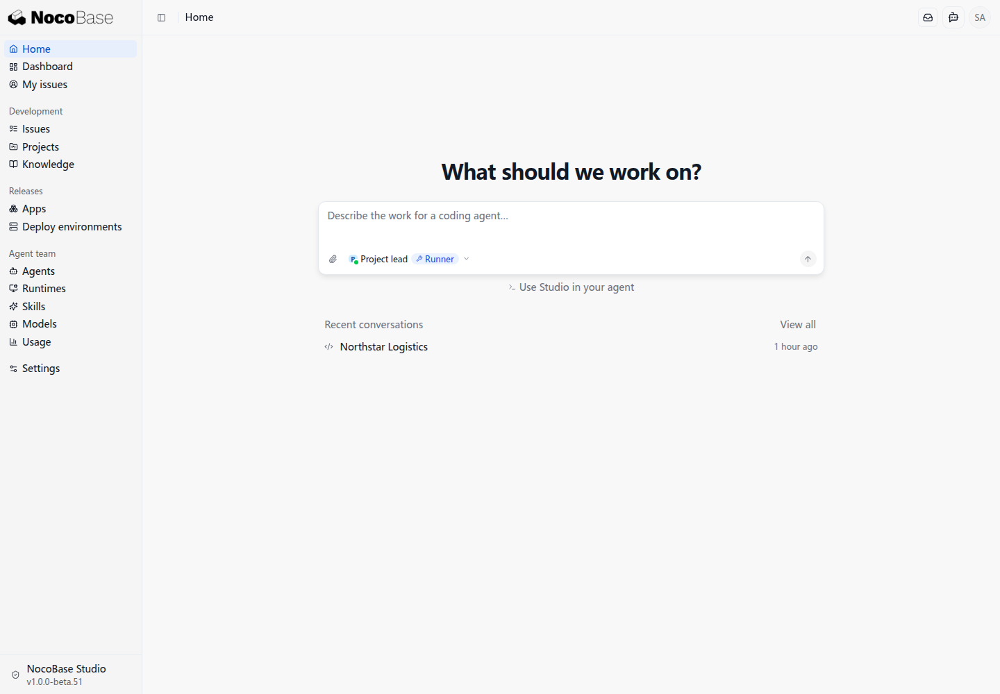
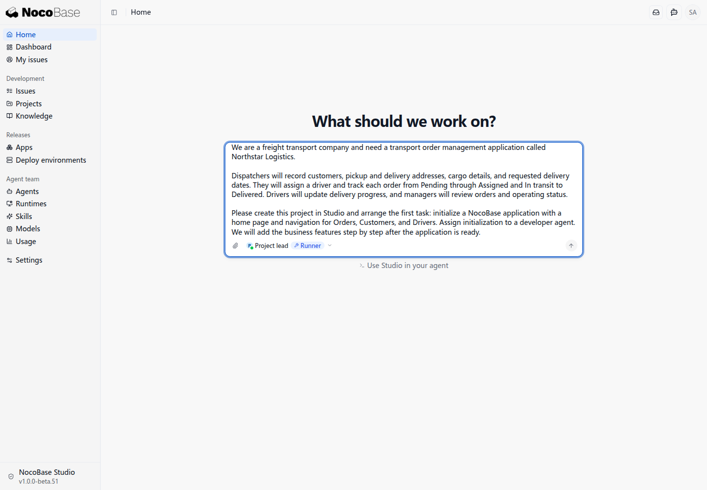
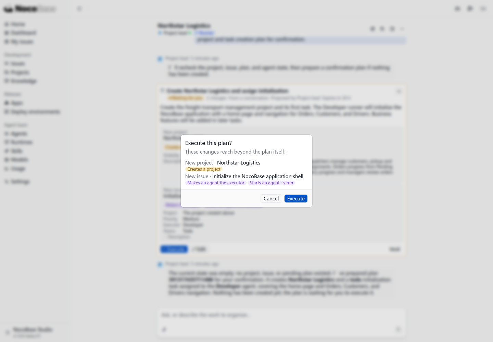
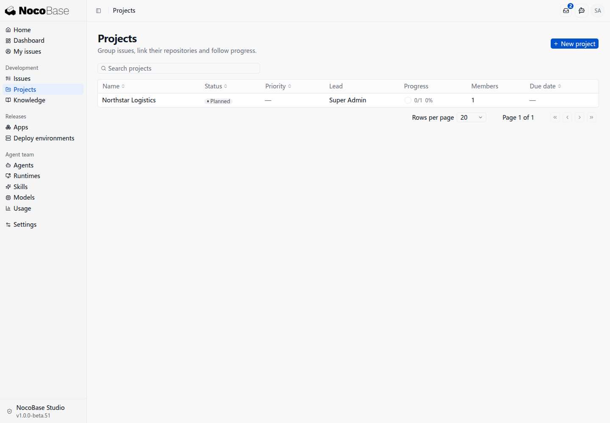

# 本轮待确认问题

> 此页仅供本地文档审阅，不作为发布稿。记录真实搭建遇到的问题，确认后再整理到正式操作说明。

<details>
<summary>项目主管未获创建项目权限（已修改）</summary>

**状态：已修改。**

2026-10-10 用户确认线上已修复项目主管缺少创建项目权限的问题。本轮按用户要求未拉取最新代码，未重新验证线上行为；以下保留此前问题与排查过程。

首页已接入 Runner，项目主管显示可用。发送“创建 Northstar Logistics 项目，并安排开发 Agent 初始化应用”后，项目主管回复：Studio 拒绝创建计划，当前账号不能创建项目，因此没有创建项目或初始化任务。

核对结果：登录账号 Super Admin 持有 `pm.projects/create`；内置项目主管的动作列表含查看项目、创建和编辑任务，但没有 `pm.projects/create`。当前证据指向 Agent 自身的权限配置，回复却把问题描述为用户账号权限，容易让用户去修改错误的对象。

为继续这次演示，已在本地给项目主管补充 `pm.projects/create`，没有修改上游源码。首次失败发生在 Studio `73c77a5`、Core `53e0b28dc7`；重启后 Studio 同步至 `8ab0d29`，该更新未修改这项内置角色权限。

原待确认事项已随线上修复关闭；具体修复提交与实现细节本轮未核对。

</details>

## “在线”类型容易误认为连接成功

**状态：待确认文案。**

未配置模型服务时，项目助理仍显示“在线”类型标签，同时实际可用状态为“模型不可用”。建议把类型表达为“在线模型”或“服务端 Agent”，与连接/可用状态区分。当前上手稿已解释区别，不把它写成已可对话。

## 创建项目后，应用初始化停在仓库准备

**状态：待讨论流程，已暂停继续搭建。**

用户提出运输订单系统需求，要求创建项目、初始化 NocoBase 应用并提供首页和订单、客户、司机导航。项目主管生成计划，用户授权执行后，Northstar Logistics 项目和 PM-1 初始化任务已创建，任务分配 Developer 并触发运行。

Developer 检查后发现项目没有关联代码仓库，运行目录只有 Runner 支持文件，没有应用源码或 Git checkout。它在任务中要求提供或关联仓库，并将任务转入 Analysis；随后 Solution designer 运行，任务最终为 Blocked。没有创建应用代码、分支或 PR，应用初始化尚未完成。

**流程缺口：**用户已经明确“从零创建项目并初始化应用”，当前计划却只创建项目记录和普通开发任务，未包含仓库准备及应用初始化的完整前置链。系统在分配和启动 Developer 后才暴露缺口，用户需返回准备仓库，打断上手流程。此处不能直接归结为用户漏做准备，也不能据此认定产品必须要求用户先建仓库。

**待讨论：**

- 新建应用是否应由 Studio 的专用初始化流程完成仓库创建或选择、默认模板初始化，再交给开发 Agent？
- 如果仓库必须由用户提供，应在哪一步明确说明并收集信息，避免普通开发任务启动后才失败？
- 项目主管的首个计划是否应区分“创建 Studio 项目记录”“初始化应用”“后续开发”，并显示各步需要用户确认的内容？
- 暂未配置 Git 连接时，应引导用户接入，还是支持先在本地初始化、之后关联仓库？这属于待确认产品方向，尚未验证。

本轮真实截图：执行确认、计划执行结果、项目列表、任务阻塞状态与详情，原件保存在本任务 references/studio-2026-10-10。此前讨论时任务暂停接续，尚未创建外部仓库。2026-10-10 用户随后授权创建私有仓库 `Charls-Wu/northstar-logistics`，已克隆到独立本地目录；尚未关联 Studio 代码位置或重试开发任务。

### 建议：先选择代码工作位置，再初始化应用

**性质：流程改进建议，尚未实施。**

当前源码已有新建远程仓库、关联现有仓库、指定 Runner 本地目录的初始化入口。本地目录可配初始化提示词，不应把 GitHub 当作首次开发的必需条件。已有仓库也可通过 clone URL 提供；GitHub 是当前内置代码托管平台连接，不等于所有代码位置都必须是 GitHub。上述入口已核对源码，本轮尚未实测本地初始化。

建议流程为：业务需求 → 确认新建应用或已有应用 → 选择本地目录或远程仓库 → 确认创建及初始化计划 → 完成工作位置与基础应用初始化 → 派发业务开发任务。仓库或目录应在开发任务派发前准备好，不要求用户在描述需求前自行创建 GitHub 仓库。

本地上手时先选择 Runner 和用户确认的目录，初始化应用；本地 Git 的建立可作为初始化步骤，是否强制要求需要结合后续版本管理流程确认。需要远程协作、PR 或远程 CI 时，再配置远程仓库及连接。初始化属于专门阶段，不由普通开发任务启动后临时追问前置条件。

### 项目主管提示词需要改进

当前 `PROJECT_LEAD_INSTRUCTIONS` 主要围绕已有任务的读取、拆分、分配和推进，没有明确规定从零创建应用时应先选择工作位置、走初始化流程，再派发开发任务。建议补充以下行为要求：

- 先区分“从零创建应用”和“修改已有应用”；无任务、无项目的首页对话也是有效起点。
- 新应用先询问或确认本地 Runner 目录、已有仓库或新仓库，不把 GitHub 设为默认必需前置；路径、远程位置和可见性不自行猜测。
- 查看当前可用命令与权限，优先使用带工作位置和初始化阶段的专用项目流程，而非只创建项目记录和普通开发任务。
- 将代码位置、应用初始化和首个业务目标纳入可审阅计划；实际运行、目录写入、仓库创建等按用户授权确认。
- 确认工作位置存在、初始化完成及源码可用后，才唤起业务开发 Agent；准备失败时停在初始化阶段，说明缺少什么，避免反复启动无源码的任务。
- 清楚区分用户账号权限、Agent 动作权限与 Runner 可用状态，拒绝原因不能一律归因于用户账号。

不能仅依靠提示词：还应核对 Agent 可见命令与动作权限、专用初始化入口是否允许该身份调用，以及普通开发任务在派发前是否检查代码位置。当前源码已有 `project setup create` 和 `project location add` 的 CLI 声明，但项目主管实际可调用范围、操作计划对这些步骤的支持尚未验证。因此先记录为提示词与流程能力共同检查的改进项，不宣称改提示词就能解决。

## 本地 Studio 的 GitHub CI 接入缺少公网地址

**状态：接入前置条件待准备，尚未实测 CI。**

当前 Studio 只在本机访问。GitHub 的 Webhook 投递和 GitHub 托管 Actions 对 Studio API 的访问都需要可达地址；没有公网入口时，这两条连接无法建立，后续构建状态回传及部署流程受阻。该问题不阻塞先在本地初始化应用。用户确认隧道到 CI 阶段再开启。

### 配置建议

本例创建了项目和任务，但未关联代码位置，开发 Agent 无法取得应用源码，初始化任务停在 **Blocked**。执行会唤起开发 Agent 的计划前，应先完成以下准备：

1. **准备代码仓库或本地目录。** 新应用需要明确源码保存位置。使用 GitHub 时，先在自己的账号下创建专用仓库；本地开发也可以使用 Runner 可访问的目录。仓库已有初始提交不代表 NocoBase 应用已初始化。
2. **在 Studio 项目中添加代码位置。** 关联仓库与分支，或指定 Runner 和本地目录。私有仓库须准备读取和推送权限，确认执行任务的 Runner 能访问该代码位置。
3. **安排应用初始化。** 在项目初始化配置中填写初始化要求，先生成应用源码、安装依赖并确认应用可以启动，再安排首页、导航和业务功能开发。不要在代码位置尚未准备好时直接启动功能开发任务。

**接入 GitHub CI 时，还需要完成以下配置，再启用自动构建和部署：**

- **Studio 公网地址：** GitHub Webhook 和 GitHub 托管的 Actions 都需要访问 Studio。本地 Studio 可在此时通过固定 HTTPS 地址的隧道开放访问，并将 Studio 的公开地址配置为该地址；此前的本地初始化无需提前开启隧道。
- **GitHub 连接与 Webhook：** 在 Studio 的 Git 设置中配置 GitHub App 连接并授权目标仓库。将对应连接的 Webhook 接收地址填入 GitHub App 的 Webhook URL，并在两端配置一致的 Webhook secret。若采用仓库级 Webhook，则使用该仓库对应的接收地址和 secret。接收地址由实际连接或仓库决定，不使用示例 ID。
- **Actions 凭据与工作流：** 使用 Studio 的 CI 配置为仓库生成部署所需的 API key，将其保存为 GitHub Actions secret **`NB_STUDIO_API_KEY`**；工作流中的 **`NB_STUDIO_URL`** 使用 Actions 可访问的 Studio 地址（本例包含 `/main`）。将生成的工作流保存到 `.github/workflows/`，核对触发分支和部署环境后再启用。Webhook secret 与 Actions API key 分别配置。

当前演示已关联本地代码位置，应用初始化与 CI 接入尚未完成。

## Developer 缺少 NocoBase 3 初始化指引

**状态：本次运行已确认，本地已补充任务说明。**

补齐代码位置后，Developer 能识别本地仓库，但仓库只有初始 README，没有应用源码及生成应用自带的 Skills。该次运行只加载 `nb-studio-cli`，它负责 Studio 项目和任务操作，不包含应用脚手架指引；任务原描述也未明确 NocoBase 3 的初始化步骤。Agent 搜索旧官网返回空结果后，自行使用 `yarn create nocobase-app . -d postgres`。没有证据说明旧命令来自该 Skill 或实际读到的网页。

源码中的专用 NocoBase 初始化流程已有正确指引：Node.js 24+、pnpm 11，以及 `pnpm create @nocobase/app northstar-logistics --template default --json`。生成器要求新的空目标目录，因此需要先生成应用，再将源码放入已有 Git 仓库。普通开发任务没有自动取得这些指引，形成了新应用初始化与后续开发之间的衔接缺口。

**建议：**从零创建应用时，由专用初始化流程提供版本明确的命令、前置条件和失败处理，或为执行 Agent 配备相应初始化 Skill，不让普通 Developer 自行猜测安装方式。本地已将正确步骤补到原 PM-1；这不代表默认流程已修复。

## Runner 默认策略拒绝下载执行初始化脚手架

**状态：默认策略与实测拒绝已确认，本地已补精确白名单。**

Developer 的原 `toolPolicy` 为 null，使用产品的 `DEFAULT_TOOL_POLICY`。普通命令白名单允许 pnpm、yarn 等工具，但未配置 `allowedDownloads`；Runner 对 `pnpm create`、`yarn create`、`pnpm dlx` 等下载外部代码并立即执行的命令另行检查，默认拒绝。这个默认行为不是本轮安装 Runner 时额外加的限制，也不等于所有 npm 依赖安装均被禁止。

本轮不仅旧版命令被拒，补充正确的 NocoBase 3 命令后也发生拒绝。当前版本的专用初始化说明提供了脚手架命令，但运行领取路径仍合并 Agent 默认工具策略，未发现按初始化任务自动增加下载授权的逻辑；尚未实测所有专用初始化入口，不将源码分析扩大为所有版本的运行结论。

**影响与建议：**默认 Developer 无法直接执行该脚手架来初始化新应用。初始化流程应同时准备正确指引和明确授权范围，并在启动前检查，避免任务运行后才暴露缺口。本地仅放行本例官方脚手架命令，保留其他默认限制。首次精确规则遗漏 `NODE_OPTIONS` 内存参数前缀，导致重试仍被拒；该本地规则随后已修正，不把这一配置失误归为产品缺陷。

### 本轮临时处理与验证进度

以下是演示环境的实际补充，不代表产品默认流程已修复。

1. 创建专用 Git 仓库，将本地 checkout 关联到项目的 Runner 代码位置；在原 PM-1 中补充目录信息，继续原任务。运行记录确认 Runner 已在该目录执行。
2. 在任务说明中补充 NocoBase 3 官方初始化命令、Node.js/pnpm 前置版本、空目录要求和默认 SQLite 方案，由 Developer 在 Runner 上执行。
3. 为本地 Developer 的 `allowedDownloads` 添加仅匹配本例官方脚手架的规则，同时保留其他默认权限检查。修正规则的内存参数前缀及正则转义问题后，用 Runner 的实际策略函数验证：本例命令允许，其他脚手架下载仍拒绝。后续运行确认正确命令已真正执行。
4. 执行随后暴露 pnpm 在隔离 HOME 中创建 dlx 缓存失败。任务已补充仓库内可写 `XDG_CACHE_HOME` 路径，并为带该缓存路径和内存参数的精确命令追加许可，再交 Runner 重试。

5. 使用仓库内 pnpm 缓存后，官方脚手架已实际执行，但模板下载两次返回 `TEMPLATE_DOWNLOAD_FAILED`。模板版本查询正常；生成器内部调用 `npm pack --silent`，底层错误未完整呈现。已补充仓库内 `npm_config_cache` 路径交 Runner 排查，这一处理的最终结果仍待确认。

**后续验证结果：**2026-10-10 的 Runner 运行 `391364430790660` 同时设置仓库内 `XDG_CACHE_HOME` 和 `npm_config_cache`，成功下载默认模板并安装依赖；随后执行 `pnpm nocobase config init --json`，默认 SQLite 配置成功。Developer 完成首页和 Orders、Customers、Drivers 导航，提交至本地 `agent-pm-1` 分支，提交 `035df70`。运行记录与任务报告显示应用启动成功，相关检查通过。初始化阻塞已在这次演示中解除；这些本地补充不代表默认流程已修复。

**当前剩余阻塞：**Runner 无可用 GitHub 推送凭据，分支尚未推送；Studio 仅关联本地目录，未通过 Git 连接关联仓库，创建 PR 返回 `NO_REPOSITORY`。尚无应用 PR，后续处理推送凭据与 Studio 仓库连接。

## GitHub App 注册被 localhost Hook URL 阻塞

**状态：已复现，未解决。** 2026-10-10，在本地 Studio 的 Settings → Git 中选择 Add connection → GitHub → My account → Create on GitHub 后，GitHub 显示 `Invalid GitHub App configuration`，并报告 `Hook url is not supported because it isn't reachable over the public Internet (localhost)` 和 `Hook is invalid`。App 注册未完成，尚未进入安装及仓库授权。


**源码事实：** 本轮隔离 Studio 的 `server/git/github.ts` 中，`buildAppManifest` 在 Webhook 关闭时仍生成 `hook_attributes: { url: input.webhookUrl, active: input.webhookActive }`，保留 localhost URL。界面提示关闭 Webhook 后使用轮询，但用户实际注册仍被 GitHub 的 URL 校验拒绝。不能将界面提示当作已验证的本地注册能力。

**影响与区别：** 这是当前 GitHub App 注册阶段的阻塞，与前面后续 CI 无公网访问入口的限制分开记录。此前“隧道到 CI 阶段再开”的安排未覆盖这一实际注册问题。

**后续处理：** 可评估修正注册配置，或提前配置公网地址后重新注册；本轮尚未修改 Studio 源码、开启隧道或完成授权，不宣称已解决。

**2026-10-11 隧道处理进度：**用户选择临时隧道，已开启 Cloudflare Quick Tunnel，并将隔离 Studio 的 APP_PUBLIC_ORIGIN 更新为公网地址。入口返回200，真实 UI 生成清单的 Hook URL、redirect_url 和 callback_urls 均为公网 HTTPS，Webhook active=true。浏览器已跳转 GitHub 登录页，注册接受、安装授权与 Runner 推送仍未验证；本项不能标记已解决。

**2026-10-11 注册回调认证失败：**用户最终填写 App 名称 `Demo Northstar Studio`，点击创建后收到401 `UNAUTHENTICATED / AUTHENTICATION_REQUIRED`。源码中的 `/oauth/git/manifest` 和 `/oauth/git/setup` 回调均要求 Studio 登录。当前从 localhost 发起、回调转向隧道域名，两个域名的登录 Cookie 不共享；这与报错一致，但尚未通过用户浏览器确认具体失败 URL。先在同一浏览器的新标签登录公网 Studio，再返回原回调页重试；不要立即重新注册同名 App。App 是否已注册、回调临时代码是否仍有效、安装授权是否完成均待核实。当前停在此处。

### 本地创建项目时连接 GitHub：三种方案待讨论

以下为当前可讨论的三种接入方案，不代表均已实测通过。GitHub App 的自动注册和手动注册使用同一种连接，区别在于注册配置过程。

| 方案                              | 配置方式                                                                                  | Runner 的 Git 推送凭据                                                               | 当前问题与验证状态                                                                                                          |
| --------------------------------- | ----------------------------------------------------------------------------------------- | ------------------------------------------------------------------------------------ | --------------------------------------------------------------------------------------------------------------------------- |
| GitHub App 自动注册＋临时隧道     | 先配置隧道及 Studio 公网地址，再通过 Create on GitHub 注册、安装 App，仅授权目标仓库      | 按当前源码，项目关联 App 连接下的仓库后，Studio 为运行提供短期仓库推送凭据           | localhost 自动注册已失败；通过隧道重新注册预计可避开该 URL 问题，但尚未实测，不保证后续全部走通                             |
| GitHub App 手动注册，关闭 Webhook | 在 GitHub 手动注册 App、关闭 Webhook、安装并授权仓库，再在 Studio 的已有 App 入口填写配置 | 按当前源码，完成 App 连接及仓库关联后，与自动注册方式使用同一凭据下发机制            | 无需依赖 Webhook 公网投递，但需要手动配置权限及 App 凭据；本轮尚未实测完整流程                                              |
| GitHub Token 连接                 | 在 GitHub 生成个人访问令牌，在 Studio 选择 Use a token instead 并填写                     | 当前源码不会通过这条连接自动下发 Runner 推送凭据，Runner 依赖其运行环境中的 Git 凭据 | Studio Token 连接尚未实测；本机已有 gh 登录，但此前 Runner 推送仍失败。宿主机凭据能否被隔离环境复用、如何配置，仍待开发确认 |

**Token 判断的来源：** 本轮使用的隔离 Studio 提交为 `8ab0d2914e6187ceb649cf585f9b0b5944f131ef`，未为此更新代码。`server/git/connections.ts` 的 `pushCredential` 在连接类型不是 `app` 时直接返回 `null`；`server/git/run-git.ts` 只将非空凭据交给 Runner，文件注释也说明 Token 连接依赖运行机器已有凭据。这是当前本地版本中“Studio 不通过 Token 连接自动下发推送凭据”的源码结论，不等于 Runner 在所有环境都无法使用 Token，也不是已实测的 Token 连接失败。

**已有运行结果的范围：** 此前失败发生在项目只关联本地目录、没有 GitHub 连接的情况下，不能作为 Token 连接已配置后仍失败的证据。本机 gh 已登录也不代表 Runner 隔离环境能够取得相同凭据；具体原因尚未查明。当前未确认 Runner 有独立 Git 凭据配置网页。

**与开发讨论：** 本地 Studio 推荐采用哪一种方案？关闭 Webhook 的自动注册配置应如何修正？Token 连接不下发 Runner 凭据是否为预期设计，用户应在哪里配置？Runner 是否支持复用宿主机 gh 登录，隔离环境的正确配置方法是什么？讨论确认前保持当前阻塞，不切换方案或继续开发任务。

<details>
<summary>此前通过项目主管创建项目的演示（历史记录）</summary>

# 创建第一个项目

以一家运输公司的订单管理应用为例，先创建项目并安排应用初始化。后续再逐步添加订单管理、文件上传、通知等业务功能。

:::danger 目前阻塞点

1. **首次开发前缺少仓库准备提示。** 任务已派发，才发现没有关联代码位置，初始化停在 **Blocked**。
2. **本地 Studio 缺少公网地址。** GitHub Webhook 和托管 Actions 无法访问本地 Studio，后续 CI 接入受阻。
3. **Developer 缺少 NocoBase 3 初始化指引。** 未提供对应初始化 Skill 或明确步骤，Agent 自行使用了旧版命令。
4. **Runner 默认拒绝下载执行脚手架。** 即使补充正确命令，初始化仍被权限策略阻止，需要额外配置。
5. **本地 Studio 无法完成 GitHub App 注册。** 注册配置仍包含 localhost Hook URL，被 GitHub 拒绝，仓库授权无法继续。

这些问题打断了从本地启动、应用初始化到 CI 接入的流程。详细配置与流程改进建议见[本轮待确认问题](./review-notes)。

:::

:::warning 本地补充后继续演示

本轮在本地补建了演示 Git 仓库，并将仓库目录关联到项目的 Runner 代码位置，补充了原初始化任务所需的信息。接下来继续原任务 PM-1，由开发 Agent 初始化应用。GitHub CI 和 Webhook 尚未接入，公网隧道留到 CI 阶段配置。

:::

## 选择项目主管

在首页的 Agent 选择器中，选择 **Project lead（项目主管）**。它通过 Runner 运行；接入本地 Codex 后，无需在线模型服务即可对话。



## 描述业务背景和第一步目标

先说明业务由谁使用、处理什么，再提出当前要完成的任务。可以使用下面的提示词：

```text
我们是一家货物运输公司，需要搭建一个名为 Northstar Logistics 的运输订单管理应用。

调度员登记客户、取货和送货地址、货物信息及要求的交付日期，为订单分配司机，并跟踪待处理、已分配、运输中、已送达的状态。司机更新配送进度，管理人员查看订单和运营情况。

请在 Studio 中创建这个项目，并安排第一个任务：初始化一个 NocoBase 应用，提供首页以及订单、客户、司机的导航。将初始化任务分配给开发 Agent。应用准备好后，我们再逐步添加业务功能。
```

将提示词输入首页对话框，确认当前选择的是项目主管，再发送。



## 查看项目主管的回复

项目主管会检查现有项目、任务和可用 Agent，再生成操作计划。本例的计划包含两项操作：

- 创建 **Northstar Logistics** 项目。
- 创建应用初始化任务，分配给 **Developer**，提供首页以及 Orders、Customers、Drivers 导航。


核对计划中的项目、任务和执行 Agent，点击 **Execute（执行）** 确认。计划中标记的 **Wakes Developer（唤起开发 Agent）** 表示执行后会触发开发 Agent 处理任务。

确认弹窗会列出创建项目和启动 Agent 的影响。核对后，点击 **Execute** 执行。



执行后，在 **Projects（项目）** 列表中可以看到 Northstar Logistics。打开项目的 **Issues（任务）**，可以查看初始化任务 PM-1 及执行状态。



</details>

**2026-10-11 连接与仓库关联已完成：**CLI核实 Demo Northstar Studio 为App连接、安装完成、无缺失权限，真实页面显示Connected，授权仓库数量1；已通过连接读取目标私有仓库。随后在现有项目 Working directories 添加该授权仓库，保留本地目录为Primary及提交035df70，不新建初始化任务。此前401后用户已进入安装页并完成授权，完整恢复操作以用户浏览器为准。临时隧道已使本轮注册安装走通，默认localhost注册缺陷不标记产品已修复。Runner推送/PR和CI尚未验证。

## 新初始化任务执行后，应用访问地址未持续可用

**2026-10-11 实测：**新任务 PM-2（391445863202816）通过 New issue → Manual → Create → Start now? → Start 下发 Developer，Runner运行391445863202818于00:52:16 UTC开始、00:53:11 UTC完成。复用已有应用，无需脚手架，未推送或开PR。执行 pnpm dev 时限制端口14200和Node堆1536MiB，启动日志就绪。Agent 的独立curl检查被命令策略拒绝，但启动过程本身成功；Agent报告进程保留运行。

**后续检查：**运行结束后，宿主机访问14200返回连接失败、没有监听端口。当前证据不足以断言停止的具体原因，不能把“进程保留运行”报告作为实际持续可用结论。任务仍in_progress。已记录任务表单、启动确认、运行中及执行报告四张截图；缺少应用结果截图。按用户“失败就停下讨论”要求，未自行启动宿主机服务、改变权限、继续业务任务或补推送PR。

## 首次 CI：配置已生成，空仓库构建失败

2026-10-11 实测：Studio 的 Write workflow 创建配置 PR #1，并保存托管凭据。Actions run 38100361767 成功安装 nb-studio、登录 Studio，并回传 building 和 failed 状态；随后 pnpm/action-setup@v4 报 No pnpm version is specified。远程仓库尚无应用 package.json，工作流也未显式指定 pnpm version。后续依赖安装、构建、部署均跳过。这里不能归因于隧道或 GitHub 登录失败，也不能宣称 Preview 已可用。按用户要求暂停，未合入配置 PR、未补版本重跑；需要讨论在提前配置 CI 的流程中，如何衔接初始化代码提交与首次构建。

2026-10-11 后续确认：用户确认先配置 CI 时缺应用代码导致的首次失败属于此阶段预期，正文改为黄色说明。配置 PR #1 已合入；PM-3 由 Runner 成功推送初始化代码到 agent/PM-3，并通过 Studio 创建应用 PR #2。run 391447691919362 completed；新的 Actions run 38100771650 已通过 pnpm 配置和依赖安装，进入应用构建。尚未验证 Preview 部署成功。

2026-10-11 Preview 部署阶段：Actions run 38100771650 的应用构建和 app ensure 成功；部署包上传请求 POST /main/api/builds/391447947771904/uploadArtifact 从 01:10:44 至 01:12:51 UTC 后返回 HTTP 524。当前 Preview waiting，无 URL、releaseId 或 deploymentId。仅确认上传请求失败，超时发生的具体环节尚未核实；未重试或调整隧道。

## 本地补充上传并查看 Preview

::: warning 本例的本地网络补充

标准工作流由 GitHub Actions 自动构建并上传部署包。本轮公网上传遇到超时，因此改为让 CI 保存构建产物，再下载到本机，通过 localhost 调用 Studio 部署接口。此处上传由本机补充执行，不能把本次演示写成全程自动部署；Webhook 不负责传输应用包。

:::

在工作流中用 **actions/upload-artifact** 保存 `storage/exports/dist.tar.gz`。本例产物名为 `northstar-preview-package`。CI 成功后，用本机已登录的 GitHub CLI 下载：

```bash
gh run download <运行编号> --repo <账号>/<仓库> -n northstar-preview-package -D <本地下载目录>
```

通过已连接本地 Studio 的 CLI 上传并请求部署，无需另起 HTTP 服务：

```bash
nb-studio deploy --app northstar-logistics-pr-2 --repository <账号>/<仓库> --sha <构建对应的完整提交> --file <本地下载目录>/dist.tar.gz
```

`--sha` 必须与构建包对应的提交一致。本轮约 82 MB 的包已通过本地接口上传成功；Studio 先登记 release，再展开应用并初始化，Preview 从 **Deploying** 变为 **Ready**。


在任务的 **Code and deployments** 中展开 PR，打开 Preview 访问入口。本轮入口已返回 HTTP 200，应用预览地址为 `http://localhost:14100/northstar-logistics-pr-2/`。应用 PR 尚未合入。

2026-10-11 结果补充：公网 IP HTTP 转发的 Actions run 38101994173 构建成功，但上传约 329 秒后返回 HTTP 408；具体超时环节未确认。改为保存 artifact 后，run 38102660812 成功；本机下载实际提交 4a0c6f7c352ed02cf63722cc636cb44587fd9903 对应的 82,076,714 字节部署包，通过本机 CLI 上传。Studio 构建记录 succeeded，Preview 已 Ready，本地访问返回 HTTP 200。此结果验证构建、包接收和部署，不代表云端自动上传问题已解决。
