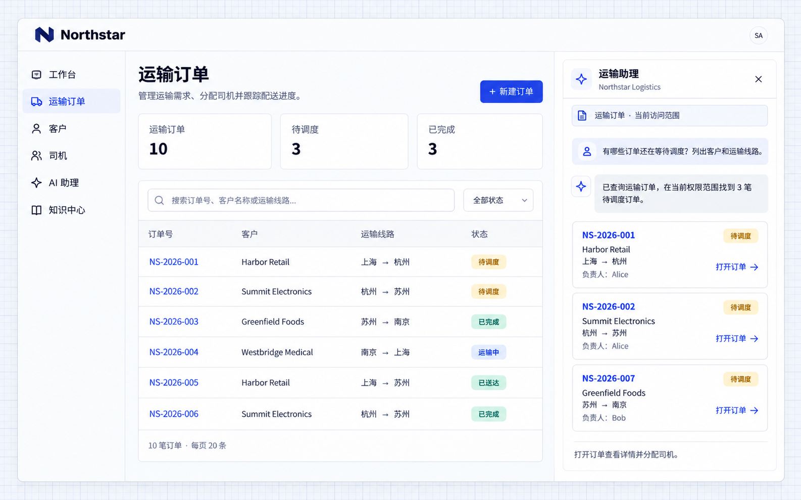

# Business queries

An AI employee can translate a natural-language question into an authorized business query, organize the records and provide page links. Connected reading actions supply current business data rather than only general advice.

## Example: find orders awaiting dispatch

```text
Connect order queries to Northstar's Transport assistant.
Let employees ask for orders awaiting dispatch or filter by customer, stage or route.
Respect the current user's data access. Return the order number, customer, route and owner as cards that open order details.
Explain when there are no matching orders in the user's scope. Continue follow-up questions with the selected order's context.
```

## View the result

Open the assistant on the order list and ask:

```text
Which orders are awaiting dispatch? Show their customers and routes.
```

The cards group the order number, customer, route and owner. **NS-2026-001, NS-2026-002 and NS-2026-007** are awaiting dispatch in this example; users can select an order to open its details.



**Query results connect to order pages so users can continue handling a record.**

## Extend queries to actions

Ask the development Agent to connect a specific action, such as assigning a driver, creating a follow-up or preparing a notification. Define its inputs, permissions, confirmation and where users see the result.

Queries, advice and writes are different operations. Advice alone does not change a record. A connected write should display its actual outcome and processing record.
