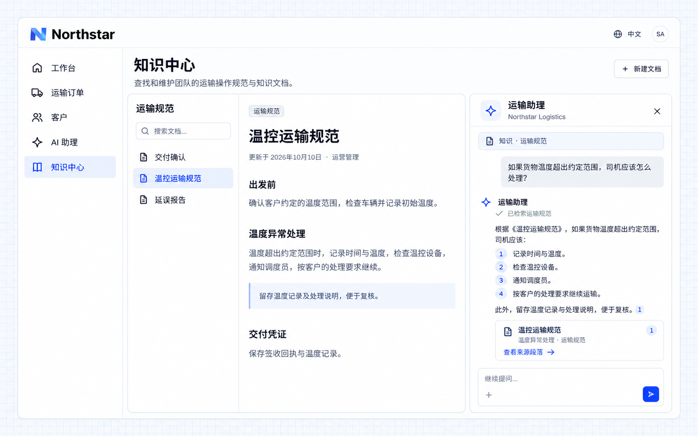

# Knowledge-based answers

Company rules often live in documents. An AI employee can find accessible material, organize an answer around the question and provide sources for users to check and read further.

## Example: find transport exception procedures

```text
Let Northstar's Transport assistant use the transport procedures space.
Retrieve relevant material before answering procedural questions. Include document and passage links.
Say when no supporting material was found; do not invent company rules.
Provide a conversation panel in the knowledge center with the original text visible beside the answer.
Respect the knowledge scopes available to the current user and assistant, including restricted finance material.
```

## View the result

Open **Temperature-controlled transport** in the knowledge center and ask:

```text
What should the driver do if the shipment temperature is outside the agreed range?
```

The document stays on the left. The answer organizes recording the time and temperature, checking equipment, informing dispatch and following customer instructions. A source card links to **Handling temperature deviations**.



**Answers connect to company material so users can check the applicable requirements.**

:::tip Important

Knowledge explains how to handle a situation; business queries supply current facts. Maintain current material and its access rules. Advice from a document does not automatically become an executed business action.

:::
