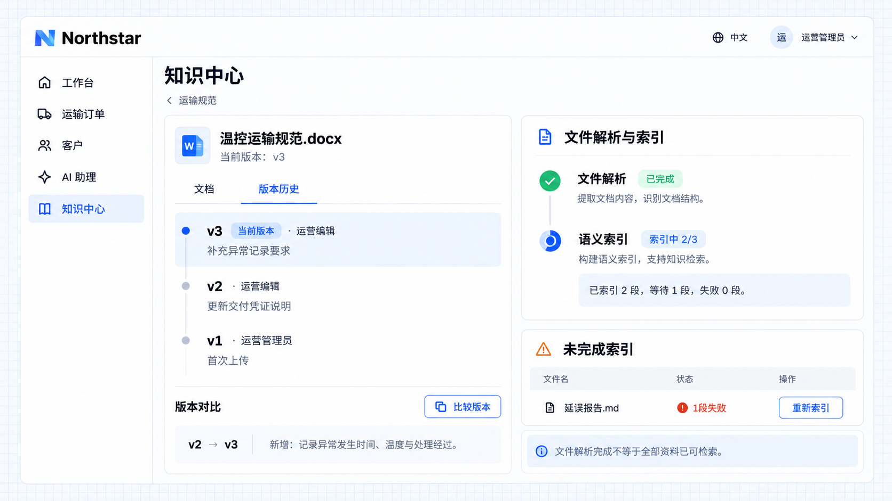

# Versions and processing status

Article and file updates retain version history so you can inspect previous content and compare changes. Extracting text from an uploaded file and building an index for semantic retrieval are separate stages: parsing completion means text has been extracted, while indexing status describes processing of the current document's sections.

## Example: update temperature-controlled transport guidelines

Northstar's operations editor adds deviation recording requirements to the guidelines. An operations administrator needs to compare versions, inspect file parsing and semantic indexing progress, and identify materials whose indexing is unfinished.

```text
Show version history and comparisons for the temperature-controlled transport guidelines in Northstar's knowledge center.
In the transport guidelines space with semantic retrieval enabled, show file parsing status, section indexing progress, and materials with unfinished indexing separately.
Show reasons and a reindex action for indexing failures. Do not display one parsed file as proof that the entire knowledge base is searchable.
```

## See the result

Open the version history of **Temperature-controlled transport guidelines.docx** and compare v2 with the current v3. The update adds requirements to record the time, temperature, and handling of deviations. File parsing is complete, but only **2 of 3 sections** have been indexed, with one still waiting. The unfinished indexing list also shows a failed section in **Delay reporting.md** with a reindex action.



**Content changes remain traceable, parsing and indexing progress are visible separately, and maintainers can continue processing unfinished materials.**

:::tip Important

Semantic indexing status is available when the application integrates the relevant retrieval capability. Parsing one file or indexing one document does not mean all knowledge is available for answering questions. Answers still require suitable retrieved content and appropriate access. Version history does not imply automatic synchronization of external sources.

:::
