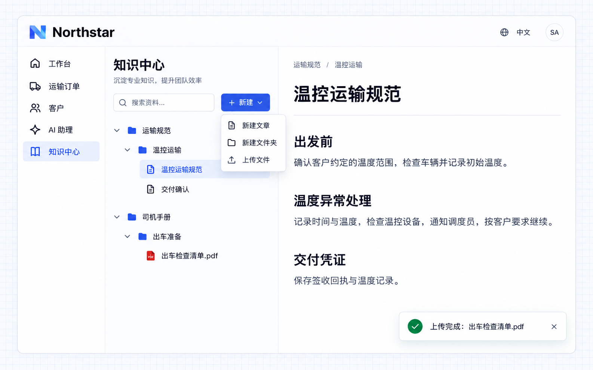

# Organize and import materials

A knowledge base separates materials by space and organizes articles and files in folders. Articles suit business guidance that needs regular maintenance; files let you import existing materials. Uploaded files provide an original-file preview and extracted text for reading and search.

## Example: transport standards and driver manuals

Northstar's operations team maintains temperature-controlled transport and delivery requirements, and needs to make an existing pre-departure checklist available to drivers. Separate spaces help employees find materials by purpose.

Give the requirement to an Agent:

```text
Organize two knowledge spaces in Northstar's knowledge center:
Transport standards and Driver manuals.
Under Transport standards, create a Temperature-controlled transport folder
with Temperature-controlled transport standards and Delivery confirmation articles.
The standards article should cover Before departure, Handling temperature deviations,
and Delivery evidence.
Under Driver manuals, create a Pre-departure preparation folder with a file upload entry.
I will upload the existing Pre-departure checklist.pdf; do not invent its contents.
Employees can open articles or files from the tree.
Editors can create articles and folders and upload files.
```



**Transport standards and driver manuals form a clear directory. Articles can be maintained directly, and existing PDFs can be placed in the appropriate folder for employees to read.**

:::tip Important

Maintaining materials requires editing permission. A successful upload and completed text extraction are separate states; confirm extraction has completed before searching file content. Organization and original-text reading work independently; semantic search requires a model and an index.

:::
