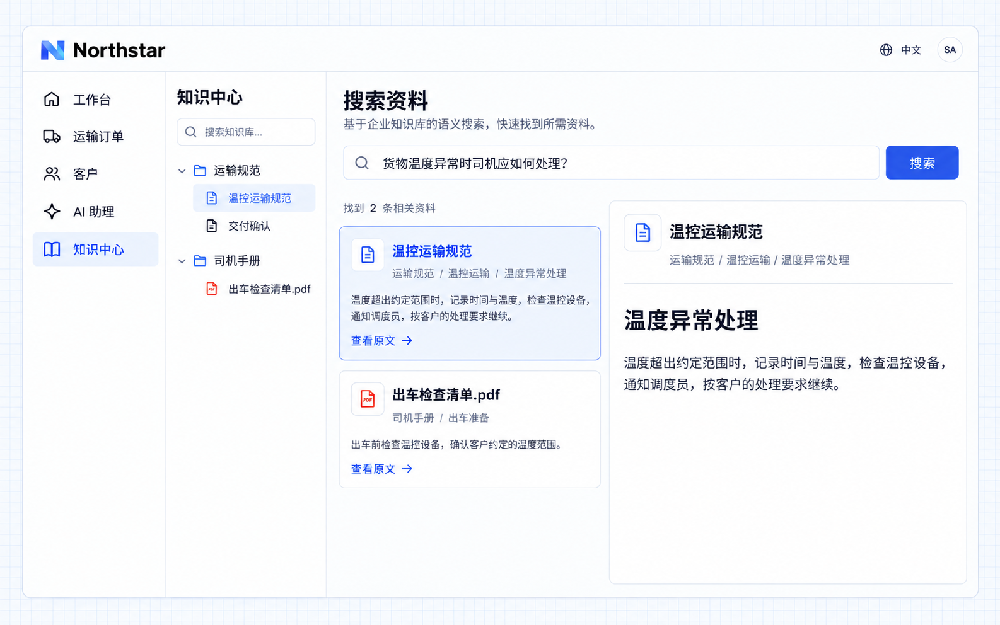

# Read and search

Employees can open articles or files from the knowledge tree to read original business guidance, or enter keywords to find relevant materials. Search results show document titles, sections, and excerpts so users can judge relevance and return to the original context.

Once the application connects semantic search, employees can describe their question in natural language and find related passages by meaning without knowing the exact wording.

## Example: finding temperature-deviation requirements

A Northstar driver needs to find the handling requirements for a temperature deviation and verify the original text. They can search for “temperature deviation” when they know the terminology, or ask “What should a driver do when the cargo temperature is abnormal?” when they do not.

Give the requirement to an Agent:

```text
Provide reading and search entries in Northstar's knowledge center.
Employees can search for "temperature deviation", see documents, sections
and excerpts, and open the original text.
Connect semantic search so "What should a driver do when the cargo temperature
is abnormal?" also finds Handling temperature deviations in the transport standards.
Show the source of each result and open the original text when selected.
Keep the current user's readable materials as the search scope.
Confirm the required model and index are available;
do not treat keyword search as enabled semantic search.
```



**With semantic search connected, a natural-language question finds relevant guidance. The document, section, and original passage provide evidence employees can check.**

:::tip Important

Keyword lookup is available directly. Semantic search requires the application to connect an appropriate model and a usable materials index. Finding relevant materials does not mean AI has composed an answer. For answers based on those materials, see [Answer questions using knowledge](./answers.md).

:::
