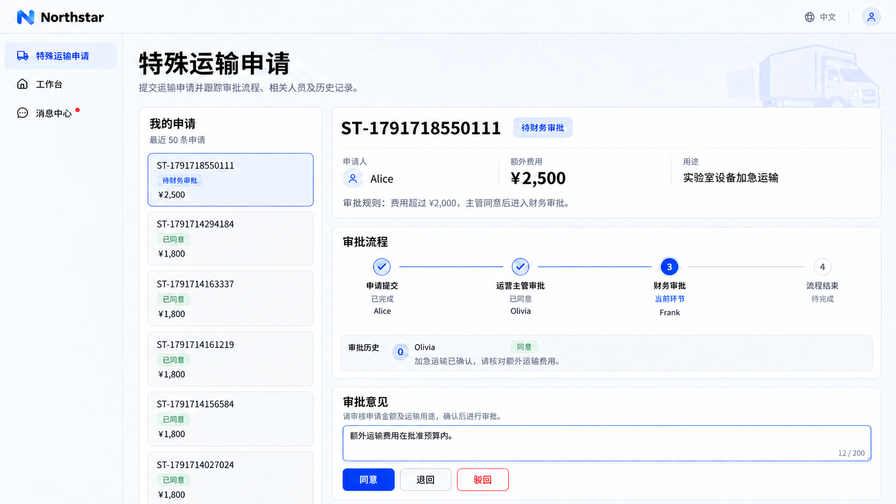

# Multiple stages and conditional routing

Requests can pass through several review stages in order, with different responsibilities at each stage. Conditions such as amount or request type determine whether another stage is included.

Reviewers may come from designated people, roles, departments or reporting relationships. Show an expected route before submission and determine actual reviewers on stage entry.

## Example: route according to transport fees

Northstar special transport fees of CNY 2,000 or less require operations review. Higher fees continue to finance after operations approves.

```text
Add approval to Northstar special transport requests with cargo details, reasons, extra fees and attachments.
Fees of CNY 2,000 or less need operations approval; higher fees continue to finance afterwards.
Preview the route and reviewers before submission; show the current stage, offered actions and opinions in details.
Retain the approval decision without automatically paying fees.
```

## View the result

Alice submits CNY 2,500 for urgent transport. It first reaches operations reviewer Olivia, who can inspect the purpose, fee and materials and provide a comment.


**The request first reaches operations review.**

After operations approves, the amount condition sends it to finance reviewer Frank, preserving the previous comment.



**Requests above CNY 2,000 continue to finance review.**

:::tip Important notes

Specify each stage’s inclusion conditions and reviewer sources. Missing reviewers should prompt assignment or prevent submission; missing people and deliberately skipping a stage are different cases.

:::
