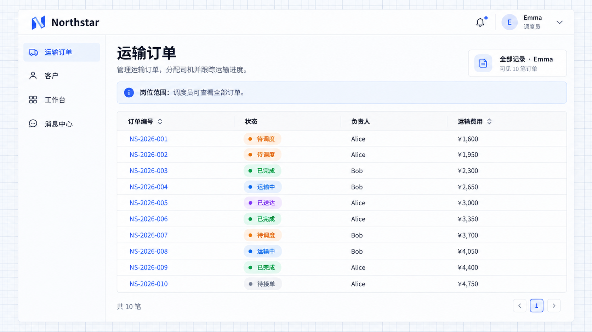

# Data scopes and rules

A data scope determines which records an action can access. Account managers view owned orders, while drivers view assigned tasks.

## Different ownership fields

Scope records by ownership, assignment or other business conditions. Users with the same action permission can still access different records according to their responsibilities.

```text
Allow account managers to view and edit orders using the owner field linked to the current user.
Allow drivers to view and handle tasks using the assigned driver's employee account.
Allow dispatchers to view all orders needed for coordination, with assignment subject to current order state.
Provide per-action scope choices in Team access and enforce consistent rules on lists, details, and mutations.
```

Define what “mine” means. Owner, creator, and driver may be different people; do not use creator ownership for every job.

| Scope               | Transport use                                |
| ------------------- | -------------------------------------------- |
| Owned by me         | Account manager follow-up                    |
| Assigned to me      | Driver tasks                                 |
| All records         | Dispatch coordination                        |
| Business conditions | Stage, region, or amount conditions          |
| Team or department  | Responsibilities backed by actual membership |

Viewing, editing, assigning, and approving each need their own actions and scopes. Server checks must also protect details and submitted actions, not just list filters.

[Default access](./default-access.md) adds a common scope, [sharing](./sharing-rules.md) adds selected records, and [restrictions](./restriction-rules.md) narrow the result. None replaces page and action permissions.

## Compare job scopes

Before adding common access, sharing or restrictions, Alice sees her six orders. Dispatcher Emma sees all ten orders in the same page. The server returns each employee’s authorized records.


**With only job scope, Alice sees her six orders.**



**Dispatcher Emma sees all ten orders.**

The following rules change visible records without changing their owner.
