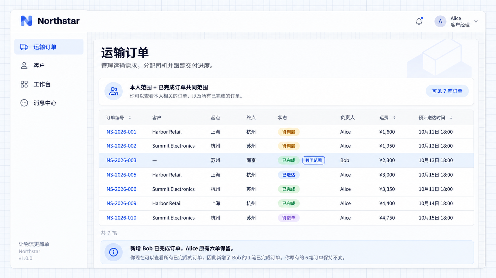

# Default data access

Default data access adds a shared record scope for people who already hold the action. Northstar account managers can use completed orders as operational references alongside their own work.

## Common reference orders

Users with an existing view permission may need a shared reference baseline. Default access adds common records to their existing scopes, such as completed or reference records.

```text
Keep account managers' owned-order viewing scope.
Add completed orders as a default viewing scope for everyone who already has View orders permission.
Let administrators save or remove the completed-order viewing rule in Access rules.
Add viewing only, not editing or transport actions on other people's orders.
```

Alice can view both owned orders and qualifying reference orders. Default scope is combined with existing scope by union rather than replacing it.

## It does not grant the action

People without View orders permission do not gain it from the default scope. Viewing completed records does not grant editing.

Configure each action separately within the resource's default rule. Use [sharing](./sharing-rules.md) for selected collaborators and [restrictions](./restriction-rules.md) for boundaries that apply across sources.

## Configure common access

Open **Access rules → Common access** and save the completed-order viewing rule. This example uses the order’s **Completed** state; excluding sensitive records would require an additional business field and condition.


**The saved common viewing rule covers completed transport orders.**

Alice now sees seven orders instead of six. **NS-2026-003** still belongs to Bob and is included because it is completed. Her existing orders remain visible.



**Alice sees seven orders, including Bob’s completed order.**
