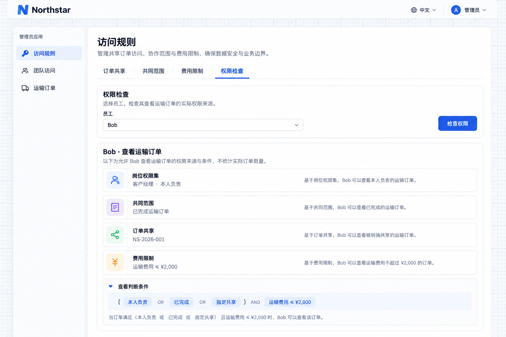

# Inspecting permissions

Permission inspection explains actions, conditions, and sources. It is not a count of actual accessible records.

## Why can Bob see this order?

When users gain additional access or cannot see a record, inspect the sources and conditions. Identify the job, sharing or restriction rule that needs adjustment.

```text
Provide permission inspection in Northstar Team access for authorized administrators only.
Select an employee and inspect pages, actions, record conditions, and sources from sets, assignments, default access, sharing, and restrictions.
Explain Bob's owned-order scope and temporary sharing of NS-2026-001 separately.
Do not present the inspection as an order count or let ordinary employees inspect other people's details.
```

Bob's result may combine owned orders, completed reference orders, and a shared record, narrowed by any applicable restriction.

| Desired change           | Configuration                     |
| ------------------------ | --------------------------------- |
| Job responsibilities     | Permission set                    |
| Who holds a job          | User or organizational assignment |
| Common references        | Default scope                     |
| Temporary collaboration  | Sharing                           |
| Common access boundaries | Restrictions                      |

Inspection explains the result; edit the corresponding configuration to change it. Select a user for that user's access. A team view describes assignments to the team, not every member's complete effective access.

Super administrators have unrestricted access. Use business employee accounts to demonstrate job differences and actual pages to see records; condition counts are not record counts.

## Inspect actual sources

Open **Access rules → Inspect access**, select Bob, then click **Inspect access**. The result shows his account manager job and applicable common access, order sharing and fee limits. Expand **View decision conditions** for the server’s conditions.



**The inspection lists the job and applicable common-access, sharing and restriction sources.**

His own scope, completed-order baseline and shared NS-2026-001 combine first. The 2,000 CNY transport fee limit then narrows the result. See the actual order list in [Restriction rules](./restriction-rules.md); this inspector does not count eligible records.
