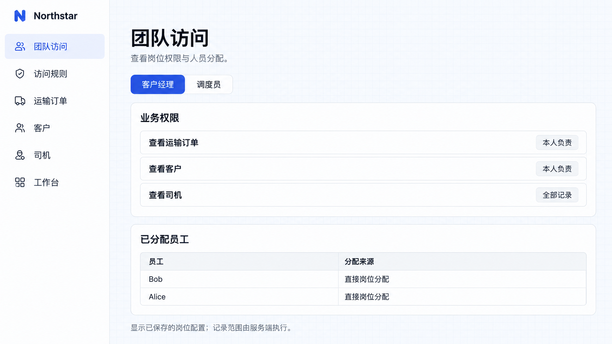

# Permission sets and assignments

Permission sets combine pages, actions, and data scopes into reusable jobs. Multiple account managers can share a set, and employees can hold several sets.

## Transport jobs

Group pages, actions and record scopes into permission sets for people with the same responsibilities. Reuse job configurations when staff join or change jobs.

```text
Create Northstar permission sets for account managers, dispatchers, and drivers.
Account managers enter customers and orders, create orders, and view or edit records they own.
Dispatchers enter the dispatch workspace, view transport orders, and assign drivers, but cannot maintain permissions.
Drivers view assigned tasks and accept, depart, and submit delivery evidence; they cannot change prices or reassign drivers.
Only authorized administrators maintain permission sets and assignments.
Provide job editing and assignments in Team access. Initially assign Alice and Bob as account managers, Emma as dispatcher, and Daniel as driver.
```

Organize editing around pages, actions, and scopes. Viewing and editing orders are separate actions; entering a page does not grant all actions within it.

## Assignment and reuse

Administrators review a job and assign employees. Alice and Bob share responsibilities but access their own records. Emma coordinates dispatch; Daniel handles assigned tasks.

An employee may hold multiple responsibilities. Removing one assignment may leave another direct or organizational source intact.

The default member set applies to signed-in users and suits common basic capabilities. Super administrators have unrestricted access and should not stand in for business employees in demonstrations.

Team and department assignments require real organizational membership. A department-name field alone does not establish permission inheritance.

## Job access in this example

Team access displays saved job permissions and employee assignments. The account manager job is assigned to Alice and Bob; the server applies each user’s actual ownership ID to record reads.



**Administrators can view saved job permissions and employee assignments.**

Alice sees her six orders, while dispatcher Emma can view all ten. These screenshots use ordinary business accounts. Creating, editing and dispatching require the separate action grants described in the full requirement above.


**With only job scope, Alice sees her six orders.**


**Dispatcher Emma sees all ten orders.**
