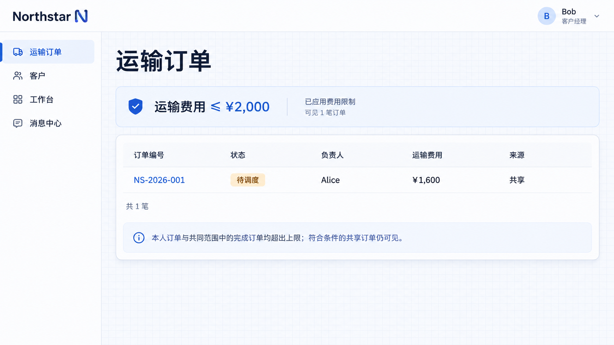

# Restriction rules

Restrictions narrow existing access from jobs, common access and sharing. They do not grant an action or records on their own.

## Example: transport fee collaboration

Restrictions narrow existing access to records meeting conditions such as an amount or region. Apply the boundary to access received through jobs, default access and sharing.

```text
Bob temporarily helps review transport fees and may view only orders with a transport fee of 2,000 CNY or less.
Add a fee limit to his View transport orders action, preserving his job and order ownership.
Apply it to his own orders, the completed-order baseline and shared orders.
Let administrators adjust or remove it in Access rules; explain that removing it may expand visible records.
```

This example uses the transport order’s fee, not the extra-fee approval application. Exactly 2,000 CNY is within the limit.

## Configure the limit

Open **Access rules → Fee limits**, select Bob, enter **2,000** and save.


**Bob’s order-viewing scope has a 2,000 CNY fee limit.**

## See the narrower result

Bob’s own orders and completed orders exceed the limit and disappear from his list. Shared **NS-2026-001**, with a **1,600 CNY** fee, remains visible and still belongs to Alice.



**After restriction, only the shared order within the fee limit remains visible.**

Removing the restriction leaves other sources intact. Removing sharing removes only that collaboration source. [Inspect access](./inspector.md) to see the sources.

## Define each operation

This example limits viewing. Editing or approval need their own rules if the same boundary applies. Multiple restrictions must all be satisfied; configure the conditions of the records still allowed.
