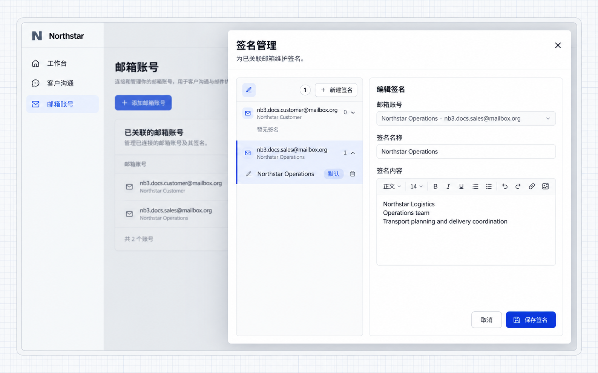
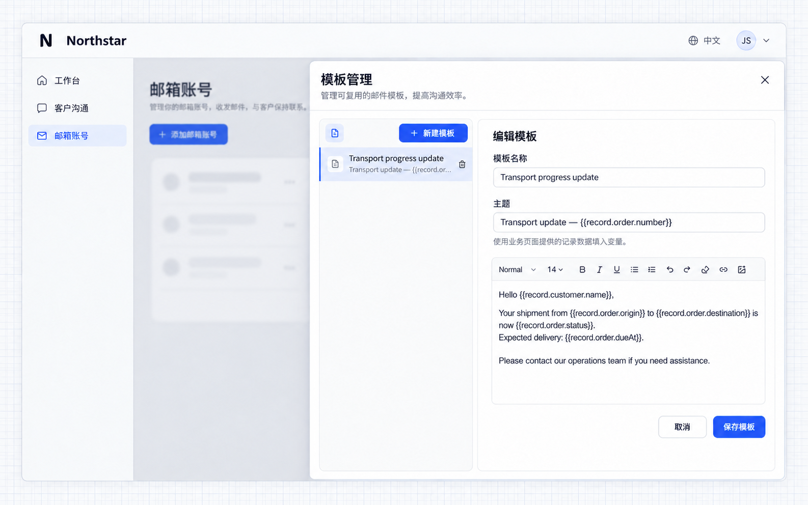
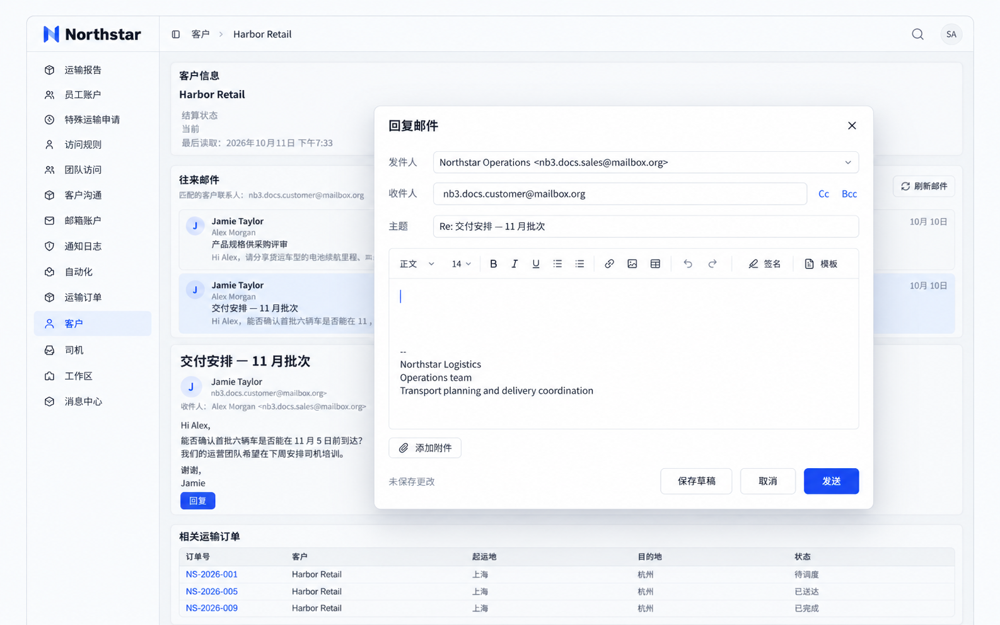

# More Mail Features

Mail provides signatures, templates, message reading, and a composer. Applications can place these capabilities on account pages, customer details, or order details.

Northstar provides **Mailbox accounts** and **Customer communication** navigation entries and embeds mail actions in customer and transport order details. Ask the Agent:

```text
Add Mailbox accounts and Customer communication to the application navigation.
Embed NocoBase's account management page for mailbox connections, signatures, and templates.
Embed the mail workspace for employees to read and send through their own connected mailboxes.
```

See [Configure Mail](./configuration.md) for connections and [Developer Reference](./development.md) for integration.

## Use mail signatures

Save recurring team names, job titles, and contact details as signatures to avoid entering them each time. Signatures belong to a mailbox account and can have a default.

```text
Prepare a Northstar Operations signature for the business mailbox,
including Northstar Logistics, Operations team, and transport coordination details.
Let employees manage signatures from Mailbox accounts and select them when composing.
```

Open **Mailbox accounts → Signatures**, select an account, enter the signature name and content, and save. Set the frequently used signature as the default.



**The business mailbox has a saved default signature, available when composing.**

## Use mail templates

Save recurring subjects and message content as templates. Templates belong to the current user. An application can also supply the current business record to populate variables such as customer names and order numbers.

```text
Prepare a Transport progress update template with the order number in the subject
and customer name, origin, destination, transport status, and expected delivery in the body.
Provide the current order and customer when opening the composer from order details.
Employees can apply the template, edit the content, and select an existing signature.
```

Open **Mailbox accounts → Templates** to manage subjects and content. This example uses variables such as `{{record.customer.name}}` and `{{record.order.number}}`.



Open the composer from transport order details, click **Template**, and select **Transport progress update**. Click **Signature** to select a signature.


**The template populates the subject and body with customer and order information, followed by the signature. Everything remains editable before sending.**

:::info Important

The embedding business page must supply template variables. Saving a template does not automatically load customer or order data. Unmatched variables remain unchanged. Review recipients and content before sending.

:::

## Read correspondence on business pages

Embed mail lists and message reading in customer details to see communication while reviewing the customer's information. Match messages by contact email.

```text
Add Correspondence to customer details.
Match the customer's contact email against senders, recipients, and copied recipients.
Only show messages accessible through the current employee's own connected mailboxes.
Select a message to read its body. Reply opens the mail composer with its reply relationship retained.
The employee reviews the content before sending. Provide Refresh mail and Load more.
```

Open customer details and select a message under **Correspondence**. This example reads already synchronized messages using the mail reading component.


**Customer information and related correspondence appear on the same page, without searching separately for the contact email.**

Click **Reply** to open the composer.



**The reply composer populates recipients and the original subject. Employees can edit the message and select a signature or template.**

:::info Important

Enter the contact email accurately: it determines the correspondence match. Business record access and mailbox access are enforced separately. Access to a customer does not grant access to another employee's mailbox.

:::

## Compose from business pages

Populate contacts and record details when composing order progress updates to reduce copying and entry errors.

```text
Add Compose progress email to transport order details.
Read the recipient from the customer contact and include the order number in the subject.
Populate the body with the customer, origin, destination, and transport status.
Employees review and edit before sending through their connected mailbox.
Allow existing templates and signatures; do not send automatically.
```

Open transport order details and click **Compose progress email**.


**Order information populates the subject and body, ready for editing before sending.**

## Usage tips

- Synchronize to retrieve new mail; refreshing displays messages already synchronized to the application.
- Choose the required history range for the initial synchronization.
- Organize mail with search, stars, and labels. Whether changes reach the provider depends on the integration.
