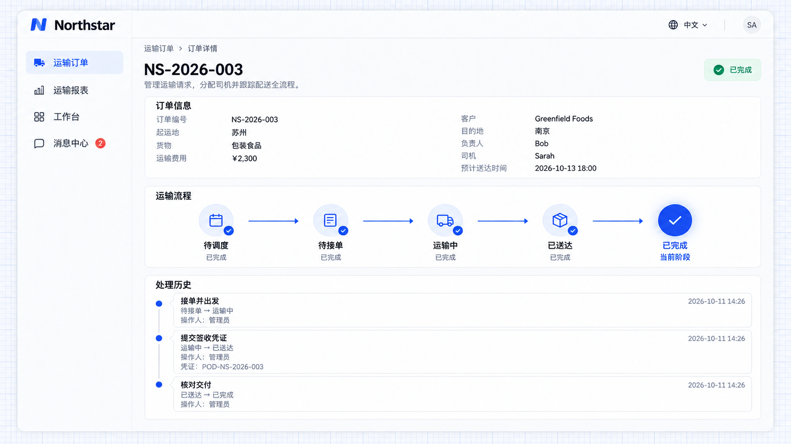

# Progress and processing history

Workflows provide current stages, traversed paths and processing history. Users can see where a record is, what it is waiting for, and who performed each action, when and with what information.

An application can display this information as a process diagram, stage bar or history list within business details. A process diagram presents execution progress; it is not a drag-and-drop process designer.

## Example: inspect order delivery history

Retain progress and each action on Northstar order pages so employees can check delivery evidence and understand how the order reached its current stage.

```text
Show the current workflow stage and processing history in Northstar order details.
Record the actor, timestamp, action, previous and next stages, and rejection reason or delivery evidence.
Mark automatic actions as performed by the system.
Keep progress and history after refresh so the delivery process can be reviewed after completion.
```

## View the result

After acceptance and departure, delivery evidence and final confirmation, order **NS-2026-003** is **Completed**. **Processing history** shows the three actual actions, stage changes, timestamps and submitted information.



**The order is complete, and its actions, stage changes and delivery evidence remain available for review.**

This transport example uses a stage bar and history list. The [background export example](./execution.md#view-execution-results) also shows automatic system actions and their output. Page layouts can be freely designed for business needs.

:::tip Important notes

For a stalled process, inspect its current stage, required conditions and latest history first. For external calls, also check success and retry status. Before changing a running process, plan how unfinished records continue and preserve submitted results and history.

:::

See the [Developer reference](./extension.md) when reviewing implementation APIs.
