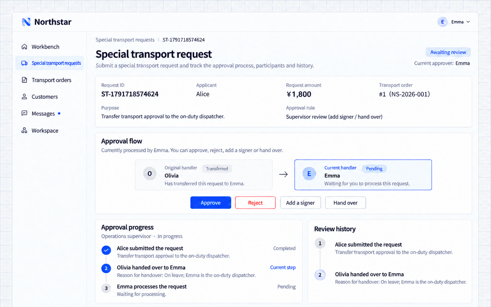
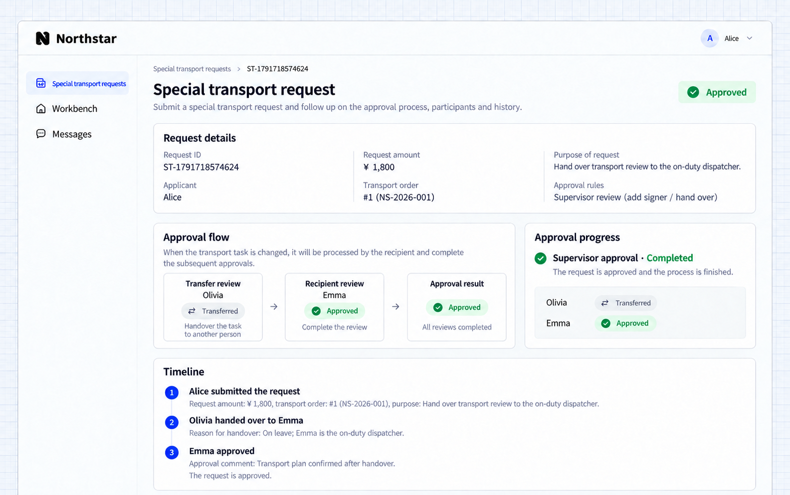

# Added reviewers and transfers

Add another person to an ongoing review or transfer the current task to an eligible person. Both operations retain the original reviewer, the new participant, reasons and subsequent opinions.

| Operation | Participation                                                                           |
| --------- | --------------------------------------------------------------------------------------- |
| Before    | The added person reviews first; the original reviewer waits and then continues.         |
| After     | The original reviewer approves, then the added person reviews before completion.        |
| Alongside | The added person participates with current reviewers under the stage’s decision policy. |
| Transfer  | A new reviewer takes over the current task; its transfer history remains.               |

## Example: request specialist review or transfer to an on-duty lead

A supervisor asks finance to review special cargo first, or transfers a task to the on-duty dispatcher when unable to handle it.

```text
Allow adding a reviewer before the supervisor and transferring tasks in Northstar special transport review.
Added reviewers must be finance reviewers. The original supervisor continues afterwards.
Transfers must select the on-duty dispatcher and include a reason.
Retain original tasks, added or replacement reviewers, reasons and opinions.
Show the added-signer and handover paths with their reviewers in a flow diagram on request details.
```

## View the approval flow in the application

The request detail shows both paths: Frank reviews first and Olivia continues for an added signer; Emma takes over for a handover. Actual approval progress and processing history remain below.


**Added reviewers increase participation; transfers change the handler. Both retain responsibility history.**

## View the application results

### 1. Add before: the specialist reviews first

Submit a special transport request with the rule allowing an added reviewer or transfer. Olivia selects **Add a signer** and invites finance reviewer Frank to assess the specialist handling cost first. Frank receives a pending task while Olivia's task becomes **Blocked**. The history records the invitation, its mode and comment.


**Adding a reviewer before inserts a review step and blocks the original reviewer until it finishes.**

After Frank approves, Olivia can continue. Her approval completes the request as **Approved**, preserving both opinions and their order.


**The specialist's approval lets the original reviewer continue; the original reviewer still makes their decision.**

### 2. Transfer: the recipient completes the review

Unable to handle another request, Olivia selects **Hand over**, chooses on-duty dispatcher Emma and provides a reason. The original task reads **Transferred**. Emma receives the successor task and its actions, while history preserves the sender, recipient and reason.




**The recipient takes over the current task; the original reviewer no longer handles it.**

After Emma approves, the request becomes **Approved**. Olivia's handover reason and Emma's final opinion remain in history.



**The recipient completes the review, with the responsibility change and decisions retained.**

:::tip Important notes

Specify permitted addition modes and transfer recipients. Define how added participants affect the original decision policy, rather than allowing arbitrary users to become reviewers.

:::

## Administrative responsibility changes

Ask the Agent to build a business-specific management page for inactive staff, missing reviewers or execution failures. Define its record scope, permissions and assignment, reassignment, redispatch or reset actions. Preserve reasons, original tasks and history.

Define whether redispatch or reset replaces a handler or ends the current round and resubmits. Specify eligible states, the restart stage and how previous opinions, deadlines, budgets and completed work are handled.

```text
Build a Northstar approval management page. Authorized administrators can view only requests, tasks, history and execution results within their business responsibility, and handle inactive staff, missing reviewers and execution failures.
Allow assignment and reassignment with a reason. Before adding redispatch or reset, confirm when it is allowed, where review restarts, whether opinions and deadlines remain, and what happens to reserved budgets and completed work. Never delete the original records. Show me the page and permission plan first.
```

Verify added-reviewer order, candidate restrictions and administrative permissions. Invalidated tasks cannot be handled, and responsibility changes remain traceable.
