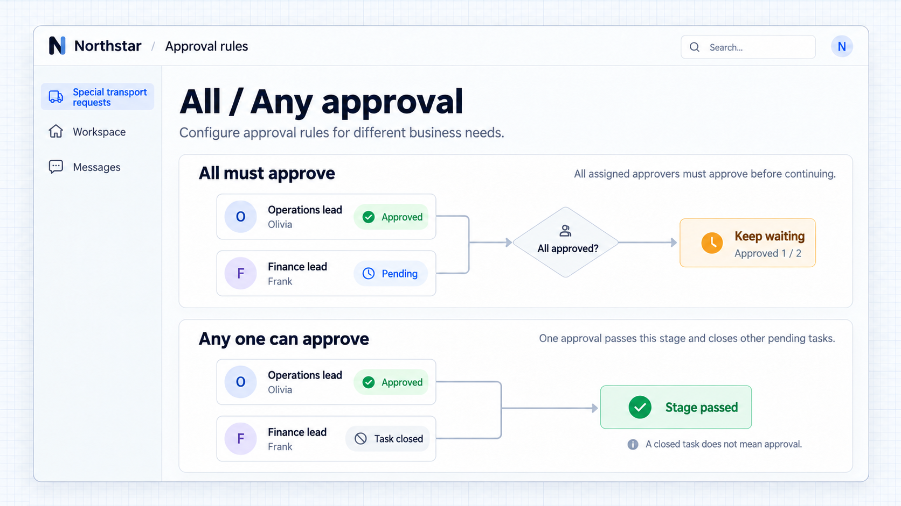
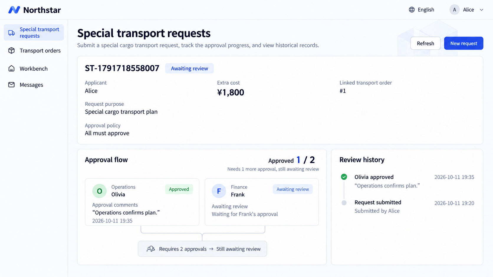
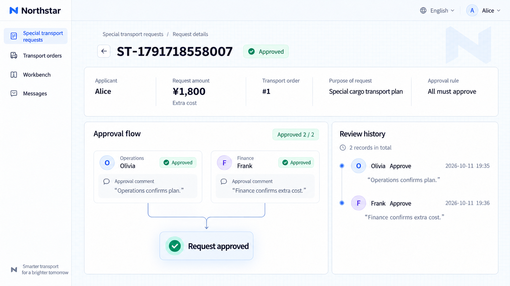
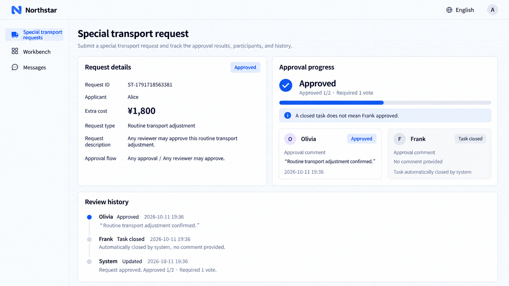

# Joint review and decision rules

Several people can decide within one stage. The configured policy combines their opinions to determine approval, rejection or whether to keep waiting.

| Policy            | Result                                                                                              |
| ----------------- | --------------------------------------------------------------------------------------------------- |
| All approval      | Everyone must agree. A rejection can end the stage immediately or after all opinions are collected. |
| Any approval      | One approval is sufficient; reject only if no participant approves.                                 |
| First answer      | The first valid answer determines the result.                                                       |
| Vote threshold    | Approval requires a specified number of votes, calculated from a proportion when needed.            |
| Sequential review | Participants within the stage handle tasks in order.                                                |

Multiple stages progress through different review steps; joint review combines opinions within the same step.

## Example: two leads review special cargo

Special cargo requires both operations and finance agreement. Routine dispatch can be approved by either authorized operations or finance reviewer.

```text
Add joint review to Northstar special cargo requests. Both operations and finance leads must approve.
Reject immediately when either rejects, requiring a reason. After one approval, keep waiting for the other.
Use any-approval for routine dispatch: one on-duty supervisor’s approval is sufficient.
Show individual opinions and whom the request is still waiting for.
```

## View the rule diagram



**All approval waits for everyone; any approval passes after one person agrees.**

## View the application results

### 1. All approval: keep waiting after the first decision

Create and submit a request in **Special transport requests**, selecting **Countersignature — all approve**. After operations reviewer Olivia approves, the request remains **Awaiting review**. The page shows **1 of 2** approvals and identifies Frank as the person it is waiting for.



**The first approval completes one person's review; the request still waits for the other.**

After finance reviewer Frank approves, the request becomes **Approved**. Both opinions and the processing history remain in the detail.



**All approval passes after both reviewers agree.**

### 2. Any approval: one decision is sufficient

Create a routine transport adjustment with **Any reviewer may approve**. After Olivia approves, the request becomes **Approved**. Frank's outstanding task closes with the stage, without requiring another opinion.



**One approval passes the stage. A closed task does not mean the other person approved.**

:::tip Important notes

Define both approval and rejection policies. Proportional decisions also require a participant count, rounding rules and a concrete vote threshold. Some approvals do not necessarily complete a stage.

:::

## Clarify aggregation rules

For voting, define the participant count, votes required, abstentions, veto seats and whether all opinions must arrive. Item-level decisions, partial approval and ratio conversion are business-specific rules for the Agent to implement; "two-thirds approval" alone is insufficient.

A team claim differs from joint review: one member may represent the team, while joint review requires individual opinions. Choose the model before defining claim, release and timeout rules.

```text
Assign finance review for ordinary Northstar dispatch requests to qualified finance staff as a team. A member claims the task and acts for the team; others cannot handle it until it is released. Explain how this differs from requiring two finance reviewers to agree, then implement the option I confirm.
```

For joint review, the first approval must not advance the request early. When any-reviewer approval closes other tasks, it does not imply those reviewers agreed. Repeated or concurrent submissions must not double-count votes or overwrite opinions.
