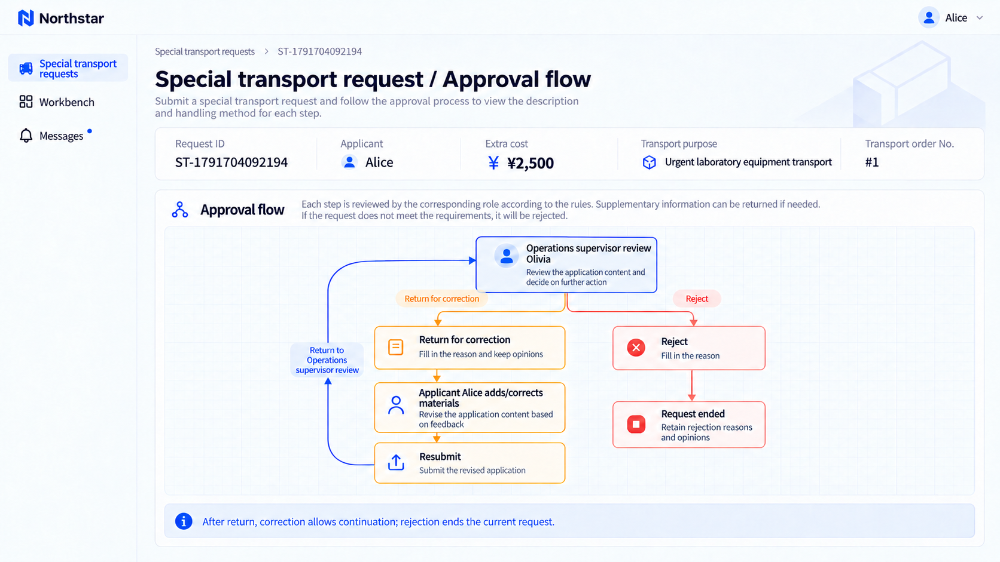

# Request handling and progress

Approval can cover submission, review, correction, resubmission and completion. Applicants track progress, reviewers handle tasks and copied recipients read materials and opinions. Each role has its corresponding actions.

## Return, rejection and withdrawal

| Operation         | Effect                                                                        |
| ----------------- | ----------------------------------------------------------------------------- |
| Return            | Go to a specified stage for permitted corrections and resubmission.           |
| Reject            | End the current request and retain reasons and opinions.                      |
| Withdraw          | The applicant withdraws at permitted stages, closing current review tasks.    |
| Request materials | The reviewer waits for additional material, then continues the original task. |

### Example: return incomplete materials

```text
Allow Northstar supervisors to return requests with missing materials to applicants, with a reason.
Allow correction and resubmission, retain earlier opinions and determine reviewers again on review entry.
Allow applicants to withdraw before completion; reviewers cannot handle closed tasks.
Distinguish return, rejection and withdrawal, and show who should act next.
Show the return/correction/resubmission and rejection paths as a flow diagram in request details.
```

The request detail shows the approval flow together with the request information and actual approval progress.



**Returned requests can continue after correction; rejection ends the request, with reasons retained.**

## Copy and acknowledgement

Copy requests to people who need their progress and result. Recipients can read materials and opinions and confirm reading; acknowledgement does not count as an approval vote.

```text
Copy Northstar special transport requests to the responsible account manager.
Provide Copied to me and read confirmation. Recipients can view progress and opinions without deciding approval.
```

## Deadlines and task assignment

Approval supports reminders, escalation and team task claims. Expired claims can be released for others to handle, with time measured against a working calendar when needed.

```text
Remind Northstar supervisors after one working day and escalate to their manager after two.
Allow eligible team members to claim tasks; release claims left unhandled past their deadline.
Show the current handler, deadline and assignment history.
```

## View the approval result

After operations lead Olivia and finance lead Frank approve the existing special transport request, it shows **Approved**. Details retain both reviewers and their opinions.


**Applicants can inspect the final decision, reviewers and opinions from each stage.**

:::tip Important notes

Specify permitted withdrawal stages, return targets and whether earlier opinions are reused on resubmission. Separate copied acknowledgement from voting, and define deadline actions such as reminders, escalation or transfer.

:::

## Evidence after resubmission

Keeping history does not mean reusing previous approvals. Review again by default; if opinions may be reused, define which content must remain unchanged. Additional materials can be awaited within a task without returning the whole request. Stale pages and invalidated tasks cannot approve new content.

## Execution after approval and page permissions

Show approval, execution scheduling, success and failure separately. Define how rejection, withdrawal, termination and return release reserved budgets. Reconcile unknown payment results before retrying to prevent duplicate payments. Copy recipients acknowledge information without voting.

```text
Review resubmitted Northstar special transport requests again, retaining previous opinions and edits while invalidating old tasks. Applicants see their own requests; reviewers and copy recipients see only authorized content. Explain unavailable actions and show updated progress after others act.
Notify the applicant and account manager after approval, without paying automatically for now. If payment is added later, show approval, scheduling and payment results separately. Only authorized people may retry; do not pay again while the previous result is unknown. Confirm budget reservation and release rules for each exit first.
```

## Acceptance, release and troubleshooting

Check visibility, actions, amount routes, joint decisions, resubmission, deadlines and execution for applicants, reviewers, copy recipients and administrators. Specify calendar or business time, holidays and whether resubmission restarts deadlines. Agreed handling must survive restarts.

```text
Give me trial steps and verification results for Northstar approvals: amount routes, joint review, returns, added reviewers and transfers match the rules; old tasks and stale pages cannot approve, and unrelated people cannot view or act; repeated clicks and concurrent actions cannot duplicate approvals or payments. Explain unverified areas and the people, permissions and notifications I must confirm before release.
Before changing rules, list requests still under review and ask whether they should continue under the original rules or be resubmitted. Explain how tasks, opinions and deadlines are handled. For a stuck request, investigate its stage, waiting participants, tasks, history and execution results before an authorized person acts with a recorded reason.
```

Report the request, your identity, action, expected and actual results. Share the exact page error with the Agent rather than guessing missing packages. See [Developer reference](./extension.md) for integration and custom-rule boundaries.
