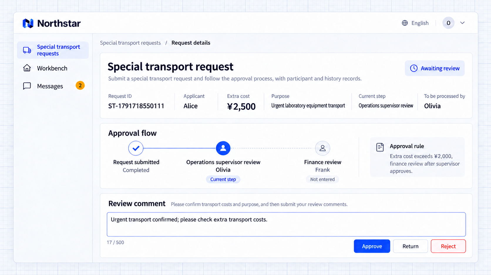
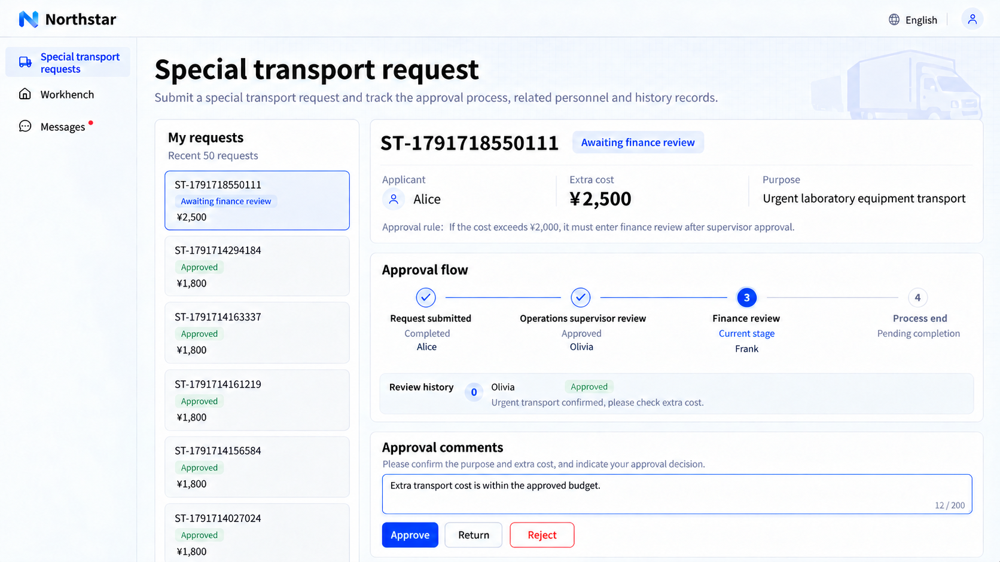

# Multiple stages and conditional routing

Requests can pass through several review stages in order, with different responsibilities at each stage. Conditions such as amount or request type determine whether another stage is included.

Reviewers may come from designated people, roles, departments or reporting relationships. Show an expected route before submission and determine actual reviewers on stage entry.

## Example: route according to transport fees

Northstar special transport fees of CNY 2,000 or less require operations review. Higher fees continue to finance after operations approves.

```text
Add approval to Northstar special transport requests with cargo details, reasons, extra fees and attachments.
Fees of CNY 2,000 or less need operations approval; higher fees continue to finance afterwards.
Preview the route and reviewers before submission; show the current stage, offered actions and opinions in details.
Retain the approval decision without automatically paying fees.
```

## View the result

Alice submits CNY 2,500 for urgent transport. It first reaches operations reviewer Olivia, who can inspect the purpose, fee and materials and provide a comment.



**The request first reaches operations review.**

After operations approves, the amount condition sends it to finance reviewer Frank, preserving the previous comment.



**Requests above CNY 2,000 continue to finance review.**

:::tip Important notes

Specify each stage’s inclusion conditions and reviewer sources. Missing reviewers should prompt assignment or prevent submission; missing people and deliberately skipping a stage are different cases.

:::

## Submitted content and reviewer assignment

Decide how the request relates to effective business data: which content freezes on submission and whether approval updates a contract, price or other official record. If someone has changed that record, require reconciliation rather than overwriting it. Route previews explain the expected sequence; reviewers are resolved when a stage starts.

Reviewers may come from reporting lines, roles, departments or a candidate team. Specify applicant exclusion, inactive staff, delegation and whether one person can hold multiple responsibilities. Missing reviewers should block submission or wait for assignment, never imply approval.

```text
After a Northstar special transport request is submitted, its cargo, fees and reason cannot be edited directly; return it before changing and resubmitting. Resolve operations reviewers from the applicant's reporting line. Only qualified finance staff can review, applicants cannot review their own requests, and inactive staff cannot act.
Block submission with a reason if no suitable manager exists; wait for an authorized administrator to assign finance if nobody is available. Exactly 2,000 requires only the manager; more than 2,000 also requires finance. Show me the route and assignment plan and ask about unresolved decisions first.
```

Verify amount boundaries, missing reviewers, applicant exclusion and refusal of changes to submitted content.
