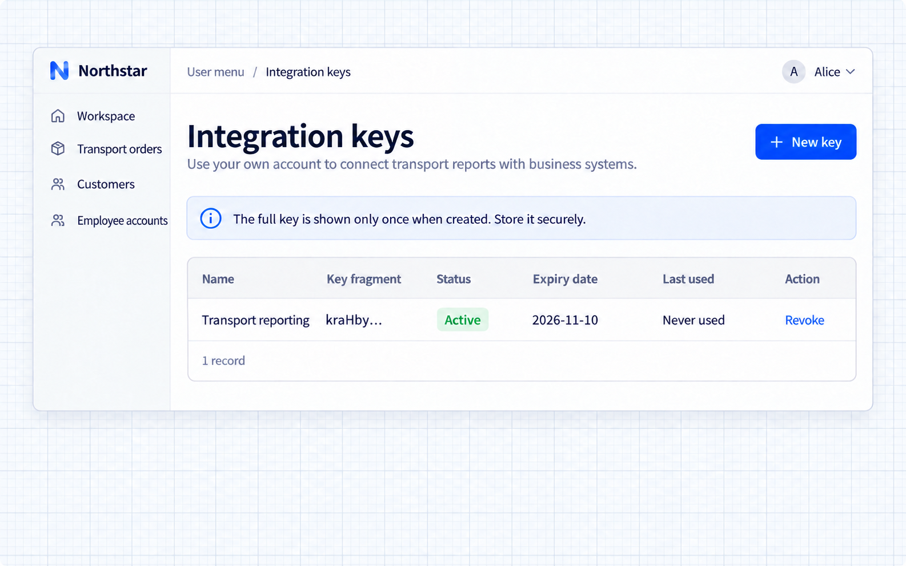

# API keys

[← Authentication overview](./index.md) · [Open the related scenario](./index.md#api)

An API key lets scripts, scheduled tasks, and external systems call application APIs without browser sign-in. By default, it represents its creator and uses that user’s existing permissions.

A Northstar account manager can use a Key to send accessible transport orders to a reporting system, while continuing to use the application through browser sign-in.

> API keys provide programmatic credentials. The integration-key screen and order API below belong to the Northstar example; verify the actual endpoints, response fields, and user permissions in your application.

[Provide an integration keys entry](#provide-an-integration-keys-entry) · [Create, save, and revoke](#create-save-and-revoke) · [Read transport orders with a script](#read-transport-orders-with-a-script) · [Result](#result)

## Provide an integration keys entry

Scripts and external systems can use separate API credentials instead of storing user passwords. Set key expiration and revoke credentials when the integration ends.

Management pages can follow business needs without a shared Settings entry:

```text
Add an Integration keys entry to the Northstar user menu using the existing API keys capability.
Employees manage only their own Keys.
Creation accepts a purpose name, such as Transport reporting, and an expiry.
Show the full Key only once after creation and ask the employee to copy it immediately.
List names, identifying fragments, status, expiry, and last use. Support revocation with confirmation.
Never expose full Keys in lists, logs, or later detail views.
```

The capability handles Keys, expiry, and revocation; the application defines page location and layout. Employees need permission to access the entry.

## Create, save, and revoke

Open Integration keys, supply a purpose and expiry, and save the full value in the calling program’s runtime environment. It appears only once; an identifying fragment cannot recover it.

Revoke a Key when it is no longer needed. Revoked or expired Keys cannot continue calling APIs; create another for a new integration. A disabled account’s Keys cannot keep representing that account.

## Read transport orders with a script

Use API requests to process application data with scripts instead of manually exporting or copying it. Access retains the key owner’s permission scope.

Save the Key in the program’s `NOCOBASE_API_KEY` environment variable:

```text
Write a script to read Northstar transport orders.
Read the API key from NOCOBASE_API_KEY, never source code or logs.
Use the application's actual API documentation to select the order list endpoint and send the Key in the x-api-key header.
The example app is http://localhost:13200/main. GET /api/northstar returns workspace data; data.orders contains accessible orders.
Read orders, resolve customer names using data.customers, and output order number, customer, origin, destination, and status.
Handle API failures instead of treating them as an empty order list.
Explain how to configure the application address and run the script.
```

This example uses a Key created by Alice, an account manager. The script calls `GET /main/api/northstar` with the `x-api-key` header, extracts orders from the workspace response, and resolves customer names. This endpoint returns accessible workspace records in a single response, without pagination.

> This script targets the Northstar example API, not a universal NocoBase orders endpoint. Check paths, response structure, and pagination before using it with another application.

### Run the script

Save the code as `fetch_orders.py`. It uses only the Python standard library.

```python
import json
import os
import sys
from urllib.error import HTTPError, URLError
from urllib.request import Request, urlopen

base_url = os.environ["NOCOBASE_APP_URL"].rstrip("/")
request = Request(
    base_url + "/api/northstar",
    headers={"x-api-key": os.environ["NOCOBASE_API_KEY"]},
)
try:
    with urlopen(request, timeout=20) as response:
        result = json.load(response)
    data = result["data"]
    customers = {str(item["id"]): item["name"] for item in data["customers"]}
    orders = [
        {
            "number": order["number"],
            "customer": customers.get(str(order["customerId"]), ""),
            "origin": order["origin"],
            "destination": order["destination"],
            "status": order["status"],
        }
        for order in data["orders"]
    ]
except HTTPError as error:
    sys.exit(f"API request failed: HTTP {error.code}")
except URLError:
    sys.exit("Cannot reach the application API.")
except (KeyError, TypeError, ValueError):
    sys.exit("Unexpected API response format.")

print(json.dumps({"count": len(orders), "orders": orders}, ensure_ascii=False, indent=2))
```

Set the application address, enter the copied Key, and run:

```bash
export NOCOBASE_APP_URL='http://localhost:13200/main'
read -rs -p 'API key: ' NOCOBASE_API_KEY
export NOCOBASE_API_KEY
python3 fetch_orders.py
```

The `read -rs` command hides the Key as you enter it. Replace the application address and endpoint when using another application.

### Read the returned orders

The real execution returned 6 orders accessible to Alice. The first two records are shown below:

```json
{
  "count": 6,
  "orders": [
    {
      "number": "NS-2026-001",
      "customer": "Harbor Retail",
      "origin": "Shanghai",
      "destination": "Hangzhou",
      "status": "awaitingDispatch"
    },
    {
      "number": "NS-2026-002",
      "customer": "Summit Electronics",
      "origin": "Hangzhou",
      "destination": "Suzhou",
      "status": "awaitingDispatch"
    }
  ]
}
```

The orders belong to Harbor Retail and Summit Electronics; `awaitingDispatch` means awaiting dispatch. A reporting or synchronization program can use these records without browser sign-in.

A Key does not expand its owner’s data access. Give an integration account appropriate permissions for cross-team reporting. A revoked or expired Key, or a disabled account, cannot continue calling APIs. Failed requests report an HTTP status instead of appearing to be an empty order list.

See [Authorization](../authorization/index.md) for business permissions and data scopes.

## Result

The integration keys page lists the purpose, recognizable fragment, status, expiration, and last use. This example uses a 30-day lifetime.



The creation view displays the full key once. Its value is masked in this screenshot.


## Verify the result

- The script returns the expected order fields within the user's scope.
- The Key comes from the environment and never appears in code or logs.
- Revoked or expired credentials produce an error rather than an empty success result.

Return to the [related overview scenario](./index.md#api) to adapt the prompt and continue with your Agent.
