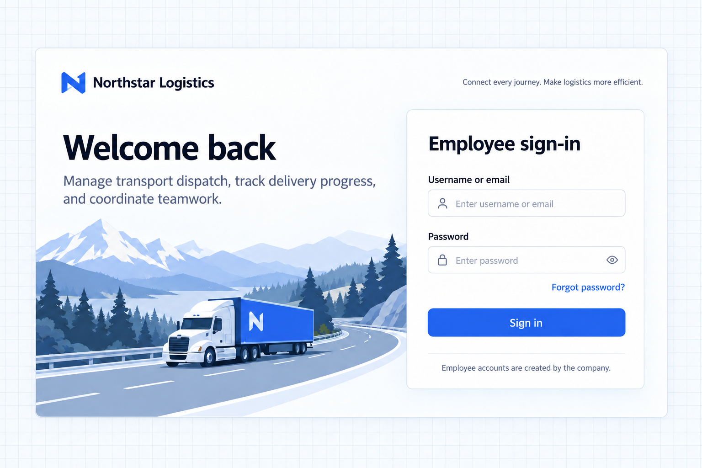

# Customizing sign-in pages

[← Authentication overview](./index.md) · [Open the related scenario](./index.md#brand)

After setting up accounts and the required authentication methods, customize the sign-in page for your company.

The sign-in page belongs to the application source. Its name, logo, copy, imagery, layout, and colors can follow a company brand while preserving authentication, error feedback, and password recovery.

> Customize application-owned branding, layout, and text while preserving the existing authentication actions, error handling, account rules, and recovery flows.

[Example: Northstar employee sign-in](#example-northstar-employee-sign-in) · [View the result](#view-the-result) · [Further customization](#further-customization)

## Example: Northstar employee sign-in

Northstar wants its employees to recognize the company and the purpose of the transport workspace. Accounts are managed centrally, without public registration.

```text
Customize the existing transport application's sign-in page for Northstar Logistics.

Use a pale-blue truck and mountain-road illustration, a white page panel, and a pale blue-gray grid backdrop for readable text.
Show the company name and icon at the top. Place a welcome message and transport dispatch, delivery tracking, and team collaboration copy on the left.
Place a white sign-in form on the right, with dark text, white inputs, and a blue sign-in button.
Preserve username or email and password sign-in, password visibility, error feedback, and password recovery.
Disable public registration on both the page and the server while retaining the registration page and components for future use.
Use consistent branding on sign-in and password recovery pages, with Chinese and English copy.
```

## View the result

The sign-in page uses a pale-blue mountain-road and truck illustration with company branding and transport business copy. Welcome copy appears on the left, and a white sign-in form sits on the right. Dark text and a blue button make the form easy to distinguish. Backgrounds, colors, and layouts can follow the company’s needs.



Page customization reuses existing forms and authentication actions. Hiding a registration link must be accompanied by disabling registration on the server.

## Further customization

Describe background images, form position, brand colors, fonts, or role-specific landing pages. Consider narrow screens and dark mode, and enforce business access on the server.

Password recovery requires an actual configured reset-email service. A visible link does not mean that service is ready.

## Verify the result

- The transport branding and form work on desktop and mobile.
- Password visibility, errors, and password recovery remain usable.
- Self-registration is disabled on the server, with reusable registration components retained.

Return to the [related overview scenario](./index.md#brand) to adapt the prompt and continue with your Agent.
