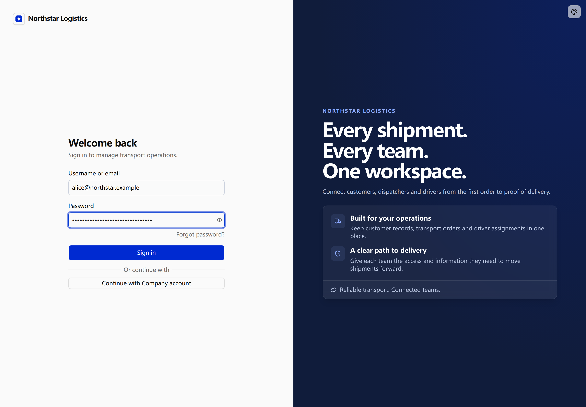
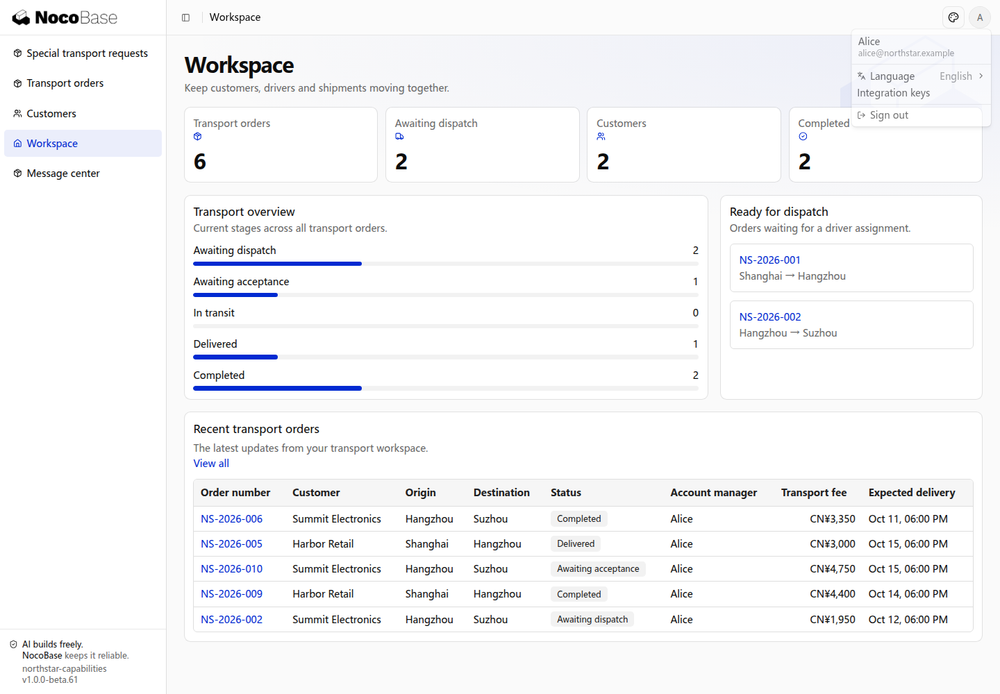
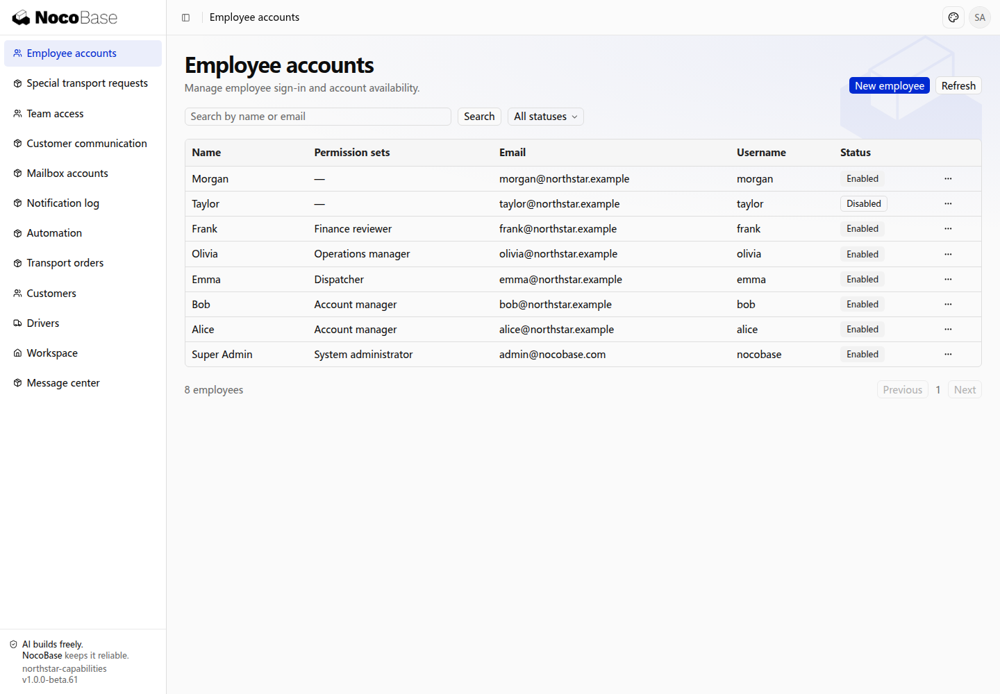
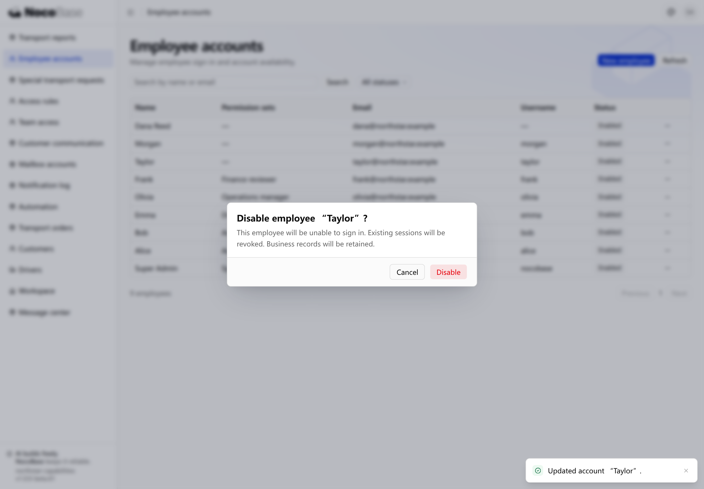
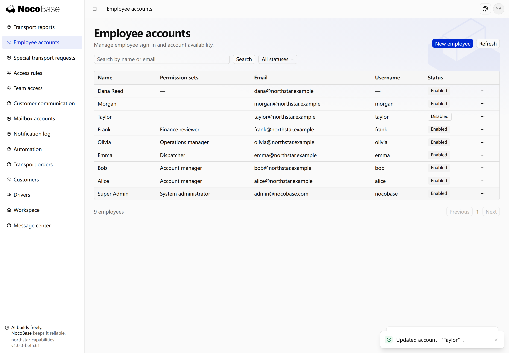

# Password authentication and accounts

[← Authentication overview](./index.md) · [Open the related scenario](./index.md#staff)

Northstar account managers, dispatchers, and drivers sign in with company-managed accounts. Administrators create accounts and disable them when employees leave.

> This guide demonstrates a customized Northstar application. Authentication supplies password sign-in and sessions; employee management screens are built for the business, and password recovery requires a working email channel.

[Sign in and sign out](#sign-in-and-sign-out) · [Company-managed employee accounts](#company-managed-employee-accounts) · [Custom password requirements](#custom-password-requirements) · [Recover a password](#recover-a-password)

## Sign in and sign out

Enter a username or email and password, then click **Sign in**. This example uses the blue Northstar sign-in page with NocoBase authentication and sessions.



After signing in, open the avatar menu in the upper-right corner and choose **Sign out**. You return to the sign-in page. Sign in again when your session expires.



See [Customize sign-in pages](./login-pages.md) for branding and layout changes.

## Company-managed employee accounts

Internal applications can disable public self-registration and let administrators create and manage accounts. Restrict account creation on both the page and the server.

```text
Northstar’s transport system is for company employees only.
Disable self-registration on both the sign-in page and the server.
Build an Employee accounts page for administrators, with name/email search and enabled/disabled filters.
Support creating, disabling, and enabling accounts, and revoking sessions separately.
Keep account creation separate from business permission assignment. Never grant administrator access by default.
```

Open **Employee accounts** to see each employee’s name, email, username, permission sets, and status. Click **New employee** and enter a name, email, and initial password. A username is optional.



An account lets an employee sign in; permission sets determine which business records they can access. Creating an account does not grant access to all orders. See [Roles and permissions](../authorization/index.md).

## Custom password requirements

Applications can customize password requirements and validate them consistently during account creation and resets. Explain the requirements in the form; this example uses a minimum of 12 characters.

```text
Require at least 12 characters when setting or resetting a password.
Show the requirement in account creation and password reset forms, with matching server-side validation.
Existing employees can continue signing in with their current passwords without an immediate password change.
```

The account creation form displays the minimum length. Enter a shorter password and click **Create** to see the validation message. The account is not submitted. The server also validates new passwords.


## Recover a password

Users who forget passwords can reset them through their registered email without administrator intervention. Confirm email ownership and provide an expiring reset link.

```text
Add a forgot-password flow for Northstar employees using an email channel.
Let employees choose Forgot password? and enter their email.
Show the same submission message whether or not an account exists.
Use the email link to set a password of at least 12 characters and return to sign-in.
Reuse authentication’s expiring, single-use reset links.
```

Click **Forgot password?** and enter the account email.


A working email delivery channel is required to complete the request → email → reset link → new password flow. The email link must point to an application address the employee can reach.

### Configure the recovery sender

Set the application's `auth.email` to an SMTP or Resend sender, explicitly enable `auth.passwordReset.enabled: true`, and configure `app.publicOrigin` with the application address users can reach. The `defineAuthConfig` factory validates the sender and supplies `AUTH_EMAIL_*` environment mappings, including secret password and API-key metadata. Notification and mailbox plugins are not required. Adding a sender alone does not enable password recovery.

```yaml
auth:
  passwordReset:
    enabled: true
  email:
    provider: smtp
    host: smtp.example.com
    port: 587
    secure: false
    auth:
      user: noreply@example.com
      pass: replace-with-the-smtp-password
    from: App <noreply@example.com>
```

For Resend, replace the entire `auth.email` block with `provider: resend`, `apiKey` and `from`; do not mix SMTP fields. The environment variables are `AUTH_EMAIL_PROVIDER`, `AUTH_EMAIL_HOST`, `AUTH_EMAIL_PORT`, `AUTH_EMAIL_SECURE`, `AUTH_EMAIL_USER`, `AUTH_EMAIL_PASSWORD`, `AUTH_EMAIL_FROM`, `AUTH_EMAIL_REPLY_TO` and `AUTH_EMAIL_API_KEY`. Do not reuse mailbox `MAIL_*` variables.

Existing custom `auth.emailAndPassword.sendResetPassword` callbacks keep priority and work when the recovery switch is absent. Explicitly disabling recovery also disables custom callbacks. `auth.passwordReset.template` still supports TypeScript email customization. An invalid new sender is a configuration error; failed or uncertain delivery never switches senders or automatically resends.

**Legacy migration:** `auth.passwordReset.emailChannel` is deprecated and supported only for old applications, defaulting to `system-email` through Authentication’s own compatibility adapter when neither a custom callback nor `auth.email` is present. Startup prints a safe migration warning when that path is selected. Move its SMTP or Resend sender fields into `auth.email`, remove the explicit legacy entry, and keep notification and mailbox configuration unchanged. No MailerProvider or installed notification/mailbox plugin is required, including for opted-in applications that previously lacked that provider. There is no scheduled removal date.

## Sessions and disabled accounts

Offboarding, suspended accounts or revoked access require blocking future sign-ins and invalidating existing sessions. Disable accounts while preserving associated business records, with the option to enable them again.

```text
Add an employee offboarding action for administrators.
Show the employee name and consequences before confirmation.
After confirmation, prevent sign-in and revoke existing sessions while preserving business records.
Allow re-enabling the account, requiring the employee to sign in again.
```

Open Taylor’s row menu and choose **Disable**. The confirmation explains that sign-in will be blocked and existing sessions revoked, while business records remain available.



After confirmation, Taylor’s status becomes **Disabled**. Existing sessions cannot access internal business resources, and the employee returns to sign-in. Choose **Enable** to restore account availability; revoked sessions are not restored.



Use **Revoke sessions** to require a new sign-in without disabling the account. See [Protect pages and APIs](./protecting-access.md) for public and internal access.

## Verify the result

- Search, filter, and create employee accounts.
- Self-registration is disabled in both the interface and server.
- Disabling an account revokes existing sessions while preserving business records.
- Forms explain the minimum length of 12 characters.
- Both client and server reject new passwords that do not meet the rule.
- Existing employees can still sign in with their current passwords.
- A real mailbox receives a reset link using the correct application URL.
- The new password works and the old password no longer signs in.
- Expired or used links cannot be reused, and unknown emails do not reveal account existence.

Return to the [related overview scenario](./index.md#staff) to adapt the prompt and continue with your Agent.
