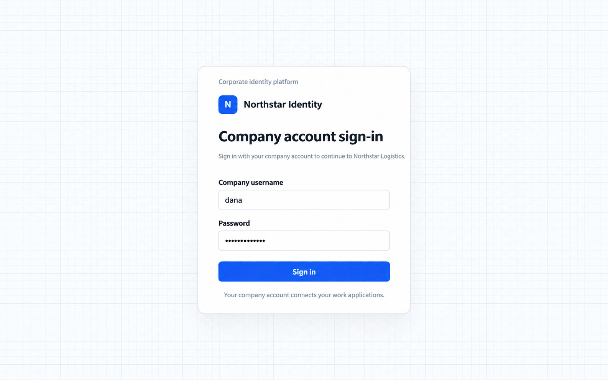

# Adding sign-in methods

[← Authentication overview](./index.md) · [Open the related scenario](./index.md#sso)

Northstar employees can use the company identity provider to enter the transport application. The provider verifies their identity; the application creates its own session and applies business permissions afterward.

> This guide uses OIDC as an example. Prepare an independent identity provider and account-linking rules first. Company sign-in is not enabled in the default application.

[Supported integration approaches](#supported-integration-approaches) · [Prepare the integration](#prepare-the-integration) · [Corporate sign-in example](#corporate-sign-in-example) · [Other integration needs](#other-integration-needs)

## Supported integration approaches

Authentication is built on Better Auth and can use provider configuration or authentication extensions. These approaches require configuration; they are not all enabled in a new application.

| Need                                  | Approach                                         | Preparation                                               |
| ------------------------------------- | ------------------------------------------------ | --------------------------------------------------------- |
| GitHub or Google accounts             | Provider sign-in configuration                   | Provider application, credentials, callback               |
| Corporate identity                    | OAuth 2.0 or OpenID Connect (OIDC)               | Identity provider, application information, account rules |
| Feishu or DingTalk accounts           | Platform authorization and user information APIs | Platform application, permissions, callback               |
| Email codes or sign-in links          | Authentication extension                         | Mail service, pages, storage                              |
| Passkeys or two-factor authentication | Authentication extension                         | Pages, configuration, data structures                     |
| Internal tickets or signatures        | Custom authentication extension                  | Protocol, verification API, stable identity               |

## Prepare the integration

The identity administrator registers the transport application, provides provider details and credentials, and registers the callback. The Agent implements application-side integration; credentials stay in server runtime configuration.

Decide whether first sign-in creates an account and whether existing accounts may be linked. Identify people with a stable provider identity, not matching names or emails alone. Identity integration and business permission assignment remain separate.

## Corporate sign-in example

Organizations with a central identity platform can reuse company accounts to reduce duplicate accounts and passwords. Configure business permissions separately after connecting identity.

```text
Connect Northstar's existing corporate identity provider using OIDC.
Keep password sign-in and add a Corporate sign-in button to the branded page.
Employees visit the company identity provider and sign in with their company account.
Show consent explaining the basic identity and email requested by the transport application.
Return to the workspace after consent; canceling must not sign the employee into the application.
Allow account creation at first sign-in, identified by the provider's stable user identity.
Do not merge accounts by matching names or emails, or grant new accounts administrator access.
List the information the provider administrator must supply, the callback to register, and application configuration.
```

### 1. Open company sign-in

Choose **Continue with Company account** on the transport application’s sign-in page. Password sign-in remains available.


### 2. Authenticate with the company identity provider

The browser redirects to the independent **Northstar Identity** service. Enter the company username and password, then click **Sign in**. The transport application does not collect the company password on its own page.



### 3. Authorize the transport application

After authentication, **Authorize Northstar Logistics** shows the signed-in employee, Dana Reed, and the requested information: employee identifier, name, and email.

Choose **Allow access** to continue, or **Cancel** to stop authorization.


### 4. Return to the workspace

Authorization redirects back to the transport application. Open the avatar menu to see **Dana Reed** and the company email. The application has established its own signed-in session.


Creating an account on first sign-in does not grant order access or administrator permissions. This new account has no business data permissions yet, so its workspace shows no orders. Administrators can assign appropriate [Permission sets](../authorization/permission-sets.md).

Company sign-in establishes identity; the application’s business permissions govern pages, orders, and actions. Whether consent is shown or remembered depends on the company identity provider’s configuration.

## Other integration needs

For GitHub or Google, specify whether to keep passwords and how to create and link accounts, and ask the Agent for provider application and callback preparation.

For an internal ticket protocol:

```text
The company portal redirects to Northstar with a single-use ticket.
Follow the supplied protocol to verify it and use the returned stable identity to locate an existing application account.
Do not automatically create accounts; explain how to request access when none is found.
Keep password sign-in and enter the transport workspace after success.
```

Also specify whether sign-out leaves the identity provider, how existing employees link accounts, and role-specific landing pages. The integration includes any required binding pages, authentication extensions, and data structures.

## Verify the result

- Password sign-in remains available and company sign-in redirects to the identity provider.
- Allowing access returns the correct identity; cancelling does not sign in.
- Repeated sign-in does not duplicate or incorrectly merge accounts; new accounts receive no automatic administrator permissions.

Return to the [related overview scenario](./index.md#sso) to adapt the prompt and continue with your Agent.
