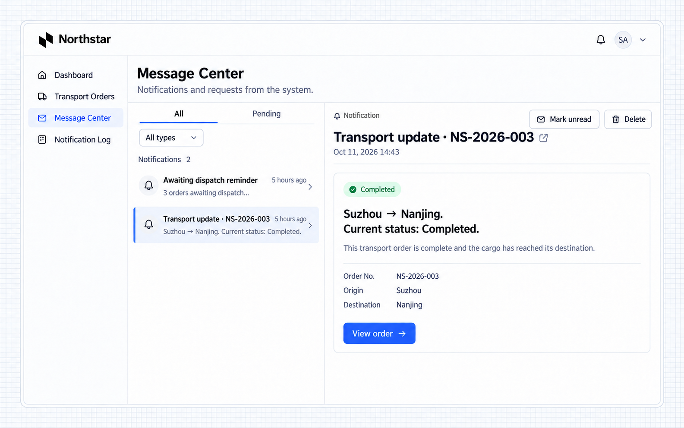

# Notifications

Notifications support **four channel categories: in-app messages, email, Feishu group robots and DingTalk group robots**. Email supports **SMTP and Resend**. A business event can use several channels, with an independent delivery result for each.

| Channel               | Supported integration      | Use                                                   |
| --------------------- | -------------------------- | ----------------------------------------------------- |
| In-app messages       | Application message center | Notify application users and link to related records. |
| Email                 | SMTP or Resend             | Send notifications to recipients' email addresses.    |
| Feishu group robots   | Group robot webhook        | Send business messages to a Feishu group.             |
| DingTalk group robots | Group robot webhook        | Send business messages to a DingTalk group.           |

The application selects when to notify, the recipients, content and destination page. Notification services handle delivery, delivery records and retry history. Other notification services can also be added through extensions.

## Example: send an in-app notification

Use in-app messages to send business reminders to application users. This example notifies the operator of transport progress and links to the order detail.

```text
Add Send progress update to Northstar transport orders. Send an in-app notification with the current status to the current operator's message center. Include the order number, origin, destination, and status, with a link to the order detail. Notify the same recipient only once for each order version. Do not change the transport state. Add a personal Message center and an administrator-only Notification log.
```

Open NS-2026-003, select **Send progress update**, then open **Message center**. This example sends the message to the demo operator, showing Suzhou → Nanjing and the completed status.



**The message center shows the progress reminder and a link to its order.**

Select the message title to open its order. Messages persist across refreshes and support read, unread, and removal actions. A message does not grant additional access to the referenced order.

## Trigger from business processes

Notify the actual applicant when approval or other business work produces a result, with a link to its details.

Once actual applicants and approval results exist, ask the Agent to notify only the applicant after approval or rejection, include the order and result, and link to the application. Pending applications should produce no result notification, and each result should notify once. A notification failure must not reverse the saved business result. User identities and decisions must come from the business process. See [Approvals](.././approval/index.md).

## Review notification logs

Notification services provide delivery logs and query APIs. An application can build a page for its administrators. **The Agent built this example's Notification log page for the transport application, using actual delivery records.**

Administrators open **Notification log** to review transport updates and dispatch digests, with source, reference, channels, status, attempts, and time.


**Administrators can inspect notification channels, processing status and attempts.**

`completed` describes processing of the notification's deliveries; provider acceptance and a recipient reading a message are different facts. Channels are independent. If no message arrives, first check whether the business generated a record, then inspect its delivery, recipient, and configuration.

To check a channel, ask the Agent to add a **Send test notification** entry. Select a configured channel and recipient, send the message, then inspect its delivery record.

## Email and group channels

Reach users outside the application through email or group channels. Track each channel independently to follow delivery and handle failures.

| Channel            | Preparation                                                                  | Configuration                           |
| ------------------ | ---------------------------------------------------------------------------- | --------------------------------------- |
| SMTP               | Server, port, sender account, password or authorization code, sender address | `notification.channels` in `config.yml` |
| Resend             | API key and authorized sender                                                | Same                                    |
| Feishu or DingTalk | Group robot webhook and optional signing secret                              | Same                                    |
| In-app             | Actual application user ID                                                   | Existing in-app channel                 |

Keep credentials on the server. Ask the Agent to add approval-result email alongside in-app notifications, resolve the actual applicant's email, skip email when absent, preserve each channel's independent result, and show delivery logs without exposing credentials. Use a stable identifier per logical notification. Inspect uncertain external delivery before sending again; retry and compensation follow the business scenario.

## Related capabilities

- [Scheduled tasks](.././scheduler.md)
- [Workflows](.././workflow/index.md)
- [Mail](.././mail/index.md)
